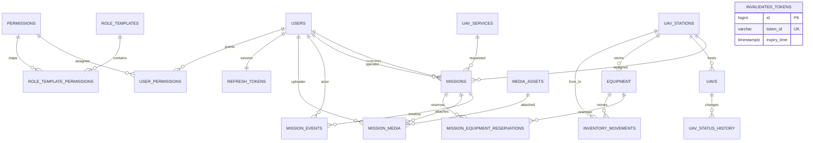

# UAV PAS PostgreSQL schema inventory

Ngày kiểm kê: 2026-10-09. Product source under review: `ca8a36bbbd12742f75c3c61d2ae5045d38bde753`; documentation checkpoint: `9f9027f`.

Đây là inventory được đọc từ Flyway migrations và JPA model hiện tại, không phải xác nhận rằng mọi acceptance BA đã đạt. Nguồn chuẩn để replay là `backend/src/main/resources/db/migration/V1__baseline_uav_pas.sql` và `V2__media_confirmation_inventory_requests.sql`.

## Boundary

- **19 tables** được tạo ở V1; **23 foreign keys**; V1 có 2 index không phải unique ngoài các unique constraint; V2 thêm 1 unique index cho `inventory_movements.request_id`.
- Khóa chính là identity `bigint`, trừ khi migration hiện hành thay đổi về sau. Các bảng đều có `created_at`/`updated_at` ở độ chính xác microsecond; `expiry_date` và `expiry_time` dùng `timestamp with time zone`, các timestamp nghiệp vụ còn lại không khai báo timezone.
- V1 là baseline gồm cả mission schema hiện hữu. V2 chỉ additive: xác nhận/xóa media và idempotency request cho inventory movement.

## ERD logical

`INVENTORY_MOVEMENTS.from_station_id` và `to_station_id` cùng trỏ `UAV_STATIONS`; ERD gộp hai quan hệ để dễ đọc. `MEDIA_ASSETS.linked_entity_*` là polymorphic text reference nên không có FK. `audit_logs.actor_user_id` có FK tới `users`, còn entity/action target là text để hỗ trợ nhiều domain.

## Table dictionary

| Table | Vai trò và khóa/unique chính | Quan hệ quan trọng |
|---|---|---|
| `users` | người dùng; `id` PK, `username`, `email`, `zalo_id` unique | customer/operator của mission; actor/uploader; refresh/permissions |
| `permissions` | permission catalog; `code` unique | user grants và role templates |
| `user_permissions` | override quyền theo user; `(user_id, permission_id)` unique | `users`, `permissions` |
| `role_templates` | quyền mặc định theo role; `role` unique | role template permissions |
| `role_template_permissions` | mapping role–permission; `(role_template_id, permission_id)` unique | templates, permissions |
| `refresh_tokens` | một refresh record/user hiện tại; `token` unique, `user_id` unique | `users`; expiry/revocation |
| `invalidated_tokens` | deny-list access token id; `token_id` unique, `expiry_time` indexed | cleanup theo expiry |
| `uav_stations` | trạm; `code` unique | mission, UAV, equipment, movement |
| `uavs` | UAV fleet; `serial_number` unique | station và status history |
| `uav_status_history` | lịch sử trạng thái UAV | `uavs` |
| `uav_services` | catalog dịch vụ; `code` unique | mission service |
| `missions` | aggregate workflow; `code` unique, `version` optimistic lock | customer/operator/service/station/UAV |
| `mission_events` | timeline/status events | mission và optional actor |
| `mission_equipment_reservations` | reservation quantity/released flag | mission và equipment |
| `equipment` | stock theo trạm; `version` optimistic lock, `serial_number` unique nullable | station, movements, reservations |
| `inventory_movements` | stock ledger; V2 `request_id` unique nullable | equipment và optional from/to station |
| `media_assets` | private object metadata; `object_key` unique | polymorphic link; V2 confirmed/deleted flags |
| `mission_media` | mission–media link; `(mission_id, media_id)` unique | mission, asset, optional uploader |
| `audit_logs` | audit actor/action/entity/details | optional actor FK tới users |

## Constraint/index review

| Nhóm | Hiện trạng từ migration | Acceptance còn mở |
|---|---|---|
| PK/FK | 19 PK; 23 FK; optional FK không có `NOT NULL` theo nghiệp vụ hiện tại | kiểm tra orphan, delete/update behavior và mọi cardinality với BA |
| Uniqueness | username/email/zalo, code/serial/object key/token, role/code catalogs và các bảng mapping có unique | negative integration tests phải chứng minh 409/rollback cho từng business key |
| Inventory | `quantity`, `available_quantity`, `reserved_quantity` là `NOT NULL`, nhưng không có DB `CHECK >= 0` trong V1/V2 | reserve/release cạnh tranh, không âm và rollback cần PostgreSQL evidence |
| Mission | `version` hỗ trợ optimistic locking; không có exclusion/overlap constraint cho UAV/operator/time window | conflict/concurrency semantics chưa được chứng minh |
| Media | `confirmed`/`deleted` có default false; `request_id` unique nullable cho movement | ownership, MIME/size/checksum, expiry và object/data consistency cần test thật |
| Indexes | `invalidated_tokens(expiry_time)`, `refresh_tokens(user_id)`, V2 `inventory_movements(request_id)`; unique constraint tạo index riêng | rà soát query plan/index cho list/filter/pagination và FK read paths |
| Time | token expiry có timezone; domain timestamps không có timezone | quyết định BA về timezone/UTC và serialize consistency |

## Mapping nguồn / evidence

- Entity/repository boundary: `backend/src/main/java/com/uav/platform/modules/*/{entity,repository}`.
- Migration validation: `backend/src/test/java/com/uav/platform/config/MigrationBaselineTest.java` và M6 stabilization evidence trong `docs/handoff/m6/evidence/tests/backend-stabilization-current-summary.json`.
- Runtime schema used by the isolated API flow: PostgreSQL disposable on port 55444, Flyway schema version 2; redacted business evidence: `docs/handoff/m6/evidence/tests/m6-current-isolated-runtime.json`.
- Fresh install và V1→V2 upgrade data preservation hiện đã có evidence PostgreSQL cùng revision ở `docs/handoff/m6/evidence/tests/backend-migration-upgrade-current-summary.json` và test `backend/src/test/java/com/uav/platform/stabilization/MigrationUpgradePostgresTest.java`. Durability restart, backup/restore và full concurrency vẫn là acceptance riêng.
