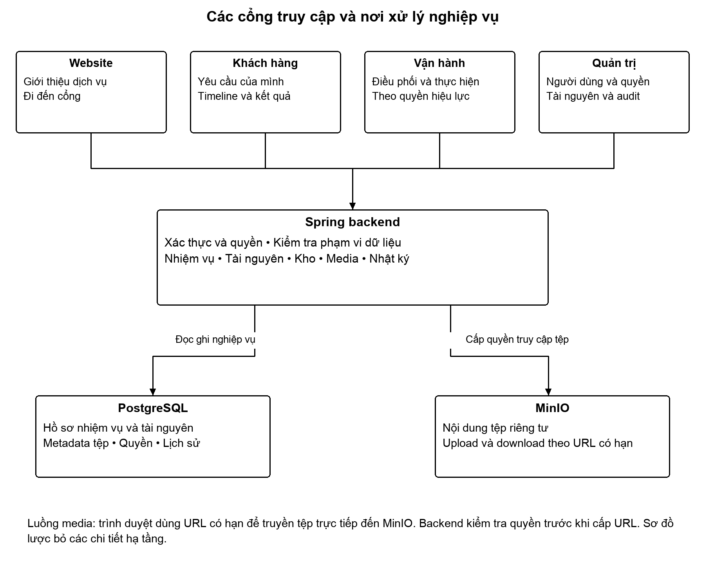
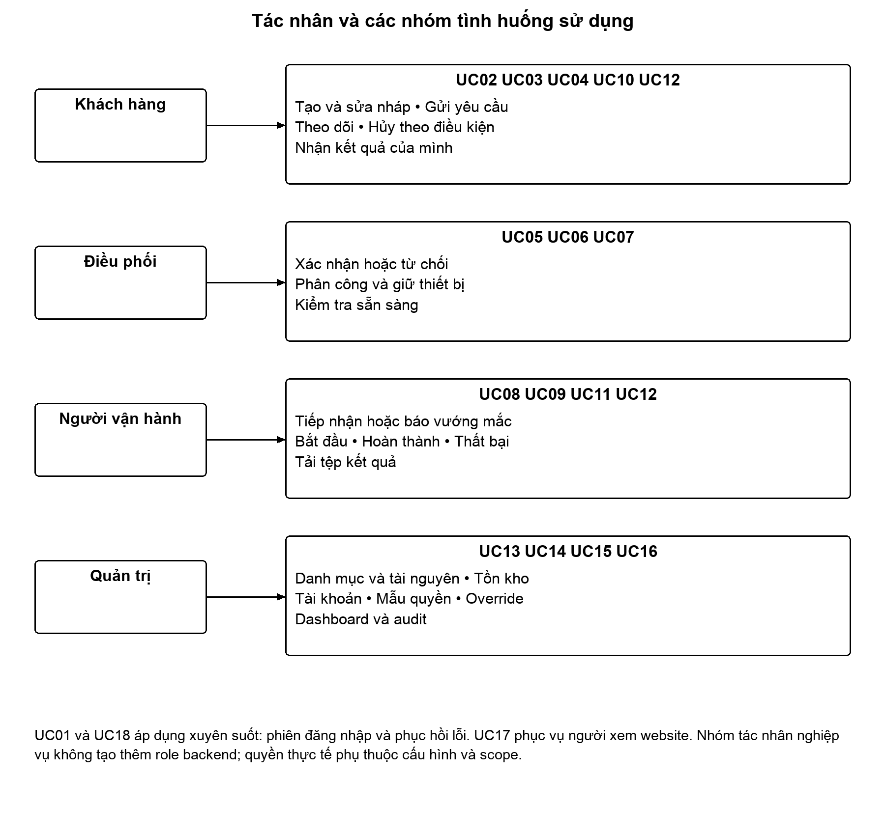
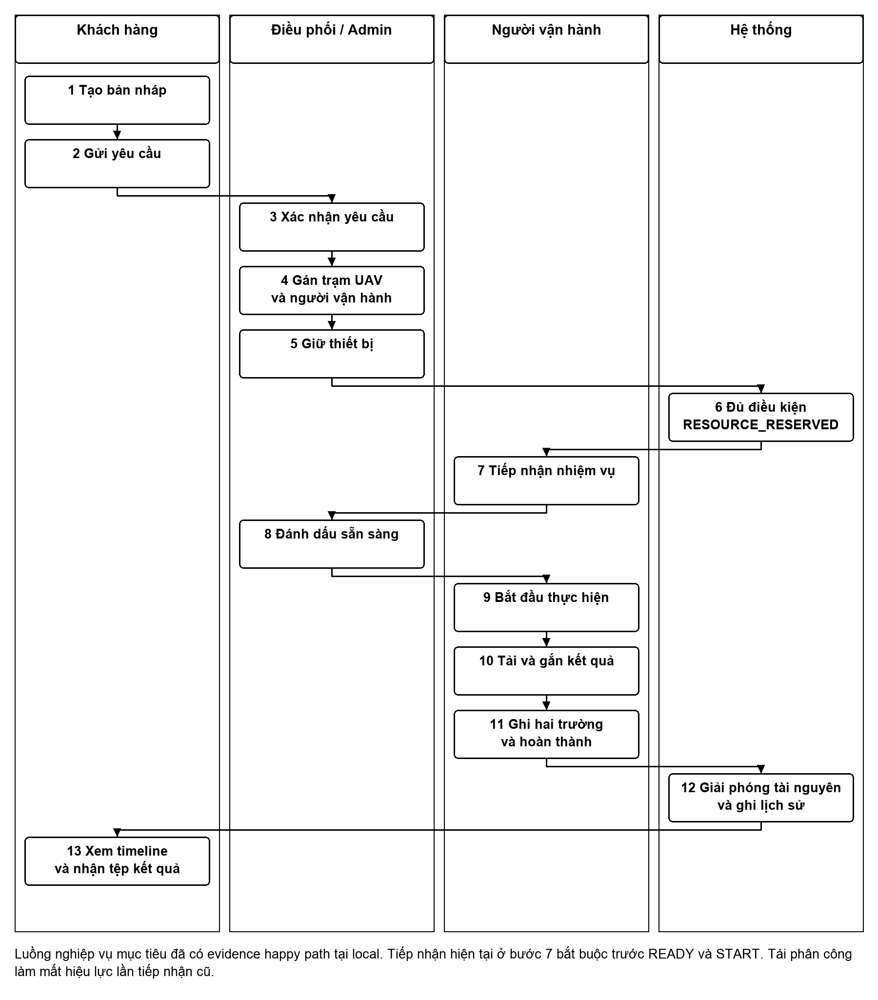
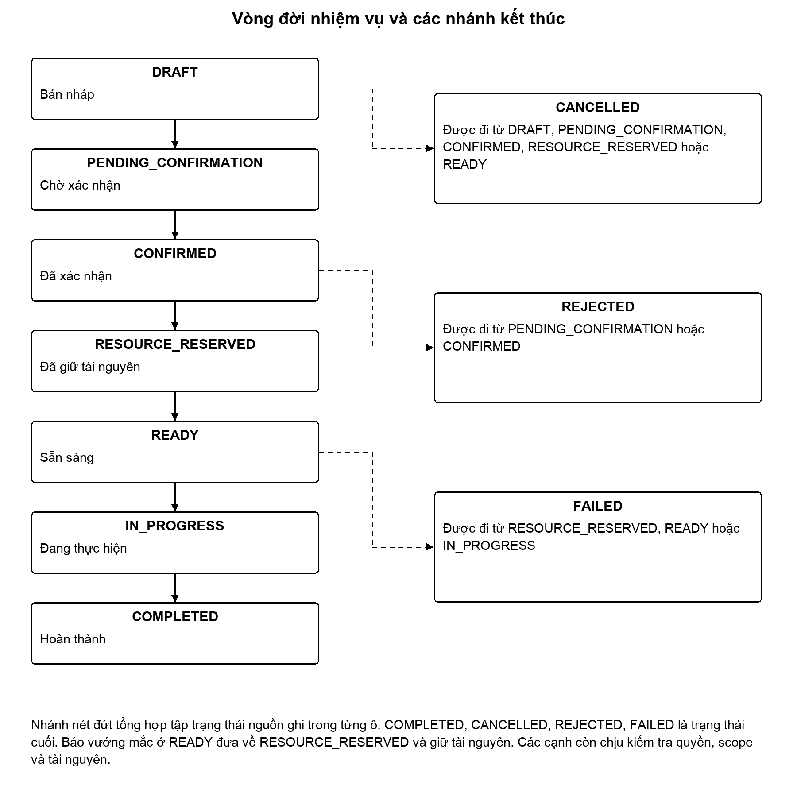
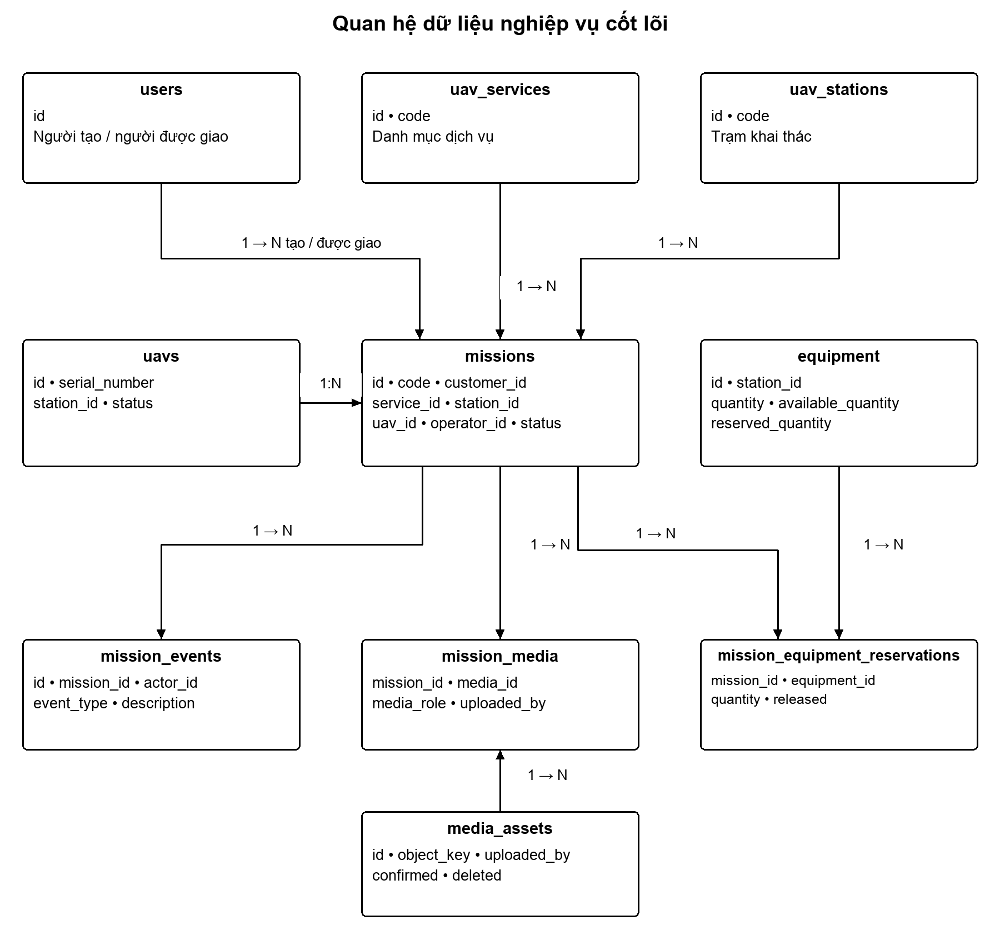
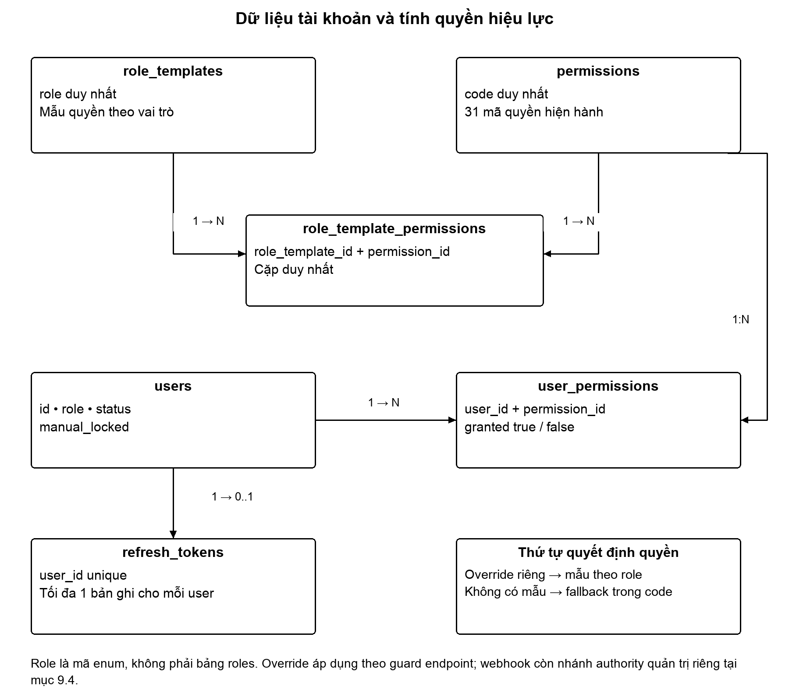
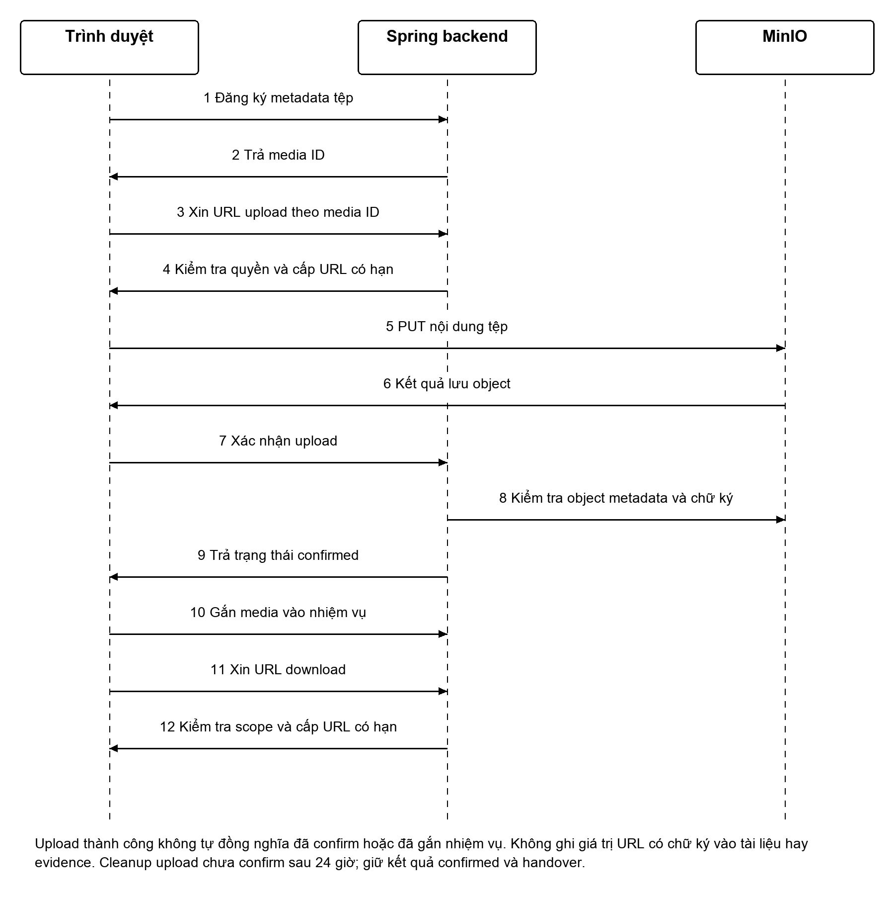

# 1 Tổng quan tài liệu

## 1 1 Mục đích và đối tượng sử dụng

Tài liệu phân tích nghiệp vụ này mô tả UAV PAS, nền tảng tiếp nhận và điều phối yêu cầu sử dụng UAV. Trọng tâm là hành trình từ khách hàng tạo yêu cầu, bộ phận điều phối bố trí tài nguyên, nhân sự vận hành thực hiện nhiệm vụ đến khi khách hàng nhận kết quả và quản trị viên tra cứu nhật ký. Tài liệu là cơ sở để trao đổi phạm vi, phát triển chức năng, thiết kế dữ liệu và tổ chức nghiệm thu.

Người sử dụng gồm chủ dự án, người phân tích nghiệp vụ, người thiết kế giao diện, lập trình viên, kiểm thử viên và người đánh giá dự án. Các yêu cầu được gắn mã để có thể truy ngược từ tình huống sử dụng đến quy tắc, dữ liệu và bằng chứng kiểm thử.

**Kết luận hiện trạng:** nền tảng đã có bằng chứng cục bộ cho quy trình yêu cầu, điều phối, tiếp nhận, thực hiện và bàn giao tệp, cùng các kiểm soát về bảo trì, hạn mức, thanh toán chưa cấu hình và thông báo bền vững. Tổng thể dự án là **PARTIAL**, mức sẵn sàng phát hành sản xuất là **NOT_READY**. HTTPS staging chưa có; SSO thực giữa các miền, nhà cung cấp thanh toán, tích hợp cơ quan bên ngoài và UAV vật lý chưa được kiểm chứng. Kết quả của từng bản mã nguồn được tách riêng ở Chương 18; không lấy kiểm thử trước tái cấu trúc để chứng nhận mã nguồn sau tái cấu trúc. [E12–E23]

## 1 2 Thông tin tài liệu

| Thuộc tính | Giá trị |
|---|---|
| Mã tài liệu | UAVPAS BA 3.0 |
| Tên dự án | UAV PAS |
| Tên đầy đủ trong đặc tả | Low-Altitude Economy UAV Platform-as-a-Service |
| Sinh viên thực hiện | Nguyễn Xuân Phát |
| Mã sinh viên | 23110209 |
| Đơn vị | Trường Đại học Việt Nhật – Đại học Quốc gia Hà Nội |
| Ngày tổng hợp | 17 tháng 10 năm 2026 |
| Phạm vi phiên bản | Phase 1, Phase 2, M1–M6 và các ưu tiên đã duyệt đến ngày 17 tháng 10 năm 2026 |
| Trạng thái nghiệp vụ | Bản phân tích để rà soát và thống nhất phạm vi; chưa có biên bản phê duyệt nghiệp vụ |

## 1 3 Mốc đối chiếu và cách đọc

Bản BA phân biệt ba lớp: hành vi đã được chấp thuận, mã nguồn ứng viên được kiểm thử và ứng dụng đang chạy. Bằng chứng B4 gồm 725 kiểm thử backend với 0 thất bại, 0 lỗi, 0 bỏ qua trên 421 tệp nguồn không thay đổi trong lượt chạy; đây là mốc **trước tái cấu trúc**. Sau tái cấu trúc, E21 ghi Maven verify thành công với 726 test, 0 lỗi/thất bại/skip và 445 tệp nguồn không drift; 151 frontend contracts PASS với backend mới. Các kết quả frontend, trình duyệt và diễn tập phục hồi được ghi riêng. Bản canonical đã được kích hoạt cục bộ trên backend 18082 và năm frontend 3100, 3101, 3102, 3103, 3300; kiểm tra độc lập 11 điểm health, readiness, từ chối xác thực sai, CORS và khả dụng frontend đều PASS. LIVE_READY ở đây chỉ xác nhận môi trường local; kết luận sản xuất vẫn NOT_READY. Trạng thái nguồn và môi trường cuối đối chiếu E21 và E23, không suy ra từ tên nhánh hoặc một tổng số kiểm thử. [E12–E23]

Các thuật ngữ **hiện có**, **đã kiểm chứng**, **chưa kiểm chứng** và **đề xuất** mang nghĩa khác nhau. Hiện có nghĩa là đã tìm thấy mã nguồn hoặc hợp đồng API. Đã kiểm chứng phải kèm phạm vi và bằng chứng chạy thực tế. Chưa kiểm chứng không đồng nghĩa chức năng bị lỗi. Đề xuất là yêu cầu cần quyết định, chưa phải cam kết của hệ thống đang chạy.

Yêu cầu mang mã FR là yêu cầu chức năng; BR là quy tắc nghiệp vụ; UC là tình huống sử dụng; NFR là yêu cầu phi chức năng; AT là kịch bản nghiệm thu; Q là quyết định còn mở. Các nhóm BA-01 đến BA-32 của tài liệu nền được giữ để truy vết ở Chương 17. [S07]

## 1 4 Cấu trúc và thay đổi của phiên bản 3

Phiên bản 3 giữ cấu trúc 33 chương của báo cáo đồ án, cập nhật các quy tắc đã thay đổi ngay trong đặc tả, tình huống sử dụng, màn hình, dữ liệu và ma trận nghiệm thu. FR-01 đến FR-42 giữ định danh. FR-43 đến FR-48 làm rõ các vòng đời bảo trì, sửa chữa, hạn mức, hóa đơn, cleanup và outbox đã có trong phạm vi triển khai; chúng không phải yêu cầu mở rộng tùy ý.

Các Chương 5–9 mô tả quy trình và quyền; Chương 10–15 mô tả dữ liệu, giao diện, API và vận hành; Chương 16–21 ghi nghiệm thu, truy vết, rủi ro và nguồn. Chương 22–28 phân tích sâu nhu cầu, ngoại lệ, màn hình và validation. Chương 29–32 phục vụ UAT, bàn giao và bảo vệ đồ án. Chương 33 cung cấp sơ đồ logic.

Nội dung khảo sát, RACI, ngưỡng hiệu năng và kế hoạch UAT chưa thực hiện được ghi rõ là đề xuất. Kết quả PASS kế thừa phạm vi và bản nguồn của evidence; hoạt động biên soạn không tạo một lượt kiểm thử sản phẩm mới. Không quy đổi số trang, số màn hình hoặc số test thành tỷ lệ hoàn thành toàn dự án.

# 2 Bối cảnh và mục tiêu nghiệp vụ

## 2 1 Bài toán cần giải quyết

Một yêu cầu sử dụng UAV cần kết nối nhiều đối tượng: người yêu cầu, dịch vụ, thời gian, vị trí, trạm, UAV, nhân sự vận hành, thiết bị và tệp kết quả. Nếu thông tin nằm ở các màn hình hoặc bản ghi rời rạc, người dùng khó xác định ai đang xử lý, tài nguyên đã được giữ hay chưa và kết quả thuộc về nhiệm vụ nào.

UAV PAS tập trung các thông tin này vào một hồ sơ nhiệm vụ. Mỗi bước thay đổi trạng thái hoặc phân công đều có thể được liên hệ với người thao tác và thời điểm thực hiện. Phân quyền và kiểm tra quyền sở hữu giới hạn dữ liệu mà từng người có thể xem hoặc cập nhật. Đây là mục tiêu thiết kế được rút ra từ đặc tả Phase 1 và Phase 2; không phải kết quả khảo sát định lượng tại một doanh nghiệp đã triển khai. [S01, S02]

## 2 2 Mục tiêu và giá trị mong đợi

| Mã | Mục tiêu | Giá trị đối với người sử dụng | Cách đánh giá đề xuất |
|---|---|---|---|
| OBJ-01 | Tiếp nhận yêu cầu có cấu trúc | Khách hàng biết yêu cầu đang ở bước nào | Hoàn thành tạo nháp và gửi duyệt bằng giao diện |
| OBJ-02 | Điều phối tài nguyên nhất quán | Giảm phân công trùng hoặc thiếu tài nguyên | Ca trùng lịch, thiếu kho và READY được kiểm tra |
| OBJ-03 | Gắn thực thi với người được giao | Xác định trách nhiệm vận hành | Người không được giao bị chặn bắt đầu và hoàn thành |
| OBJ-04 | Bàn giao kết quả đúng chủ sở hữu | Khách hàng tải đúng tệp của nhiệm vụ | Kiểm tra nội dung tệp và truy cập chéo tài khoản |
| OBJ-05 | Theo dõi lịch sử thay đổi | Hỗ trợ tra cứu và giải thích sự cố | Đối chiếu timeline, audit và dữ liệu nhiệm vụ |
| OBJ-06 | Tách giao diện theo công việc | Mỗi nhóm có khu vực thao tác phù hợp | Kiểm tra điều hướng, quyền, phiên đăng nhập từng cổng |

## 2 3 Chỉ số theo dõi sau thử nghiệm

Đề xuất theo dõi tỷ lệ yêu cầu được xác nhận, thời gian từ gửi duyệt đến xác nhận, thời gian từ xác nhận đến sẵn sàng, tỷ lệ nhiệm vụ hoàn thành, tỷ lệ hủy/từ chối/thất bại và số xung đột tài nguyên. Các chỉ số cần được định nghĩa cùng khoảng thời gian, mẫu số và trạng thái loại trừ trước khi dùng để đánh giá hiệu quả.

Ví dụ, tỷ lệ hoàn thành có thể tính bằng số nhiệm vụ COMPLETED chia số nhiệm vụ đã kết thúc trong kỳ. Cần quyết định có đưa CANCELLED và REJECTED vào mẫu số hay không; không tự gộp yêu cầu nháp vào chỉ số thực thi. Hiện chưa có số đo sản xuất để công bố thời gian tiết kiệm, doanh thu hoặc tỷ lệ cải thiện.

## 2 4 Hiện trạng và mô hình mục tiêu

Hiện trạng phần mềm gồm nền tảng tài khoản, tài nguyên, nhiệm vụ, media và audit. Quy trình mục tiêu dùng chung backend qua bốn ứng dụng frontend. Việc tách ứng dụng đã có trong mã nguồn; đăng nhập thống nhất giữa các miền vẫn là thiết kế cần triển khai riêng. Không có dữ liệu khảo sát để khẳng định quy trình thủ công trước dự án tại một tổ chức cụ thể.

# 3 Phạm vi và cấu trúc sản phẩm

## 3 1 Phạm vi theo giai đoạn

**Phase 1** xây dựng tài khoản và quyền, trạm, đội UAV, kho thiết bị, media, dashboard và audit. **Phase 2** bổ sung dịch vụ UAV, nhiệm vụ, phân công, giữ chỗ thiết bị, thực thi và bàn giao kết quả. Phase 1 và Phase 2 là các giai đoạn nghiệp vụ. [S01, S02]

**M1–M6** là các mốc tổ chức frontend và tích hợp: M1 nền tảng monorepo; M2 cổng vận hành; M3 cổng quản trị; M4 cổng khách hàng; M5 website công khai; M6 kiểm tra tích hợp và bàn giao. M1 không đồng nghĩa Phase 1 và M2 không đồng nghĩa Phase 2. [S07, S08]

## 3 2 Thành phần ứng dụng

| Thành phần | Cấu trúc | Trách nhiệm |
|---|---|---|
| Frontend mới | Bốn ứng dụng dưới frontend/apps | Website, Customer, Operations và Admin |
| Frontend tương thích | frontend/legacy | Duy trì đường đi cũ trong quá trình chuyển đổi |
| Backend | Một ứng dụng Spring Boot | Xử lý nghiệp vụ theo mô hình modular monolith |
| Gói dùng chung | frontend/packages | API, phiên, kiểu dữ liệu, truy vấn và giao diện dùng chung |
| Dữ liệu quan hệ | PostgreSQL | Nhiệm vụ, tài nguyên, tài chính, quyền và công việc nền |
| Kho đối tượng | MinIO trong kiểm thử cục bộ | Nội dung tệp riêng tư, truy cập qua URL có hạn |

Backend có các miền tài khoản, xác thực, quyền, trạm, UAV, kho, nhiệm vụ, media, bảo trì, hạn mức và hóa đơn, thông báo, webhook, báo cáo, cấu hình, audit và tổng quan. Một số miền có nhiều lớp dịch vụ nội bộ. Số lớp, DTO hoặc package không phải số microservice. Chỉ mục nguồn sau tái cấu trúc được quản lý độc lập với bằng chứng trước tái cấu trúc để không tạo tham chiếu tới tên lớp đã di chuyển. [E21]

## 3 3 Ranh giới các cổng

| Cổng | Người sử dụng chính | Công việc |
|---|---|---|
| Website công khai | Khách truy cập | Tìm hiểu nền tảng, dịch vụ và chuyển sang cổng khách hàng |
| Customer | Người yêu cầu dịch vụ | Xem danh mục, tạo/gửi yêu cầu, theo dõi và tải kết quả |
| Operations | Điều phối và nhân sự vận hành | Quản lý tài nguyên, phân công, thực hiện nhiệm vụ |
| Admin | Quản trị và người được quyền kiểm tra | Quản lý tài khoản, quyền, mẫu vai trò và nhật ký |

Điều phối nhiệm vụ nằm ở Operations, kể cả khi người thao tác có vai trò quản trị. Tên cổng không cấp thêm quyền. Một tài khoản có thể sử dụng nhiều cổng khi có quyền phù hợp; phạm vi phiên phụ thuộc chế độ xác thực và cookie. Với cùng backend trên localhost, cookie có thể được trình duyệt gửi từ nhiều cổng frontend khác port; điều đó chưa chứng minh SSO giữa các miền thực.

## 3 4 Phạm vi đã mở rộng và giới hạn tích hợp

Phạm vi hiện có gồm bảo trì theo ngày, lệnh sửa chữa và chi phí vật tư, hạn mức theo thời gian dự kiến, danh mục gói, hóa đơn được kiểm soát bằng cấu hình, báo cáo từ dữ liệu thật, cấu hình quản trị và hàng đợi thông báo bền vững. Các chức năng này được mô tả tại FR-42 đến FR-48. Thanh toán chưa cấu hình phải trả trạng thái chưa khả dụng; không có QR ngân hàng giả, mô phỏng khách hàng tự xác nhận đã trả tiền hay biểu giá mặc định được coi là đã duyệt.

Tổ chức đa tenant, đào tạo, bài thi, chứng chỉ, giấy phép bay, điều khiển UAV thật, telemetry phần cứng, hiệu quả AI thực địa và xác nhận tiếp nhận của cơ quan cứu nạn không được công bố là đã cung cấp. Mã xử lý SAR hiện kiểm tra nhiệm vụ và người được giao trước tác dụng phụ, nhưng phản hồi khuyến nghị quay về không phải lệnh bay. Tính năng giới thiệu hoặc có API không thay cho bằng chứng tích hợp ngoài hệ thống. [E13, E15, E17]

# 4 Bên liên quan và tác nhân

## 4 1 Danh mục tác nhân nghiệp vụ

| Mã | Tác nhân | Nhu cầu và trách nhiệm |
|---|---|---|
| ACT-01 | Khách truy cập | Tìm hiểu khả năng hệ thống và điểm bắt đầu sử dụng |
| ACT-02 | Khách hàng | Tạo yêu cầu đúng thông tin, theo dõi tiến độ, nhận kết quả |
| ACT-03 | Điều phối viên | Xác nhận hoặc từ chối, chọn tài nguyên, đánh dấu sẵn sàng |
| ACT-04 | Người vận hành được giao | Tiếp nhận, báo vướng mắc, bắt đầu và kết thúc nhiệm vụ |
| ACT-05 | Nhân sự quản lý tài nguyên | Cập nhật trạm/UAV/kho và tình trạng khả dụng |
| ACT-06 | Quản trị viên | Quản lý truy cập, vai trò, khóa tài khoản và kiểm tra audit |
| ACT-07 | Người kiểm tra nhật ký | Đọc audit trong phạm vi AUDIT_READ |
| ACT-08 | Nhóm phát triển và kiểm thử | Duy trì hợp đồng, dữ liệu, chất lượng và bằng chứng nghiệm thu |

Các tác nhân là vai trò trong quy trình, không mặc nhiên là chức danh nhân sự thực tế. Một người có thể đảm nhiệm nhiều tác nhân; hệ thống vẫn kiểm tra từng quyền thao tác.

## 4 2 Vai trò hệ thống và quyền hiệu lực

Backend hiện có bốn mã vai trò: `ROLE_PILOT`, `ROLE_COMMANDER`, `ROLE_OPERATOR`, `ROLE_ADMIN`. Chưa có enum `ROLE_CUSTOMER`. Tài khoản khách hàng trong fixture kiểm thử dùng ROLE_PILOT; không suy diễn tất cả pilot đều là khách hàng trong mọi trường hợp. [S07, S12]

Quyền hiệu lực được xác định theo thứ tự: tài khoản phải hợp lệ và không bị khóa; override riêng của tài khoản được ưu tiên; nếu không có override thì dùng mẫu vai trò; chỉ khi không có mẫu mới dùng bộ quyền mặc định trong code. Override false là từ chối rõ ràng. Xóa override nghĩa là quay về mẫu, không nhất thiết là mất quyền.

Khi endpoint dùng permission service, quyền hiệu lực áp dụng override và trạng thái tài khoản. Một số guard có nhánh authority riêng, như webhook tại mục 9.4, nên không khẳng định ROLE_ADMIN luôn bị deny override chặn ở mọi endpoint. Quyền xem toàn bộ nhiệm vụ không thay thế các quyền thao tác khác. Người bắt đầu hoặc hoàn thành nhiệm vụ còn phải đúng tài khoản được phân công. [S12]

## 4 3 Phân công trách nhiệm đề xuất

| Hoạt động | Khách hàng | Điều phối | Vận hành | Quản trị |
|---|---|---|---|---|
| Cung cấp nội dung yêu cầu | Chính | Hỗ trợ | Tham khảo | Giám sát |
| Duyệt và bố trí tài nguyên | Theo dõi | Chính | Phản hồi | Cấp quyền |
| Thực hiện và cập nhật kết quả | Theo dõi | Giám sát | Chính | Kiểm tra |
| Phân quyền và khóa tài khoản | Nhận thông báo | Đề nghị | Đề nghị | Chính |
| Xác nhận phạm vi nghiệm thu | Góp ý | Góp ý | Góp ý | Phối hợp chủ dự án |

Bảng là phân công nghiệp vụ đề xuất, không thay thế permission của backend hoặc biên bản phân công trong tổ chức.

# 5 Quy trình nghiệp vụ tổng thể

## 5 1 Luồng đặt dịch vụ đến bàn giao

1. Khách hàng đăng nhập, xem dịch vụ đang hoạt động và tạo nhiệm vụ nháp với thời gian, địa điểm và nội dung cần thực hiện.
2. Khách hàng gửi nháp để chuyển sang chờ xác nhận. Hệ thống lưu owner, mã nhiệm vụ và sự kiện vào lịch sử.
3. Điều phối viên kiểm tra yêu cầu. Nếu đáp ứng được thì xác nhận; nếu không thì từ chối và ghi lý do.
4. Điều phối viên chọn trạm hoạt động, UAV khả dụng, người vận hành hoạt động và giữ thiết bị đủ số lượng. Khi đủ các nhóm tài nguyên theo logic hiện tại, nhiệm vụ chuyển sang RESOURCE_RESERVED.
5. Người được giao xem nhiệm vụ, báo vướng mắc nếu có hoặc tiếp nhận phân công. Điều phối viên kiểm tra các điều kiện trước khi chuyển READY.
6. Người được giao bắt đầu nhiệm vụ. Trạng thái nhiệm vụ thành IN_PROGRESS, UAV thành IN_USE.
7. Người vận hành tải lên tệp kết quả, xác nhận tệp và gắn với nhiệm vụ; sau đó hoàn thành với ghi chú kết thúc và tình trạng thiết bị bắt buộc. Ba loại khảo sát khu vực, ghi hình trên không và thu thập dữ liệu còn cần ít nhất một tệp kết quả đã xác nhận.
8. Hệ thống chuyển COMPLETED, giải phóng phần tài nguyên liên quan theo nghiệp vụ và lưu lịch sử. Khách hàng xem timeline, tải tệp; người có AUDIT_READ kiểm tra nhật ký.

Luồng trên đã có bằng chứng cục bộ qua giao diện. Trạm, UAV và tồn kho đầu vào được tạo bằng fixture/API; kết quả này không chứng minh đã kiểm tra đầy đủ màn hình tạo tài nguyên. [S03, S04]

## 5 2 Điểm kiểm soát trong luồng

| Điểm | Quyết định | Nếu không đạt |
|---|---|---|
| Trước lưu nháp | Loại, tiêu đề, ngày, khoảng thời gian và địa điểm hợp lệ | Trả lỗi nhập liệu; không báo tạo thành công |
| Trước thao tác | Có phiên, permission, phạm vi dữ liệu và trạng thái phù hợp | Từ chối; giao diện giải thích và cập nhật trạng thái |
| Khi gán tài nguyên | Hoạt động, khả dụng, cùng trạm khi đã có ràng buộc, không trùng lịch | Giữ nguyên kết quả giao dịch bị từ chối |
| Trước READY | Tài nguyên hợp lệ và người được giao đã tiếp nhận phiên bản phân công hiện tại | Báo điều kiện chưa đạt; không chuyển READY |
| Khi kết thúc | Đúng người được giao và chuyển trạng thái hợp lệ | Không giải phóng hay ghi hoàn thành dở dang |
| Khi tải kết quả | Tệp được xác nhận, chưa xóa, đúng phạm vi truy cập | Không cấp quyền tải chỉ dựa vào ID tệp |

## 5 3 Các nhánh thay thế

**Hủy yêu cầu:** người có MISSION_CANCEL và truy cập được nhiệm vụ có thể hủy tại các trạng thái được phép. Giao diện hỏi xác nhận trước thao tác. Hủy ở IN_PROGRESS không thuộc state machine hiện hành.

**Từ chối:** điều phối có MISSION_REJECT từ chối khi PENDING_CONFIRMATION hoặc CONFIRMED. Giao diện yêu cầu lý do không trống và khách hàng đọc được lý do trong lịch sử. Từ chối sau phân công một phần giải phóng tài nguyên trong cùng giao dịch; các ca backend đã có bằng chứng, còn ma trận giao diện đầy đủ được theo dõi riêng.

**Báo vướng mắc:** người được giao nhập ghi chú; hệ thống xóa hiệu lực tiếp nhận và giữ tài nguyên đã phân công. Nếu nhiệm vụ đang READY, hệ thống đưa về RESOURCE_RESERVED; các trạng thái trước thực hiện khác được phép giữ nguyên. Tiếp nhận lại đặt operatorAccepted thành true và xóa ghi chú vướng mắc hiện hành; sự kiện cũ vẫn có trong timeline.

**Thất bại:** endpoint fail có trong backend, kiểm tra người được giao và trạng thái cho phép, ghi lý do cùng giải phóng tài nguyên. Chưa có bằng chứng giao diện đầy đủ cho mọi nhánh fail/rollback.

# 6 Vòng đời và quy tắc nghiệp vụ

## 6 1 Danh mục trạng thái nhiệm vụ

| Mã trạng thái | Nhãn nghiệp vụ | Ý nghĩa |
|---|---|---|
| DRAFT | Bản nháp | Đã lưu yêu cầu, chưa gửi điều phối |
| PENDING_CONFIRMATION | Chờ xác nhận | Khách hàng đã gửi, chờ xử lý |
| CONFIRMED | Đã xác nhận | Chấp nhận yêu cầu, đang bố trí tài nguyên |
| RESOURCE_RESERVED | Đã giữ tài nguyên | Đủ nhóm tài nguyên theo điều kiện tự chuyển hiện hành |
| READY | Sẵn sàng | Đã kiểm tra điều kiện để bắt đầu |
| IN_PROGRESS | Đang thực hiện | Người được giao đã bắt đầu |
| COMPLETED | Hoàn thành | Đã kết thúc thành công |
| CANCELLED | Đã hủy | Dừng yêu cầu bằng hành động hủy |
| REJECTED | Bị từ chối | Yêu cầu không được tiếp nhận tiếp |
| FAILED | Thất bại | Dừng với lý do thất bại |

## 6 2 Ma trận chuyển trạng thái

| Trạng thái hiện tại | Trạng thái kế tiếp được cho phép |
|---|---|
| DRAFT | PENDING_CONFIRMATION, CANCELLED |
| PENDING_CONFIRMATION | CONFIRMED, CANCELLED, REJECTED |
| CONFIRMED | RESOURCE_RESERVED, CANCELLED, REJECTED |
| RESOURCE_RESERVED | READY, CANCELLED, FAILED |
| READY | IN_PROGRESS, CANCELLED, FAILED |
| IN_PROGRESS | COMPLETED, FAILED |
| COMPLETED, CANCELLED, REJECTED, FAILED | Không có chuyển trạng thái kế tiếp |

Ma trận lấy từ Mission.allowedTransitions. Có cạnh trong ma trận chưa đủ để thao tác được: còn cần endpoint, quyền, scope và điều kiện tài nguyên. Ví dụ fail yêu cầu đúng người vận hành được giao. Nhấn lặp một hành động sau khi trạng thái đã đổi không được coi là thành công lần hai. [S11]

## 6 3 Quy tắc định danh và dữ liệu đầu vào

- **BR-01:** customer của nhiệm vụ được lấy từ người đăng nhập khi tạo, không cho client tự chỉ định owner khác trong yêu cầu tạo hiện tại.
- **BR-02:** loại, tiêu đề, ngày yêu cầu, giờ bắt đầu, giờ kết thúc dự kiến và địa điểm là dữ liệu bắt buộc. Ngày yêu cầu không ở quá khứ theo validation hiện hành; giờ kết thúc phải sau giờ bắt đầu.
- **BR-03:** mã nhiệm vụ là duy nhất; mẫu mã hiện tại có dạng MSN-năm-số thứ tự. Không dùng mã hiển thị để thay thế khóa nội bộ khi cập nhật.
- **BR-04:** chỉ sửa nội dung khi DRAFT và gửi phiên bản hoặc snapshot dự kiến. Payload vẫn phải đủ trường DTO yêu cầu. Khi 409, giữ nội dung chưa lưu để đối chiếu; khi mất phản hồi, đọc lại trước retry. Luồng có backend regression và bằng chứng giao diện lịch sử, không còn là màn hình chưa triển khai. [E12]

- **BR-05:** serviceId là tùy chọn; nếu được cung cấp thì dịch vụ phải tồn tại và đang hoạt động. Priority không truyền được mặc định NORMAL.

## 6 4 Quy tắc tài nguyên và thực thi

- **BR-06:** gán ban đầu theo trạng thái được controller/service cho phép; thay, gỡ và tái phân công dùng lệnh chuyên biệt với expectedVersion hoặc expectedCurrentUavId theo hợp đồng từng lệnh, cùng lý do. Trạm phải hoạt động, trạm nhiệm vụ và UAV phải tương thích. Lệnh bị từ chối giữ nguyên phân công cũ. Bất kỳ tái phân công nào làm vô hiệu lần tiếp nhận cũ; người được giao phải tiếp nhận lại trước READY và START.
- **BR-07:** UAV phải AVAILABLE lúc gán; hệ thống kiểm tra lịch trùng và chuyển UAV thành ASSIGNED. Không coi một truy vấn availability trước đó là bảo đảm đặt chỗ thành công sau này.
- **BR-08:** người vận hành phải hoạt động và không có nhiệm vụ trùng khoảng thời gian. Kiểm tra năng lực, chứng chỉ bay hoặc điều kiện đào tạo chưa thuộc phạm vi này.
- **BR-09:** khoảng lịch được thiết kế theo [bắt đầu, kết thúc), cho phép hai mốc kề nhau. Cạnh tranh đồng thời vẫn cần kiểm tra trên PostgreSQL; thiết kế khoảng không tự chứng minh mọi race đã được xử lý.
- **BR-10:** thiết bị phải ACTIVE và còn đủ lượng khả dụng. Giữ chỗ làm giảm khả dụng, tăng phần giữ; release hoàn trả phần giữ. Giao dịch không được tạo số lượng âm.
- **BR-11:** logic tự chuyển RESOURCE_RESERVED cần có trạm, UAV, người vận hành và ít nhất một reservation chưa release. Trường hợp nhiệm vụ không cần thiết bị cần quyết định nghiệp vụ riêng.
- **BR-12:** READY và START đều kiểm tra lại tài nguyên và bắt buộc operatorAccepted=true cho phân công hiện hành. Người được giao phải còn hợp lệ; dữ liệu đọc trước đó không thay kiểm tra trong giao dịch. Tái phân công làm mất hiệu lực tiếp nhận, kể cả khi người vận hành không đổi.
- **BR-13:** start, complete và fail yêu cầu đúng tài khoản được giao. Quyền quản trị rộng không tự thay thế điều kiện này.
- **BR-14:** hủy, từ chối, hoàn thành và thất bại giải phóng tài nguyên liên quan nguyên tử với thay đổi nhiệm vụ. Hoàn thành bắt buộc completionNote và equipmentCondition không trắng, tối đa 500 ký tự mỗi trường. AREA_INSPECTION, AERIAL_RECORDING và DATA_COLLECTION cần tối thiểu một tệp OUTPUT hoặc DOCUMENT đã confirm, chưa xóa; UAV_RENTAL và OTHER không có điều kiện tối thiểu này. Ghi nhận giờ dự kiến đúng một lần; công việc lập hóa đơn chỉ được ghi khi đã bật theo BR-23.

## 6 5 Quy tắc truy cập và lịch sử

- **BR-15:** không có MISSION_VIEW_ALL thì danh sách ROLE_OPERATOR bị giới hạn theo người được giao; tài khoản khác bị giới hạn theo customer. Đọc chi tiết cho phép chủ nhiệm vụ hoặc người được giao, sau các kiểm tra permission.
- **BR-16:** quyền tải media phải kết hợp quyền endpoint với phạm vi tài nguyên; biết ID không tạo quyền truy cập.
- **BR-17:** tệp phải được confirm và chưa deleted trước khi gắn vào nhiệm vụ; không gắn tệp đã liên kết một nhiệm vụ khác vào nhiệm vụ hiện tại.
- **BR-18:** sự kiện nghiệp vụ phải giữ được tác nhân, thời điểm, loại sự kiện và nội dung cần giải thích. Giao diện dịch mã hệ thống nhưng giữ nguyên ghi chú người dùng.
- **BR-19:** phải giữ ít nhất một tài khoản hoạt động có cả USER_MANAGE và PERMISSION_MANAGE khi trước thao tác đang có người quản lý truy cập; AccessRecoveryGuard chặn việc làm mất người quản lý cuối cùng. Cần kiểm tra live revoke/lock riêng.
- **BR-20:** COMPLETED, CANCELLED, REJECTED và FAILED khóa thao tác tiếp nhận, báo vướng mắc và ghi media ở backend trong các đường đi đã kiểm thử. Giao diện phản ánh cùng chính sách. Tệp bàn giao đã gắn được giữ lại; ẩn nút không thay cho kiểm tra server.
- **BR-21:** hồ sơ tự phục vụ chỉ sửa họ tên và số điện thoại bằng version; giữ nguyên email, username, mật khẩu, vai trò, trạng thái và avatar.
- **BR-22:** hạn mức ghi nhận từ thời gian dự kiến của nhiệm vụ khi hoàn thành, không từ telemetry hoặc số giờ bay thực. Thanh toán hóa đơn nhiệm vụ không cộng giờ; thanh toán gói áp dụng giới hạn của gói và giữ giờ đã dùng cùng chu kỳ hiện tại.
- **BR-23:** tự lập hóa đơn mặc định tắt; chỉ bật khi có mức giá dương thực sự được chủ dự án duyệt. Sau khi công việc chờ đã được lưu bền vững, lỗi tạo hóa đơn không hoàn tác hoàn thành; xử lý lại không ghi trùng hóa đơn hoặc giờ dùng. Lỗi lưu chính công việc chờ vẫn làm giao dịch hoàn thành rollback để không mất việc âm thầm.
- **BR-24:** ảnh JPEG, PNG, WebP và PDF tối đa 100.000.000 bytes; MP4 và WebM tối đa 1.000.000.000 bytes, kể cả giá trị biên. Chỉ upload chưa confirm và chưa gắn quá 24 giờ được dọn tự động. Xóa object là công việc có trạng thái và thử lại bền vững.
- **BR-25:** lịch bảo trì theo ngày dùng múi giờ Asia/Ho_Chi_Minh; đến hạn không tự khóa UAV. Lệnh sửa chữa có version, một lệnh đang hoạt động trên mỗi UAV; vật tư ghi chi phí VND, không tự trừ kho thiết bị.
- **BR-26:** sự kiện hóa đơn và thanh toán được lưu cùng giao dịch tài chính; worker riêng xử lý thông báo nội bộ và phân phối webhook. Gửi ngoài mặc định tắt, chỉ gửi tới URL chính xác đã được duyệt; HTTP 2xx chỉ chứng minh bên nhận chấp nhận HTTP. Sự kiện có ID ổn định và có thể gửi lặp, nên bên nhận phải chống lặp.
- **BR-27:** bỏ đích webhook giữ bản ghi đánh dấu xóa và lịch sử delivery. Công việc chưa gửi chuyển CANCELLED với lý do DESTINATION_REMOVED; không gửi mới sau khi xóa đã commit. Lần gửi đang thực hiện có thể kết thúc trước khi thao tác xóa commit.
# 7 Yêu cầu chức năng

## 7 1 Quy ước ưu tiên và trạng thái

**P1** là yêu cầu cốt lõi của quy trình hoặc kiểm soát dữ liệu. **P2** là yêu cầu hỗ trợ vận hành và trải nghiệm. Ưu tiên thể hiện mức quan trọng trong bản BA, không phải lịch phát hành đã được chốt.

Trạng thái **đã thử luồng chính** chỉ xác nhận các tình huống có evidence; **có triển khai** chỉ xác nhận mã nguồn/API; **một phần** nghĩa là còn thiếu chức năng hoặc nghiệm thu; **chờ quyết định** nghĩa là chưa có phạm vi/hợp đồng được duyệt. Tiêu chí ở các bảng là điều kiện nghiệm thu cần đáp ứng, không mặc nhiên đều đã đạt.

## 7 2 Tài khoản và kiểm soát truy cập

| Mã | Yêu cầu và tiêu chí chấp nhận | Ưu tiên | Phạm vi bằng chứng |
|---|---|---|---|
| FR-01 | Đăng ký dữ liệu hợp lệ, kiểm tra trùng định danh và không nhận quyền quản trị từ client | P1 | PASS đường API đã thử; PARTIAL biến thể UI; E14,E17 |
| FR-02 | Đăng nhập và đọc hồ sơ, quyền hiệu lực; từ chối tài khoản sai hoặc bị khóa | P1 | PASS phạm vi đã thử; PARTIAL ma trận khóa trên UI; E12,E14,E17 |
| FR-03 | Refresh, logout, thu hồi phiên và cô lập tài khoản theo hợp đồng hiện có | P1 | PASS API và cạnh tranh; PARTIAL liên miền; E12,E14,E17 |
| FR-04 | Tìm, phân trang và đọc tài khoản bằng USER_READ; không trả bí mật xác thực | P1 | PASS source và màn hình đã thử; PARTIAL bộ lọc đầy đủ; E16,E17 |
| FR-05 | Đổi vai trò và khóa bằng USER_MANAGE; giữ người quản lý truy cập hiệu lực cuối cùng | P1 | PASS backend; PARTIAL toàn ma trận phiên và UI; E12,E17 |
| FR-06 | Mẫu quyền, allow, deny và reset có hiệu lực server; ghi rõ ngoại lệ webhook tại mục 9.4 | P1 | PASS kiểm soát đã thử; PARTIAL ngoại lệ endpoint và UI; E12,E17 |

## 7 3 Trạm và đội UAV

| Mã | Yêu cầu và tiêu chí chấp nhận | Ưu tiên | Phạm vi bằng chứng |
|---|---|---|---|
| FR-07 | Đọc, tạo và sửa trạm với mã duy nhất, địa chỉ, tọa độ và trạng thái | P1 | PASS source và smoke; PARTIAL CRUD UI đầy đủ; E16,E17 |
| FR-08 | Trạm không hoạt động hoặc không tương thích bị chặn khi chuẩn bị và bắt đầu; không ghi dở dang | P1 | PASS các guard cục bộ đã thử; E14,E17 |
| FR-09 | Quản lý UAV với serial duy nhất, model, hãng, trạm và quyền tương ứng | P1 | PASS source và smoke; PARTIAL CRUD UI đầy đủ; E16,E17 |
| FR-10 | Trạng thái và lịch sử UAV kiểm soát phân công; bảo trì theo FR-43 và FR-44 | P1 | PASS vòng đời đã thử; quá hạn không tự khóa UAV; E12,E17 |
| FR-11 | Kiểm tra lịch UAV và operator nguyên tử; cho khoảng kề nhau, từ chối chồng lấn theo điều kiện khả dụng | P1 | PASS cạnh tranh PostgreSQL đã thử; E12,E17 |

## 7 4 Thiết bị và tồn kho

| Mã | Yêu cầu và tiêu chí chấp nhận | Ưu tiên | Phạm vi bằng chứng |
|---|---|---|---|
| FR-12 | Tạo, sửa và đọc thiết bị theo loại, trạm, serial và trạng thái | P1 | PASS source và màn hình đã thử; PARTIAL CRUD đầy đủ; E13,E17 |
| FR-13 | Nhập xuất lượng dương, ghi lịch sử và không xuất vượt khả dụng | P1 | PASS quy trình và phục hồi cục bộ; E13,E17 |
| FR-14 | Giữ và giải phóng thiết bị đúng nhiệm vụ; lượng không âm và rollback khi tranh chấp | P1 | PASS giao dịch và cạnh tranh đã thử; E12,E14,E17 |
| FR-15 | Điều chuyển có request ID ổn định; replay không tạo biến động hoặc bản ghi đích thứ hai | P1 | PASS backend replay; PARTIAL mọi biến thể UI; E13,E17 |
| FR-16 | Lịch sử tồn kho phân trang có actor, ghi chú và nguồn đích để đối soát | P2 | PASS phạm vi đã thử; PARTIAL mọi loại movement; E13,E17 |

## 7 5 Dịch vụ và yêu cầu của khách hàng

| Mã | Yêu cầu và tiêu chí chấp nhận | Ưu tiên | Phạm vi bằng chứng |
|---|---|---|---|
| FR-17 | Danh mục dịch vụ active, mô tả trung thực; không suy giá hoặc khả năng bay từ tên dịch vụ | P1 | PASS catalog cục bộ; giá và nội dung cần duyệt; E14,E16,E17 |
| FR-18 | Tạo DRAFT thuộc người đăng nhập, mã duy nhất và điều kiện gói/hạn mức đã cấu hình | P1 | PASS luồng và mã đồng thời; thiếu BASIC phải báo cấu hình; E14,E17 |
| FR-19 | Sửa DRAFT với snapshot/version; 409 giữ dữ liệu chưa lưu, mất phản hồi phải đối chiếu lại | P1 | PASS backend và UI lịch sử; PARTIAL replay toàn bộ sau phát hành; E12,E17 |
| FR-20 | Gửi DRAFT đúng một lần; tab cũ có lỗi rõ và tải trạng thái mới | P1 | PASS cục bộ; E14,E17 |
| FR-21 | Danh sách, chi tiết, timeline và media kết hợp permission với owner, assignment hoặc global scope | P1 | PASS A/B và sai operator; PARTIAL mọi override; E14,E15,E17 |
| FR-22 | Hủy đúng vòng đời, có xác nhận và giải phóng tài nguyên đúng một lần | P1 | PASS ca backend/UI đã thử; PARTIAL toàn trạng thái UI; E12,E14,E17 |

## 7 6 Điều phối và thực hiện nhiệm vụ

| Mã | Yêu cầu và tiêu chí chấp nhận | Ưu tiên | Phạm vi bằng chứng |
|---|---|---|---|
| FR-23 | Xác nhận yêu cầu; từ chối có lý do và giải phóng phần phân công nguyên tử | P1 | PASS phạm vi cục bộ đã thử; E12,E14,E17 |
| FR-24 | Gán theo quyền; thay, gỡ và tái phân công kiểm tra expectedVersion hoặc expectedCurrentUavId theo lệnh, cùng lý do; vô hiệu tiếp nhận cũ | P1 | PASS quy trình và rollback đã thử; E12,E14,E17 |
| FR-25 | RESOURCE_RESERVED cần đủ tài nguyên và reservation; READY bắt buộc kiểm tra lại và tiếp nhận hiện tại | P1 | PASS cục bộ; E14,E17 |
| FR-26 | Người được giao tiếp nhận với expectedVersion; báo vướng mắc bằng ghi chú trên trạng thái hiện hành được khóa; trạng thái kết thúc bị khóa | P1 | PASS stale 409, tiếp nhận lại và terminal; E14,E17 |
| FR-27 | START chỉ từ READY bởi người được giao, đủ quyền, có tiếp nhận và tài nguyên hợp lệ; UAV thành IN_USE | P1 | PASS cục bộ; E14,E17 |
| FR-28 | COMPLETE cần hai ghi chú không trắng tối đa 500 ký tự và kết quả đã xác nhận cho ba loại quy định; giải phóng, quota và billing job nguyên tử | P1 | PASS cục bộ; invoice failure sau enqueue không đảo hoàn thành; E14,E17 |
| FR-29 | FAIL bởi người được giao, có lý do, giải phóng nhất quán; chuyển sai không tác dụng phụ | P1 | PASS backend; PARTIAL UI fail toàn diện; E12,E17 |
| FR-30 | Lỗi version, xung đột và phản hồi bị mất có hướng phục hồi; không gửi lặp mù hoặc giả thành công | P1 | PASS đường phục hồi được nêu; PARTIAL mọi mutation; E12,E13,E14 |

## 7 7 Media và lịch sử

| Mã | Yêu cầu và tiêu chí chấp nhận | Ưu tiên | Phạm vi bằng chứng |
|---|---|---|---|
| FR-31 | Đăng ký, PUT bytes, confirm rồi attach; kiểm tra MIME, size và chữ ký định dạng, không thành công sớm | P1 | PASS browser/storage; không là quét mã độc; E14,E15,E17 |
| FR-32 | Download private theo endpoint và scope; không gửi auth backend sang origin kho | P1 | PASS bytes PDF và 403; URL ký là quyền tạm thời; E14,E17 |
| FR-33 | Metadata, danh sách và xóa theo scope; tệp deleted/unconfirmed không là kết quả, tệp gắn/terminal được bảo vệ | P1 | PASS backend và preview; xóa object là eventual; E14,E15,E17 |
| FR-34 | Timeline có actor, thời gian, sự kiện, ghi chú; nhãn Việt hóa giữ nguyên nội dung người dùng | P2 | PASS phạm vi đã thử; PARTIAL toàn loại sự kiện; E14,E16,E17 |
| FR-35 | Audit đọc theo quyền, phân trang và phạm vi lọc rõ; không khẳng định completeness chưa kiểm tra | P1 | PASS sự kiện đã đối chiếu; PARTIAL mọi mutation; E14,E16,E17 |

## 7 8 Dashboard hồ sơ và trải nghiệm đa cổng

| Mã | Yêu cầu và tiêu chí chấp nhận | Ưu tiên | Phạm vi bằng chứng |
|---|---|---|---|
| FR-36 | Dashboard và báo cáo dùng dữ liệu thật, scope rõ, không gán giờ dự kiến thành bay thực hoặc detection thành cứu nạn | P2 | PASS báo cáo/KPI đã thử; PARTIAL mọi chỉ số; E13,E16,E17 |
| FR-37 | Website tiếng Việt, điều hướng đúng cổng, trạng thái khả năng trung thực; giá/liên hệ chưa duyệt được nói rõ | P2 | PASS source và browser đã thử; PARTIAL duyệt nội dung; E16 |
| FR-38 | Tải, rỗng, lỗi, thiếu quyền và đang lưu phân biệt; hành động theo permission/trạng thái, tránh nhấn trùng | P1 | PASS màn hình đã thử; PARTIAL mọi trạng thái; E13,E14,E15,E16 |
| FR-39 | Nhãn Việt hóa, màn hình hẹp, bàn phím và reduced motion; không công bố đạt WCAG khi chưa audit đủ | P2 | PASS viewport đã thử; PARTIAL browser/device/accessibility; E15,E16 |
| FR-40 | Người dùng sửa họ tên và điện thoại với optimistic version, giữ input khi lỗi; các trường auth/quyền không đổi | P2 | PASS phạm vi hồ sơ đã duyệt; E12,E18 |
| FR-41 | Giữ hợp đồng cookie, bearer tương thích và CSRF; kiểm chứng riêng SSO/HTTPS liên miền | P1 | PASS contract local; BLOCKED HTTPS/SSO thực; E12,E14 |
| FR-42 | Quản trị gói/hạn mức, hóa đơn có điều kiện, báo cáo và settings thật; loại trừ đa tenant chưa duyệt | P2 | PASS subset local; PARTIAL phạm vi rộng; BLOCKED provider/giá; E13,E15,E17 |

## 7 9 Các vòng đời hỗ trợ đã triển khai

| Mã | Yêu cầu và tiêu chí chấp nhận | Ưu tiên | Phạm vi bằng chứng |
|---|---|---|---|
| FR-43 | Tạo, sửa, tạm dừng và kích hoạt lịch bảo trì theo ngày; hoàn tất sửa chữa chỉ tiến lịch được liên kết | P1 | PASS local; không tự grounding khi quá hạn; E12,E17 |
| FR-44 | Quản lý lệnh sửa chữa, một lệnh active/UAV, version, kiểm tra hoàn tất, vật tư và tổng VND; đóng rồi không sửa | P1 | PASS local; không trừ kho hoặc xác nhận kiểm định vật lý; E12,E17 |
| FR-45 | Hạn mức giờ dự kiến ghi một lần; trả tiền nhiệm vụ không cộng giờ, trả tiền gói giữ usage và chu kỳ | P1 | PASS local; reset chu kỳ/chặn concurrent UAV chưa được suy ra; E13,E17 |
| FR-46 | Auto invoice OFF khi chưa duyệt giá; job retry bền vững không trùng, payment proof và replay nguyên tử | P1 | PASS local failure/replay; BLOCKED tiền thật và giá; E13,E17,E18 |
| FR-47 | Dọn upload chưa confirm/chưa gắn quá 24 giờ; bảo vệ handover, lưu tombstone, retry và quét PUT muộn | P1 | PASS local; cleanup eventual, không antivirus; E14,E15,E17 |
| FR-48 | Lưu outbox cùng tài chính; notification/fanout nguyên tử, event ID ổn định, gửi mặc định OFF và giữ cancellation | P1 | PASS local; PARTIAL public TLS và bên nhận xử lý thật; E15,E17,E18 |

# 8 Đặc tả tình huống sử dụng

Mỗi UC dưới đây nêu điều kiện trước, trình tự, ngoại lệ và kết quả mong đợi. Các kịch bản nghiệm thu ở Chương 16 kiểm tra từng phần của UC; trạng thái thử nghiệm được ghi riêng, không suy ra từ việc đã có đặc tả.

## UC01 Đăng nhập và khôi phục phiên

**Tác nhân:** người dùng đã có tài khoản. **Liên quan:** FR-02, FR-03, BR-19. **Điều kiện trước:** backend sẵn sàng; tài khoản có thể xác thực.

1. Người dùng mở trang đăng nhập của cổng và nhập thông tin.
2. Frontend gửi login tới backend; backend trả kết quả JSON tương thích và cookie HttpOnly theo hợp đồng hiện hành; các yêu cầu dùng cookie tuân thủ CSRF.
3. Frontend nạp hồ sơ và quyền hiệu lực, chuyển tới trang được phép.
4. Khi access token hết hạn, client thử refresh theo cơ chế đang có; thành công thì tiếp tục yêu cầu hợp lệ.
5. Người dùng đăng xuất; client xóa trạng thái phiên/dữ liệu riêng và quay về đăng nhập.

**Ngoại lệ:** sai thông tin, khóa tài khoản hoặc refresh thất bại phải hiện trạng thái thích hợp, không mở dữ liệu riêng; backend mất kết nối không được giả danh là đăng nhập thành công. **Kết quả:** phiên hợp lệ có hiệu lực theo phạm vi cookie hoặc bearer được cấu hình. Đổi cổng không được mô tả là SSO. Đã có thử đăng nhập/logout. Ca hết hạn tự nhiên ngày 15 tháng 10 năm 2026 dùng môi trường disposable với TTL 5000 ms; đó là bằng chứng lịch sử, không phải kiểm thử lại cùng điều kiện trên artifact cuối. [S03, S04]

## UC02 Tạo và gửi yêu cầu dịch vụ

**Tác nhân:** khách hàng có MISSION_CREATE và MISSION_UPDATE. **Liên quan:** FR-17–FR-20, BR-01–BR-05. **Điều kiện trước:** có phiên; có dữ liệu dịch vụ nếu chọn serviceId.

1. Khách hàng mở tạo nhiệm vụ, chọn loại và dịch vụ nếu cần.
2. Nhập tiêu đề, ngày, giờ bắt đầu/kết thúc dự kiến, địa điểm, mô tả, ưu tiên và ghi chú.
3. Chọn “Lưu bản nháp”; hệ thống kiểm tra dữ liệu, tạo DRAFT và chuyển tới chi tiết.
4. Khách hàng kiểm tra lại nội dung rồi gửi yêu cầu.
5. Hệ thống chuyển PENDING_CONFIRMATION và ghi sự kiện gửi.

**Ngoại lệ:** bỏ trống trường bắt buộc, thời gian sai, dịch vụ ngừng hoạt động hoặc phiên không hợp lệ phải bị từ chối. Gửi lại từ tab cũ nhận lỗi trạng thái, giao diện nạp lại dữ liệu. **Kết quả:** chỉ có một bước chuyển hợp lệ của nhiệm vụ; không tự tạo thanh toán hay tự phân công tài nguyên. Happy path và stale submit đã được thử. [S03]

## UC03 Chỉnh sửa bản nháp

**Tác nhân:** người có MISSION_UPDATE và truy cập được nhiệm vụ. **Liên quan:** FR-19, BR-04. **Điều kiện trước:** nhiệm vụ DRAFT.

1. Người dùng mở bản nháp và chọn sửa nội dung.
2. Thay đổi các trường được hỗ trợ trong MissionUpdateRequest.
3. Hệ thống kiểm tra trạng thái và dữ liệu trước khi ghi.
4. Hệ thống trả bản nháp mới và ghi sự kiện UPDATED.

**Ngoại lệ:** nhiệm vụ đã được gửi hoặc sửa từ phiên khác thì không lưu đè. Phản hồi 409 giữ nội dung đang nhập và cho đọc lại bản server; phản hồi bị mất được đối chiếu bằng trạng thái/snapshot trước khi gửi lại. **Kết quả:** giữ owner và dữ liệu ngoài hợp đồng. Luồng sửa nháp đã có backend regression và bằng chứng giao diện lịch sử; cần tách phạm vi đó khỏi lượt phát hành mới. [E12]

## UC04 Xem nhiệm vụ và phạm vi dữ liệu

**Tác nhân:** khách hàng, người được giao hoặc người có quyền xem rộng. **Liên quan:** FR-21, BR-15–BR-18. **Điều kiện trước:** có quyền cho từng phần dữ liệu.

1. Người dùng mở danh sách theo cổng và bộ lọc được cung cấp.
2. Backend áp dụng scope trước khi trả phân trang.
3. Người dùng mở chi tiết; hệ thống kiểm tra lại permission và quan hệ với nhiệm vụ.
4. Timeline/media chỉ nạp nếu người dùng có quyền tương ứng.
5. Người dùng mở rộng lịch sử hoặc tải tệp được phép.

**Ngoại lệ:** thay ID trên URL hoặc filter customerId không tạo quyền xem người khác; 403 hiển thị không có quyền, không để sót tệp từ cache tài khoản trước. **Kết quả:** khách hàng B không thấy dữ liệu của A trong ca đã thử. Phân trang toàn tập và mọi tổ hợp permission cần thêm nghiệm thu.

## UC05 Xác nhận hoặc từ chối yêu cầu

**Tác nhân:** điều phối có MISSION_CONFIRM hoặc MISSION_REJECT. **Liên quan:** FR-23. **Điều kiện trước:** nhiệm vụ truy cập được; confirm từ PENDING_CONFIRMATION; reject từ PENDING_CONFIRMATION hoặc CONFIRMED.

1. Điều phối đọc thời gian, vị trí và nội dung yêu cầu.
2. Nếu chấp nhận, chọn xác nhận; backend chuyển CONFIRMED.
3. Nếu từ chối, nhập lý do không trống trên giao diện và gửi.
4. Hệ thống ghi REJECTED cùng lý do trong timeline/audit; khách hàng xem lại lý do.

**Ngoại lệ:** người khác đã chuyển trạng thái thì thao tác cũ thất bại và giao diện cập nhật lại. **Kết quả:** không còn thao tác thay đổi trên giao diện của nhiệm vụ REJECTED. Ca reject đã được thử; reject sau phân công một phần cần kiểm tra tài nguyên riêng.

## UC06 Phân công trạm UAV và người vận hành

**Tác nhân:** điều phối có quyền gán tương ứng. **Liên quan:** FR-24, BR-06–BR-09. **Điều kiện trước:** CONFIRMED hoặc RESOURCE_RESERVED; danh sách tài nguyên chỉ được tải khi có quyền đọc.

1. Chọn trạm đang hoạt động và lưu phân công.
2. Chọn UAV khả dụng; backend kiểm tra trạng thái, trạm và lịch, sau đó đánh dấu ASSIGNED.
3. Chọn người vận hành đang hoạt động; backend kiểm tra lịch trước khi gán.
4. Hệ thống ghi từng sự kiện phân công và trả thông tin nhiệm vụ mới.

**Ngoại lệ:** tài nguyên bị giữ sau khi tải danh sách phải bị từ chối tại lúc ghi. Thay hoặc gỡ UAV/operator/trạm và tái giữ thiết bị dùng lệnh chuyên biệt, gửi expectedVersion hoặc expectedCurrentUavId theo hợp đồng từng lệnh, cùng lý do. Giao dịch khóa và kiểm tra cả tài nguyên cũ/mới; lỗi giữ nguyên phân công cũ. Tái phân công làm mất tiếp nhận và yêu cầu xác nhận lại. **Kết quả:** lịch sử ghi được trước/sau; không START chỉ vì đã có phân công. [E12, E14]

## UC07 Giữ thiết bị và đánh dấu sẵn sàng

**Tác nhân:** điều phối có MISSION_RESERVE_EQUIPMENT và MISSION_STATUS_UPDATE. **Liên quan:** FR-25, BR-10–BR-12. **Điều kiện trước:** giai đoạn phân công; thiết bị hoạt động và đủ lượng.

1. Chọn thiết bị và số lượng cần giữ.
2. Hệ thống cập nhật tồn khả dụng/phần giữ, tạo reservation cho nhiệm vụ.
3. Khi đủ trạm, UAV, operator và reservation, hệ thống chuyển RESOURCE_RESERVED.
4. Người được giao tiếp nhận phân công hiện tại. Điều phối chọn sẵn sàng; backend kiểm tra lại tài nguyên và tiếp nhận rồi chuyển READY.

**Ngoại lệ:** không đủ kho hoặc tài nguyên mất hiệu lực phải từ chối; toàn bộ thay đổi của lệnh lỗi cần rollback. **Kết quả:** chỉ READY sau bước kiểm tra tương ứng. Tiếp nhận hiện tại là điều kiện bắt buộc ở cả READY và START. Nếu tái phân công hoặc báo vướng mắc, phải xử lý điều kiện mới và tiếp nhận lại.

## UC08 Tiếp nhận hoặc báo vướng mắc

**Tác nhân:** đúng người vận hành được giao, có MISSION_STATUS_UPDATE. **Liên quan:** FR-26. **Điều kiện trước trên giao diện:** CONFIRMED, RESOURCE_RESERVED hoặc READY.

1. Người vận hành mở danh sách được giao và chi tiết nhiệm vụ.
2. Nếu có vướng mắc, nhập ghi chú rồi gửi; hệ thống ghi sự kiện và đặt trạng thái tiếp nhận là chưa nhận.
3. Khi sẵn sàng nhận phân công, người vận hành chọn tiếp nhận.
4. Hệ thống ghi sự kiện, đặt operatorAccepted=true và xóa ghi chú vướng mắc hiện hành.

**Ngoại lệ:** người không được giao phải bị chặn. Giao diện không cho ghi chú trống. **Kết quả:** tiếp nhận không tự chuyển trạng thái nhiệm vụ. Báo vướng mắc đưa READY về RESOURCE_RESERVED, giữ tài nguyên và xóa hiệu lực tiếp nhận; các trạng thái trước thực hiện khác được phép giữ nguyên. Lệnh tiếp nhận có expectedVersion; lệnh báo vướng mắc nhận ghi chú và khóa trạng thái hiện hành trong giao dịch, không có expectedVersion trong hợp đồng hiện tại. Backend kiểm tra người được giao và giới hạn trạng thái; cả bốn trạng thái kết thúc đều từ chối hai lệnh này. Lần tiếp nhận cũ không có giá trị sau tái phân công.

## UC09 Bắt đầu và hoàn thành nhiệm vụ

**Tác nhân:** đúng người được giao, có MISSION_START/MISSION_COMPLETE. **Liên quan:** FR-27, FR-28. **Điều kiện trước:** READY để bắt đầu, IN_PROGRESS để hoàn thành.

1. Người vận hành chọn bắt đầu; backend kiểm tra scope, trạng thái và UAV.
2. Nhiệm vụ chuyển IN_PROGRESS; UAV chuyển IN_USE.
3. Người vận hành thực hiện công việc bên ngoài phần mềm và cập nhật tệp theo UC12.
4. Người vận hành nhập cả ghi chú kết thúc và tình trạng thiết bị, mỗi trường không trắng và tối đa 500 ký tự. AREA_INSPECTION, AERIAL_RECORDING và DATA_COLLECTION phải có ít nhất một OUTPUT hoặc DOCUMENT đã xác nhận; UAV_RENTAL và OTHER không bắt buộc tệp theo quy tắc này.
5. Backend ghi COMPLETED, giải phóng tài nguyên, lưu sự kiện/audit và giờ hạn mức từ lịch dự kiến trong giao dịch. Khi tự lập hóa đơn đã được bật hợp lệ, lưu công việc chờ bền vững; worker tạo hóa đơn sau đó. Giao diện phân biệt hoàn thành với PENDING, ERROR hoặc ISSUED của hóa đơn.

**Ngoại lệ:** phiên hết hạn, sai người được giao, nhấn lặp hoặc trạng thái đã đổi phải trả lỗi; frontend nạp lại trạng thái. **Kết quả:** khách hàng thấy hoàn thành và tệp đã gắn. Đây là quy trình quản lý nhiệm vụ; hệ thống chưa chứng minh điều khiển bay hoặc nhận telemetry từ UAV thật.

## UC10 Hủy nhiệm vụ

**Tác nhân:** người có MISSION_CANCEL và scope phù hợp. **Liên quan:** FR-22, BR-14. **Điều kiện trước:** DRAFT, PENDING_CONFIRMATION, CONFIRMED, RESOURCE_RESERVED hoặc READY.

1. Người dùng chọn hủy.
2. Giao diện yêu cầu xác nhận; đóng hộp xác nhận không tạo thay đổi.
3. Nếu đồng ý, backend kiểm tra lại và thực hiện hủy cùng giải phóng tài nguyên liên quan.
4. Hệ thống trả CANCELLED; giao diện cập nhật danh sách, chi tiết và lịch sử.

**Ngoại lệ:** nếu đã IN_PROGRESS thì không được hủy theo state machine hiện tại. Thất bại không được để UAV/kho ở trạng thái nửa chừng. **Kết quả:** nhiệm vụ kết thúc. Ca hủy sau lỗi stale đã thử; mọi nhánh hủy sau giữ tài nguyên còn cần mở rộng.

## UC11 Ghi nhận nhiệm vụ thất bại

**Tác nhân:** người vận hành được giao có MISSION_STATUS_UPDATE. **Liên quan:** FR-29. **Điều kiện trước:** RESOURCE_RESERVED, READY hoặc IN_PROGRESS và đủ điều kiện backend.

1. Người vận hành xác định không thể tiếp tục và cung cấp lý do thất bại.
2. Gửi lệnh fail theo hợp đồng đang có.
3. Backend kiểm tra người được giao, chuyển FAILED, giải phóng phần giữ và ghi lịch sử.
4. Khách hàng/điều phối xem lý do và trạng thái kết thúc.

**Ngoại lệ:** thiếu lý do bắt buộc hoặc trạng thái không hợp lệ phải bị từ chối. **Kết quả:** có dấu vết thất bại để tra cứu; không tự phát sinh hoàn tiền vì chưa có quy trình hoàn tiền được duyệt hoặc tích hợp nhà cung cấp thực. Backend có chức năng; hành trình giao diện và rollback đầy đủ chưa được xác nhận.

## UC12 Tải lên và bàn giao media

**Tác nhân:** người có MISSION_MEDIA_UPLOAD trong scope nhiệm vụ; người tải cần quyền đọc media phù hợp. **Liên quan:** FR-31–FR-33.

1. Chọn tệp; frontend gửi metadata để nhận quyền upload gắn nhiệm vụ.
2. Trình duyệt gửi bytes trực tiếp đến kho đối tượng bằng URL được ký. API client không tự gắn bearer của ứng dụng vào đích kho.
3. Frontend yêu cầu confirm; backend kiểm tra đối tượng đã được tải.
4. Frontend gắn media đã confirm vào nhiệm vụ với mediaRole phù hợp.
5. Khách hàng xem danh sách, yêu cầu quyền tải và tải nội dung được phép.

**Ngoại lệ:** upload lỗi, hết hạn URL, confirm không khớp dung lượng/MIME/chữ ký định dạng hoặc attach sai scope không trở thành kết quả hợp lệ. URL PUT bị giới hạn bởi thời gian còn lại trước mốc 24 giờ; hết hạn bản đăng ký cần đăng ký mới. UI giữ giai đoạn chưa hoàn tất và đọc lại metadata trước phục hồi. **Kết quả:** tải xuống private theo quyền; tệp confirmed/đã bàn giao không bị xóa theo tuổi. Cleanup có thể trễ để chờ URL PUT hết hạn và quét object của upload đã được chấp nhận nhưng kết thúc muộn. [E14]

## UC13 Quản lý trạm và UAV

**Tác nhân:** người có STATION_MANAGE/UAV_MANAGE và quyền đọc tương ứng. **Liên quan:** FR-07–FR-10.

1. Tạo hoặc cập nhật trạm với mã, tên, vị trí, trạng thái.
2. Tạo UAV với serial, model, hãng và trạm nếu có.
3. Cập nhật trạng thái hoặc bảo trì qua lệnh được cung cấp.
4. Tra cứu UAV và lịch sử thay đổi để quyết định khả dụng cho nhiệm vụ.

**Ngoại lệ:** mã/serial trùng, trạm không tồn tại hoặc trạng thái không phù hợp phải được xử lý nhất quán. **Kết quả:** danh mục sẵn sàng phục vụ điều phối; bảo trì không được coi là một lệnh bay. Fixture đã dùng API tạo tài nguyên, chưa đóng toàn bộ CRUD UI.

## UC14 Nhập xuất giữ và điều chuyển thiết bị

**Tác nhân:** người có INVENTORY_MANAGE. **Liên quan:** FR-12–FR-16.

1. Chọn thiết bị và loại biến động; nhập số lượng, ghi chú, trạm đích nếu điều chuyển.
2. Hệ thống kiểm tra số lượng và trạng thái, xử lý yêu cầu lặp theo request ID nếu có.
3. Ghi biến động và số lượng mới trong cùng giao dịch.
4. Người dùng đối chiếu số khả dụng, phần giữ và lịch sử.

**Ngoại lệ:** xuất/giữ vượt khả dụng, release vượt phần giữ, request ID dùng lại không tương thích hoặc cập nhật đồng thời phải bị chặn/giải quyết theo hợp đồng. **Kết quả:** không làm biến động kho hai lần do retry đã nhận diện. Không mặc định mọi lệnh mission đều có idempotency key vì inventory có request ID.

## UC15 Quản lý quyền và khóa tài khoản

**Tác nhân:** quản trị có USER_MANAGE/PERMISSION_MANAGE. **Liên quan:** FR-04–FR-06, BR-19.

1. Tìm tài khoản, xem vai trò và các override.
2. Chọn đổi vai trò, đặt allow/deny, reset về mẫu hoặc khóa/mở khóa theo quyền.
3. Backend kiểm tra khả năng quản lý truy cập còn lại trước khi ghi.
4. Hệ thống ghi audit và trả kết quả; frontend làm mới quyền/dữ liệu liên quan.

**Ngoại lệ:** loại bỏ người quản lý cuối cùng bị trả lỗi LAST_ACCESS_MANAGER. Reset override không có nghĩa deny nếu mẫu vẫn cấp quyền. **Kết quả:** quyền hiệu lực phản ánh trạng thái mới phía server. Độ trễ hiệu lực với phiên đang mở và UI revoke cần test riêng.

## UC16 Xem dashboard và audit

**Tác nhân:** người có DASHBOARD_READ, DASHBOARD_MISSION hoặc AUDIT_READ tương ứng. **Liên quan:** FR-35, FR-36.

1. Mở tổng quan hoặc nhật ký.
2. Frontend chỉ gọi các endpoint đã có quyền và hiển thị phạm vi số liệu.
3. Với audit, xem tác nhân, hành động, đối tượng, thời điểm và nội dung.
4. Chuyển trang khi cần; bộ lọc giao diện hiện chỉ lọc các bản ghi trên trang đang tải.

**Ngoại lệ:** thiếu quyền thì hiển thị hướng dẫn/không có quyền, không gọi API chắc chắn bị cấm. **Kết quả:** đọc được dữ liệu thật; không coi không tìm thấy ở trang hiện tại là không có sự kiện trong toàn hệ thống. Audit COMPLETED đã thử, tính đầy đủ mọi sự kiện chưa đóng.

## UC17 Truy cập website và chuyển cổng

**Tác nhân:** khách truy cập hoặc người đã có tài khoản. **Liên quan:** FR-37, FR-41.

1. Mở website công khai, đọc nội dung dịch vụ và chọn điểm bắt đầu phù hợp.
2. Theo liên kết sang cổng khách hàng hoặc cổng được phân quyền.
3. Cổng đích kiểm tra phiên theo cookie/bearer hiện hành và yêu cầu đăng nhập nếu không có phiên hợp lệ.
4. Sau đăng nhập, người dùng chỉ đến trang đích hợp lệ trong chính sách điều hướng.

**Ngoại lệ:** đường dẫn đích không hợp lệ không được dùng để phát tán thông tin phiên. **Kết quả:** điều hướng đúng cổng; chưa có bảo đảm một lần đăng nhập dùng cho mọi miền. Nội dung giá, điều khoản và gửi liên hệ cần duyệt riêng.

## UC18 Phục hồi khi lỗi hoặc trạng thái cũ

**Tác nhân:** mọi người dùng đang thao tác. **Liên quan:** FR-30, FR-38.

1. Người dùng mở nhiệm vụ rồi tác nhân khác thay đổi dữ liệu.
2. Khi người dùng gửi hành động cũ, backend kiểm tra và trả xung đột nếu không còn hợp lệ.
3. Giao diện thông báo lỗi bằng tiếng Việt, bỏ trạng thái đang xử lý và nạp lại nhiệm vụ/lịch sử.
4. Người dùng chọn hành động còn hợp lệ; lỗi cũ được xóa trước lượt thử mới.

**Ngoại lệ:** nếu nạp lại thất bại, giữ thông báo có thể thử lại; không thay bằng thành công giả. **Kết quả:** không có unhandled rejection hoặc nút DRAFT còn tác dụng sau khi đã gửi. Ca hai tab 409 rồi hủy thành công đã có evidence.
## UC19 Quản lý lịch bảo trì

**Tác nhân:** người có UAV_MANAGE. **Liên quan:** FR-43, BR-25, AT-27. **Điều kiện trước:** UAV tồn tại, dữ liệu ngày hợp lệ.

1. Mở trang bảo trì, chọn UAV và tạo lịch với chu kỳ ngày, mốc tiếp theo và ghi chú theo hợp đồng.
2. Backend lưu lịch cùng version và trạng thái hoạt động; danh sách tính đến hạn theo Asia/Ho_Chi_Minh.
3. Khi sửa hoặc tạm dừng, gửi version đã đọc; nếu có thay đổi đồng thời thì nhận 409 và đọc lại.
4. Khi sửa chữa hoàn tất và có liên kết lịch hợp lệ, hệ thống tiến lịch đó; các lịch khác không bị thay đổi.

**Ngoại lệ:** ngày/chu kỳ sai, UAV không tồn tại hoặc version cũ không được lưu. **Kết quả:** lịch giúp điều phối thấy thời điểm cần bảo trì, không tự chuyển UAV sang MAINTENANCE chỉ vì quá hạn. Thông báo email, chu kỳ theo giờ bay và mua vật tư không nằm trong UC này. [E12,E17]

## UC20 Thực hiện sửa chữa và ghi chi phí vật tư

**Tác nhân:** người có UAV_MANAGE. **Liên quan:** FR-44, BR-25, AT-27. **Điều kiện trước:** chỉ một lệnh OPEN/IN_PROGRESS cho UAV theo kiểm soát hiện có.

1. Tạo lệnh OPEN, chọn UAV, nội dung công việc và lịch liên kết nếu có.
2. Bắt đầu bằng version hiện tại. UAV đang phục vụ nhiệm vụ hoặc chưa đủ điều kiện không được chuyển tùy tiện; lệnh hợp lệ thành IN_PROGRESS và UAV sang MAINTENANCE.
3. Ghi tên vật tư, đơn vị, số lượng và đơn giá VND. Server dùng BigDecimal tính và làm tròn giá trị từng dòng cùng tổng.
4. Ghi kết quả kiểm tra bắt buộc rồi hoàn tất. Lệnh, trạng thái UAV khả dụng, lịch liên kết và audit được ghi nguyên tử.
5. Nếu hủy, lưu lý do và trạng thái CANCELLED. Hủy lệnh đang sửa không tự chứng minh UAV an toàn; UAV vẫn MAINTENANCE theo chính sách hiện hành.

**Ngoại lệ:** version cũ, vật tư sai biên, lệnh active thứ hai hoặc UAV bận bị chặn. COMPLETED/CANCELLED không được sửa nội dung/vật tư. **Kết quả:** chi phí có thể đối soát, không tự trừ kho Equipment, tính thuế/công lao động, thanh toán nhà cung cấp hay cấp chứng nhận kỹ thuật. [E12,E17]

## UC21 Xem hạn mức và xử lý hóa đơn có điều kiện

**Tác nhân:** khách hàng xem của mình; quản trị có USER_MANAGE quản lý hạn mức và tạo hóa đơn; worker xử lý công việc chờ. **Liên quan:** FR-42,45,46; BR-22,23; AT-29,34.

1. Người dùng xem gói đang mở, giờ đã dùng, giới hạn và chu kỳ. Khi thiếu BASIC đã cấu hình, hệ thống báo lỗi cấu hình, không tự tạo gói giá giả.
2. Khi nhiệm vụ hoàn thành, ghi giờ từ lịch dự kiến một lần. Chuẩn hóa hiện tại đổi thời lượng sang phút, làm tròn 0,1 giờ, chặn trong 0,5–24 giờ và dùng 1 giờ khi timestamp thiếu/sai; đây là hành vi nguồn, chưa phải biểu giá mới được phê duyệt.
3. Tự lập hóa đơn giữ OFF cho tới khi có đơn giá dương được duyệt. Nếu bật hợp lệ, completion lưu billing job rồi kết thúc; worker thử tạo một hóa đơn duy nhất theo mission.
4. Khi tạo hóa đơn lỗi sau enqueue, job lưu ERROR an toàn, số lần thử và lần thử tiếp; completion và usage đã commit được giữ. Việc retry không yêu cầu operator hoàn thành lại.
5. Khi khách chọn trả tiền mà provider chưa có, màn hình báo chưa khả dụng. Không có đường khách hàng tự gửi callback để xác nhận đã trả.
6. Nếu có callback đã được cấu hình và xác minh hợp lệ, hóa đơn, payment, quota theo loại gói và outbox ghi nguyên tử. Replay cùng giao dịch không tạo thêm tác dụng phụ.

**Ngoại lệ:** thiếu giá, giá không dương, ký sai, số tiền sai, trạng thái không thành công, ID hóa đơn mâu thuẫn hoặc transaction ID tái dùng khác nội dung đều không cập nhật tài chính. Lỗi lưu billing job trước commit làm completion rollback; lỗi tạo invoice sau job không làm mất hoàn thành. **Kết quả:** thanh toán mission không cộng giờ; thanh toán gói áp dụng giới hạn và giữ usedHours/chu kỳ. Chưa có nghiệp vụ reset chu kỳ, hoàn tiền hoặc tiền thật được công bố. [E13,E17,E18]

## UC22 Dọn tệp chưa hoàn tất và đối soát

**Tác nhân:** worker hệ thống; người vận hành có quyền media đọc tình trạng và xử lý trường hợp cần can thiệp. **Liên quan:** FR-33,47; BR-24; AT-30.

1. Worker chọn nhóm nhỏ tệp chưa confirm, chưa gắn và đã quá 24 giờ; loại trừ tệp bàn giao được bảo vệ.
2. Khóa nhiệm vụ trước asset, đọc lại trạng thái rồi ghi ý định xóa, lịch thử và kết quả theo giao dịch từng tệp.
3. Nếu còn URL PUT sống, chờ tới thời điểm an toàn. Khi kho lỗi, giữ tombstone và backoff; tiến trình mới tiếp tục từ dữ liệu bền vững.
4. Sau xóa thành công vẫn có quét giới hạn cho upload đã bắt đầu trước hạn nhưng hoàn tất muộn. Không coi URL hết hạn là hủy ngay luồng truyền.
5. Người vận hành đối chiếu metadata, trạng thái object và liên kết; không xóa kết quả confirmed/attached để giảm backlog.

**Kết quả:** eventual cleanup có thể kiểm tra lại, không bảo đảm xóa vật lý tức thời. Kiểm tra chữ ký đầu tệp là nhận dạng định dạng có giới hạn, không antivirus hoặc giải mã toàn bộ. [E14,E15,E17]

## UC23 Quản lý thông báo tài chính và đích webhook

**Tác nhân:** người quản trị theo guard mục 9.4 và các worker. **Liên quan:** FR-48, BR-26,27, AT-35.

1. Giao dịch phát hành hóa đơn hoặc thanh toán ghi sự kiện ổn định INVOICE_ISSUED hoặc PAYMENT_COMPLETED.
2. Worker khóa event, ghi marker thông báo nội bộ và fanout cùng giao dịch. Lỗi thông báo rollback worker, không rollback tài chính đã commit.
3. Khi chưa có đích phù hợp, giữ WAITING_SUBSCRIBERS hoặc trạng thái chưa cấu hình; không ghi đã gửi. Sau khi có đích, fanout không tạo lại thông báo nội bộ.
4. Người quản trị tạo hoặc bật subscription. Gửi ngoài chỉ đủ điều kiện khi runtime bật và URL chính xác được duyệt; DNS phải công khai và địa chỉ đã kiểm tra được dùng tại kết nối, không theo redirect.
5. Worker gửi có timeout, giới hạn response và số lần thử. Mỗi lần dùng event ID ổn định; bên nhận cần chống lặp vì sự cố sau HTTP acceptance trước commit có thể khiến gửi lại.
6. Khi xóa đích, giữ lịch sử và hủy pending/retry/unconfigured, không gửi mới sau commit. Lần in-flight có thể hoàn tất trước khi xóa commit.

**Kết quả:** người dùng đọc được trạng thái queued, retry, failure, HTTP accepted, cancelled hoặc legacy unverified. HTTP 2xx chưa chứng minh cơ quan tiếp nhận cứu nạn hay xử lý nghiệp vụ. Không backfill tài chính lịch sử khi chưa biết đã phát thông báo; chưa có API public redrive cho lỗi terminal. [E15,E17,E18]

## UC24 Cập nhật hồ sơ cá nhân

**Tác nhân:** người đăng nhập. **Liên quan:** FR-40, BR-21, AT-33.

1. Đọc hồ sơ của mình và version hiện tại, sửa họ tên hoặc số điện thoại.
2. Gửi PATCH với version; backend kiểm tra định dạng, trùng số điện thoại theo quy tắc và phiên bản.
3. Khi thành công, đọc lại hồ sơ và cập nhật tên hiển thị trong phiên.
4. Nếu 409, giữ dữ liệu nhập để so với server; nếu mất phản hồi, đọc lại trước retry.

**Kết quả:** chỉ trường được duyệt thay đổi. Email, username, mật khẩu, role, status và avatar giữ nguyên. Luồng này không mở rộng hợp đồng xác thực. [E12,E18]

# 9 Ma trận quyền và cô lập dữ liệu

## 9 1 Danh mục 31 permission hiện hành

| Nhóm | Mã permission |
|---|---|
| Tài khoản và quyền | USER_READ, USER_MANAGE, PERMISSION_MANAGE |
| Trạm | STATION_READ, STATION_MANAGE |
| UAV | UAV_READ, UAV_MANAGE |
| Kho | INVENTORY_READ, INVENTORY_MANAGE |
| Media chung | MEDIA_READ, MEDIA_MANAGE |
| Tổng quan và audit | DASHBOARD_READ, DASHBOARD_MISSION, AUDIT_READ |
| Đọc nhiệm vụ | MISSION_VIEW, MISSION_VIEW_ALL, MISSION_TIMELINE_VIEW |
| Yêu cầu khách hàng | MISSION_CREATE, MISSION_UPDATE, MISSION_CANCEL |
| Duyệt | MISSION_CONFIRM, MISSION_REJECT |
| Phân công | MISSION_ASSIGN_STATION, MISSION_ASSIGN_UAV, MISSION_ASSIGN_OPERATOR, MISSION_RESERVE_EQUIPMENT |
| Thực thi | MISSION_START, MISSION_COMPLETE, MISSION_STATUS_UPDATE |
| Media nhiệm vụ | MISSION_MEDIA_VIEW, MISSION_MEDIA_UPLOAD |

Nguồn là enum PermissionCode và các controller hiện hành. MISSION_VIEW_ALL mở rộng phạm vi, không cấp MISSION_VIEW một cách ngầm định. Khi cấu hình mẫu phải kiểm tra đủ quyền để đọc danh sách và quyền hành động; không suy luận từ nhãn ROLE_COMMANDER. [S12, S13]

## 9 2 Ma trận tác nhân theo cấu hình nghiệp vụ mong muốn

| Nghiệp vụ | Khách hàng | Điều phối | Người được giao | Quản trị |
|---|---|---|---|---|
| Tạo/gửi yêu cầu | Của mình | Khi được cấp quyền | Khi được cấp quyền | Khi được cấp quyền |
| Xem nhiệm vụ | Của mình | Rộng nếu VIEW_ALL | Được giao | Rộng nếu VIEW_ALL |
| Duyệt và bố trí | Không cấp trong cấu hình khách hàng cơ sở | Có các quyền tương ứng | Không mặc định | Khi được cấp quyền |
| Tiếp nhận/vướng mắc | Không thực hiện thay | Không thực hiện thay | Có STATUS_UPDATE | Chỉ nếu được giao và đủ quyền |
| Bắt đầu/hoàn thành | Không thực hiện thay | Không thực hiện thay | START/COMPLETE | Chỉ nếu được giao và đủ quyền |
| Xem timeline/media | Của mình và có quyền | Scope và quyền tương ứng | Được giao và có quyền | Scope và quyền tương ứng |
| Quản lý tài khoản/quyền | Không cấp trong cấu hình cơ sở | Chỉ quyền được cấp | Không cấp trong cấu hình cơ sở | USER_MANAGE/PERMISSION_MANAGE |
| Đọc audit | Không cấp trong cấu hình cơ sở | Nếu AUDIT_READ | Nếu AUDIT_READ | Nếu AUDIT_READ |

Bảng mô tả cấu hình nghiệp vụ dự kiến cho các tác nhân; không phải bản chụp quyền của mọi tài khoản trong cơ sở dữ liệu. Để xác định quyền thật, phải lấy kết quả `/permissions/me`, mẫu vai trò và override của tài khoản tại thời điểm kiểm thử.

## 9 3 Ma trận cô lập bắt buộc

| Tình huống | Kết quả mong đợi | Evidence hiện có |
|---|---|---|
| A mở nhiệm vụ do A tạo | Đọc chi tiết và các phần đã được cấp quyền | Luồng chính PASS |
| B sửa URL để mở ID của A | Bị từ chối, không hiển thị nội dung riêng/media | Browser 403 PASS |
| B mở danh sách của mình | Không xuất hiện nhiệm vụ của A | Danh sách riêng PASS |
| Operator mở nhiệm vụ được giao | Đọc và thực hiện hành động đúng quyền/trạng thái | Luồng chính PASS |
| Operator khác gọi START/COMPLETE | Bị chặn dù có quyền hành động | Có kiểm tra code; bộ ca thực tế cần bổ sung |
| Operator mở danh sách người dùng Admin | Không đọc được bảng quản trị | Evidence tích hợp trước polish PASS |
| Người không có quyền lấy URL tải tệp A | Không được cấp URL tải | API ownership có evidence; mọi biến thể chưa đóng |
| Đổi tài khoản trong cùng trình duyệt | Không tái dùng cache dữ liệu tài khoản cũ | Cần nghiệm thu mở rộng |

## 9 4 Hợp đồng phiên hiện tại và giới hạn SSO

Backend hiện phát access và refresh cookie HttpOnly, đồng thời giữ response token và khả năng dùng bearer tương thích. Refresh có thể lấy thông tin từ cookie; logout xóa cookie và thu hồi phiên theo hợp đồng. Access cookie dùng path /; refresh cookie dùng /api/v1/auth. Secure, SameSite và domain là cấu hình triển khai, không phải bằng chứng HTTPS đã chạy. SecurityConfig giữ mô hình stateless và kiểm soát CSRF bằng cookie/header XSRF với các ngoại lệ matcher hiện hữu. [E14, S09]

Các thử nghiệm cục bộ chứng minh đường đi cookie, CSRF, CORS được phép và logout trong phạm vi đã chạy. Chúng chưa chứng minh SSO thực giữa các miền, chính sách cookie trên topology HTTPS hoặc mọi tổ hợp trình duyệt. Không chuyển token qua URL để giả lập SSO. Mở rộng topology cần đặc tả và thử nghiệm riêng; bản BA giữ nguyên auth routes, DTO và chính sách hiện tại.

Đối với webhook, giao diện dùng USER_MANAGE để mở chức năng. Controller tại thời điểm đối chiếu còn chấp nhận USER_MANAGE hoặc authority ROLE_ADMIN/ADMIN. Vì vậy không dùng mô tả tổng quát về override để khẳng định deny USER_MANAGE sẽ chặn mọi đường webhook. Quyền quản trị đích vẫn khác quyền cho phép gửi ra ngoài: đích chỉ gửi được khi runtime bật và URL nằm trong danh sách đã duyệt.

# 10 Mô hình dữ liệu nghiệp vụ

## 10 1 Các thực thể và quan hệ chính

Nhiệm vụ là trung tâm quy trình. Một người dùng có thể tạo nhiều nhiệm vụ ở vai trò customer và được giao nhiều nhiệm vụ ở vai trò operator. Mỗi nhiệm vụ tham chiếu tối đa một dịch vụ, trạm, UAV và operator trong mô hình hiện tại; các tham chiếu có thể chưa có khi còn nháp. Nhiệm vụ có nhiều sự kiện, nhiều reservation thiết bị và nhiều liên kết media.

Một thiết bị có thể xuất hiện trong nhiều reservation; mission_equipment_reservations là thực thể kết nối có số lượng và trạng thái release. Mission_media kết nối nhiệm vụ với media_assets và lưu vai trò tệp/người tải lên. Lịch sử không nên được suy ra chỉ từ trạng thái hiện tại vì cần biết trình tự thay đổi.

| Quan hệ | Bội số nghiệp vụ | Ghi chú |
|---|---|---|
| Người dùng → nhiệm vụ tạo | 1 → nhiều | customer_id bắt buộc ở nhiệm vụ |
| Người dùng → nhiệm vụ được giao | 1 → nhiều | operator_id tùy chọn trước phân công |
| Trạm → UAV/thiết bị/nhiệm vụ | 1 → nhiều | Tham chiếu tùy chọn theo giai đoạn |
| Nhiệm vụ → sự kiện | 1 → nhiều | Sự kiện có actor tùy chọn |
| Nhiệm vụ ↔ thiết bị | nhiều ↔ nhiều | Qua reservation có quantity/released |
| Nhiệm vụ ↔ tệp | nhiều ↔ nhiều ở schema | Qua mission_media; service kiểm tra scope liên kết |
| Vai trò → mẫu quyền | 1 → tối đa 1 mẫu | Khi không có mẫu, code có fallback |
| Người dùng ↔ permission | nhiều ↔ nhiều | Override qua user_permissions |
| Người dùng → refresh record | 1 → tối đa 1 hiện tại | user_id unique; không giả định nhiều phiên độc lập |

## 10 2 Danh mục bảng và tiến hóa schema

| Bảng | Vai trò và khóa nghiệp vụ |
|---|---|
| users | Hồ sơ tài khoản; username/email/zalo_id duy nhất |
| permissions | Danh mục quyền; code duy nhất |
| user_permissions | Allow/deny riêng; cặp user/permission duy nhất |
| role_templates | Mẫu quyền theo vai trò; role duy nhất |
| role_template_permissions | Thành viên quyền trong mẫu; cặp template/permission duy nhất |
| refresh_tokens | Refresh record, hạn dùng và trạng thái thu hồi |
| invalidated_tokens | Danh sách access token ID bị vô hiệu hóa đến hạn |
| uav_stations | Danh mục trạm; code duy nhất |
| uavs | Đội UAV; serial_number duy nhất |
| uav_status_history | Lịch sử thay đổi trạng thái UAV |
| uav_services | Danh mục dịch vụ; code duy nhất |
| missions | Hồ sơ nhiệm vụ; code duy nhất, version kiểm soát cập nhật |
| mission_events | Timeline và sự kiện nghiệp vụ |
| mission_equipment_reservations | Giữ thiết bị theo nhiệm vụ và đánh dấu release |
| equipment | Thiết bị và số lượng; version kiểm soát cập nhật |
| inventory_movements | Lịch sử biến động; request_id duy nhất nếu có |
| media_assets | Metadata private object; object_key duy nhất |
| mission_media | Liên kết nhiệm vụ/tệp; cặp mission/media duy nhất |
| audit_logs | Nhật ký tác nhân, hành động, đối tượng và nội dung |
| sar_missions, ai_tasks, ai_detections | Hồ sơ SAR, tác vụ và kết quả nhận diện; sự hiện diện của bảng không chứng minh tích hợp phần cứng |
| notifications | Thông báo nội bộ gắn người nhận và trạng thái đọc |
| service_plans, user_quotas | Danh mục gói, giới hạn, giờ đã dùng và chu kỳ |
| invoices, payment_transactions | Hóa đơn và giao dịch có kiểm tra danh tính, số tiền và chống lặp |
| system_configurations | Cấu hình có kiểu giá trị và quyền cập nhật |
| webhook_subscriptions, webhook_delivery_logs | Đích nhận và công việc gửi có lịch sử, retry, cancellation |
| maintenance_schedules | Lịch bảo trì UAV theo ngày và trạng thái kích hoạt |
| repair_orders, repair_materials | Lệnh sửa chữa, kiểm tra hoàn tất và các dòng chi phí vật tư |
| mission_billing_jobs | Công việc lập hóa đơn duy nhất theo nhiệm vụ |
| billing_payment_guard, inventory_request_guard | Hàng khóa để tuần tự hóa identity của yêu cầu lặp |
| financial_outbox_events | Sự kiện tài chính bền vững và mốc thông báo/phân phối |

V1–V15 là chuỗi migration được giữ nguyên lịch sử đã công bố. V9 bổ sung bảo trì và sửa chữa; V12 bổ sung billing job và guard; V13 bổ sung trạng thái dọn media; V14 xử lý sequence; V15 bổ sung outbox và giữ lịch sử webhook khi xóa đích. Danh mục trên gồm 37 bảng ứng dụng, không tính flyway_schema_history. Một dòng có thể nhóm nhiều bảng cùng trách nhiệm để dễ đọc. Tổng 19 bảng V1 và 22 bảng của runtime cũ chỉ là mốc lịch sử, không phải schema cuối. [E17, E21]

Quan hệ mới đáng chú ý: UAV có nhiều lịch và lệnh sửa chữa; lệnh có nhiều vật tư. Người dùng có hạn mức và hóa đơn; hóa đơn có giao dịch, sự kiện outbox và các lần gửi. Nhiệm vụ có tối đa một billing job theo ràng buộc duy nhất. Xóa đích webhook không cascade xóa lịch sử delivery. Các tham chiếu và unique constraint phải được kiểm tra cùng giao dịch, không chỉ bằng sơ đồ ER.

## 10 3 Từ điển dữ liệu nhiệm vụ

Giới hạn độ dài dưới đây là giới hạn cột trong migration; không mặc nhiên đồng nghĩa frontend đã kiểm tra mọi giới hạn trước khi gửi.

| Trường hoặc nhóm | Kiểu và bắt buộc | Ý nghĩa và ràng buộc |
|---|---|---|
| id / code | bigint / chuỗi 30; bắt buộc | Khóa nội bộ / mã hiển thị duy nhất |
| customer_id | bigint; bắt buộc | Người tạo; lấy từ phiên đăng nhập |
| service_id | bigint; tùy chọn | Dịch vụ đang hoạt động nếu được chọn |
| mission_type / status | chuỗi 40; bắt buộc | Enum loại nhiệm vụ / vòng đời |
| title / description | chuỗi 180 bắt buộc / 2000 tùy chọn | Tiêu đề và mô tả yêu cầu |
| requested_date | date; bắt buộc | Ngày yêu cầu, được validation không quá khứ |
| start_time / expected_end_time | timestamp; bắt buộc | Khoảng thực hiện dự kiến; kết thúc sau bắt đầu |
| location_name | chuỗi 255; bắt buộc | Tên hoặc mô tả vị trí |
| latitude / longitude | numeric(10,7); tùy chọn | Tọa độ; biên độ và quy ước địa lý cần thống nhất validation |
| station_id / uav_id / operator_id | bigint; tùy chọn lúc tạo | Tài nguyên được phân công |
| priority / notes | chuỗi 40 / 2000 | Ưu tiên bắt buộc; ghi chú tùy chọn |
| operator_accepted | boolean; bắt buộc | Đã tiếp nhận phân công; không phải status mới |
| operator_conflict_note | chuỗi 1000; tùy chọn | Vướng mắc hiện hành của người được giao |
| completion_note / equipment_condition | Chuỗi; bắt buộc khi hoàn thành, tối đa 500 mỗi trường trong request | Lưu ghi chú kết thúc và tình trạng bàn giao; dung lượng cột không nới giới hạn API |
| failure_reason / failure_notes | chuỗi 500 / 2000 | Lý do và ghi chú thất bại |
| cancelled_at / completed_at | timestamp; tùy chọn | Thời điểm hủy / hoàn thành |
| version | bigint; bắt buộc | Phiên bản optimistic locking |

## 10 4 Từ điển tài nguyên và tồn kho

| Thực thể và trường | Ý nghĩa và ràng buộc chính |
|---|---|
| Station.code/name | Mã 40 ký tự duy nhất; tên 120 ký tự bắt buộc |
| Station.address/latitude/longitude/status | Địa chỉ 255 ký tự, tọa độ và trạng thái trạm |
| Uav.serial_number/model/manufacturer | Serial 100 ký tự duy nhất; model 100; hãng 120; bắt buộc |
| Uav.station_id/status/last_maintenance_at | Trạm, trạng thái và thời điểm bảo trì gần nhất |
| Equipment.name/type/status | Tên 100 ký tự, loại và trạng thái bắt buộc |
| Equipment.serial_number/station_id | Serial 100 ký tự unique nếu có; trạm lưu giữ |
| Equipment.quantity | Số lượng tổng theo mô hình thiết bị |
| Equipment.available_quantity/reserved_quantity | Số khả dụng và số đang giữ; bắt buộc |
| Equipment.version | Kiểm soát cập nhật đồng thời |
| InventoryMovement.quantity/type | Số lượng biến động và loại thao tác |
| InventoryMovement.from_station_id/to_station_id | Trạm nguồn/đích nếu có |
| InventoryMovement.actor/note/request_id | Người thao tác, ghi chú và mã nhận diện yêu cầu lặp |
| Reservation.mission_id/equipment_id/quantity | Nhiệm vụ, thiết bị và số lượng giữ |
| Reservation.released/released_at/reserved_by | Trạng thái hoàn trả, thời điểm và người giữ |

Các ràng buộc số lượng cần được đọc cùng migration mới, validation và giao dịch khóa. Bằng chứng PostgreSQL bao phủ reserve/release, tranh tài nguyên, replay và rollback ở các ca được liệt kê trong E12–E14. Version một mình không chứng minh đã loại bỏ mọi race; ma trận kiểm thử vẫn cần đối soát quantity, available_quantity, reserved_quantity và reservation theo nhiệm vụ.

## 10 5 Từ điển media và lịch sử

| Thực thể và trường | Ý nghĩa và ràng buộc chính |
|---|---|
| MediaAsset.original_name/content_type/size/type | Tên gốc, MIME, kích thước bytes và loại tệp; size ít nhất 1 trong request |
| MediaAsset.object_key/storage_provider | Khóa đối tượng duy nhất và nhà cung cấp lưu trữ |
| MediaAsset.linked_entity_type/linked_entity_id | Tham chiếu tài nguyên dạng chuỗi; không có FK đa hình |
| MediaAsset.uploaded_by/confirmed/confirmed_at/deleted | Người upload, xác nhận tải thành công, thời điểm, đánh dấu xóa |
| MissionMedia.mission_id/media_id/media_role | Liên kết và vai trò tệp; cặp mission/media duy nhất |
| MissionMedia.uploaded_by | Người gắn tệp, FK tùy chọn tới users |
| MissionEvent.event_type/old_status/new_status | Loại sự kiện và trạng thái trước/sau nếu có |
| MissionEvent.actor_id/description/metadata | Tác nhân, mô tả 500 ký tự, metadata dạng text |
| AuditLog.actor_user_id/actor_username | Tác nhân, FK có thể trống nhưng có tên nếu được ghi |
| AuditLog.action/entity_type/entity_id/details | Hành động, loại đối tượng, ID và chi tiết 2000 ký tự |

Media role gồm INPUT, FLIGHT_DATA, OUTPUT, DOCUMENT, OTHER. Giao diện vận hành cho người dùng chọn OUTPUT, DOCUMENT hoặc FLIGHT_DATA, mặc định OUTPUT và độc lập với MIME của tệp. Tệp FLIGHT_DATA riêng lẻ không đáp ứng điều kiện kết quả bàn giao bắt buộc; cần tệp đã xác nhận có vai trò OUTPUT hoặc DOCUMENT. Vai trò tệp mô tả mục đích sử dụng, không thay quyền truy cập.

## 10 6 Từ điển tài khoản và phân quyền

| Thực thể và trường | Ý nghĩa và ràng buộc chính |
|---|---|
| User.username/email | Định danh duy nhất; username 50, email 255 ký tự |
| User.full_name/phone_number/avatar_url | Hồ sơ tùy chọn; 100/20/500 ký tự theo schema |
| User.role/status/manual_locked | Vai trò, trạng thái và khóa thủ công |
| User.failed_attempts/lock_time | Dữ liệu hỗ trợ khóa do xác thực thất bại |
| User.password_hash/zalo_id | Thông tin xác thực/liên kết Zalo; không đưa giá trị vào báo cáo |
| Permission.code/description | Mã enum duy nhất và mô tả |
| UserPermission.granted | Override true/false; thiếu bản ghi nghĩa là dùng mẫu |
| RoleTemplate.role/name/defaults_initialized | Vai trò duy nhất, tên mẫu và trạng thái khởi tạo |
| RoleTemplatePermission | Cặp template và permission; hiện diện là có quyền trong mẫu |
| RefreshToken.user_id/expiry_date/revoked | Tài khoản, thời hạn và thu hồi; không cung cấp giá trị token |
| InvalidatedToken.token_id/expiry_time | Mã token bị vô hiệu hóa và thời hạn giữ deny-list |

Các thực thể nghiệp vụ chính có created_at/updated_at; bảng guard kỹ thuật không mang toàn bộ trường của BaseEntity. Timestamp nghiệp vụ chưa khai báo múi giờ, trong khi hạn token có timezone. Cần thống nhất quy ước lưu/hiển thị thời gian trước triển khai nhiều múi giờ; không tự gọi tất cả thời điểm hiện tại là UTC.

## 10 7 Chính sách lưu giữ và xử lý dữ liệu

Chính sách đã duyệt giữ tệp confirmed và kết quả bàn giao; tự dọn bản upload chưa confirm, chưa gắn sau 24 giờ. Xóa hợp lệ tạo ý định xóa bền vững và thử lại khi kho đối tượng lỗi. upload_valid_until, delete_attempts, delete_after và object_deleted_at giúp phân biệt chờ an toàn, đã thử và đã xóa object. Một URL PUT hết hạn không hủy luồng truyền đã được kho chấp nhận; tombstone còn được quét để xử lý object đến muộn. [E14]

Các quyết định chưa chốt gồm thời gian giữ audit/timeline, chính sách xóa tài khoản đang được tham chiếu, chu kỳ hạn mức mới, thời hạn lưu dữ liệu tài chính và yêu cầu khôi phục sản xuất. Không áp dụng mốc 24 giờ của upload chưa confirm sang tệp bàn giao hoặc audit. Sao lưu phải bảo toàn đồng thời metadata, liên kết nhiệm vụ và object, như diễn tập cục bộ E18.

## 10 8 Từ điển các vòng đời bổ sung

| Nhóm trường | Ý nghĩa và quy tắc |
|---|---|
| Schedule intervalDays, nextDueDate, active, version | Chu kỳ ngày và ngày đến hạn theo lịch; tạm dừng không xóa lịch sử |
| Repair status, uavId, scheduleId, version | OPEN, IN_PROGRESS, COMPLETED hoặc CANCELLED; scheduleId liên kết đúng UAV nếu có |
| Repair inspection và completion note | Kiểm tra xác nhận khi hoàn tất; cập nhật UAV, lịch và audit nguyên tử |
| Material name, unit, quantity, unitPrice | Lượng dương, đơn giá VND không âm theo validation; server tính dòng và tổng bằng số thập phân |
| Quota usedHours và plan limits | Giờ dùng được giữ khi áp dụng gói; không reset chu kỳ ngầm |
| Invoice missionId hoặc planId, amount, status | Phân biệt hóa đơn nhiệm vụ với gói để áp dụng quyền lợi đúng |
| Billing job attempts, nextAttemptAt, error | Thử lại có thời điểm và lỗi an toàn; duy nhất theo mission |
| Outbox eventKey và trạng thái xử lý | ID ổn định, sự kiện lưu cùng tài chính; marker thông báo và fanout cùng giao dịch worker |
| Delivery eventId, attempts, nextAttemptAt, outcome | Theo dõi gửi ít nhất một lần; HTTP acceptance không là xác nhận nghiệp vụ |
| Subscription deletedAt và active | Xóa mềm, giữ lịch sử; không tái kích hoạt tombstone |

Các tên trường là tên logic để đọc mô hình; chỉ mục DTO/entity tại E21 xác định tên khai báo cuối sau tái cấu trúc. Không cung cấp giá trị token, signing key hoặc URL đã ký trong từ điển.

# 11 Yêu cầu giao diện và trải nghiệm

## 11 1 Luồng màn hình theo cổng

| Cổng | Đường dẫn hoặc nhóm màn hình | Nội dung chính |
|---|---|---|
| Customer | /login, /dashboard | Đăng nhập, tóm tắt thông tin phù hợp khách hàng |
| Customer | /services, /missions/create | Danh mục dịch vụ và tạo nháp |
| Customer | /missions, /missions/[id] | Danh sách, trạng thái, lịch sử và kết quả |
| Customer | /profile | Đọc hồ sơ và sửa tên/số điện thoại với expectedRevision |
| Operations | /overview | Tổng quan theo quyền, lối vào nhiệm vụ được giao |
| Operations | /dispatch/missions, /assigned-missions | Hàng đợi điều phối và danh sách được giao |
| Operations | /missions/[id] | Duyệt, phân công, thực thi, media và timeline |
| Operations | /stations, /uavs, /inventory, /media | Quản lý tài nguyên theo quyền |
| Admin | /users, /permissions, /role-templates, /access-control | Quản trị tài khoản và quyền |
| Admin | /audit-logs | Nhật ký hệ thống theo phân trang |
| Operations | /maintenance | Lịch bảo trì, lệnh sửa chữa và vật tư |
| Customer và Admin | /billing, các màn hình quota | Gói, giờ sử dụng và hóa đơn có điều kiện |
| Admin | /reports, /settings, /webhooks | Báo cáo thật, cấu hình và trạng thái gửi |

Route thuộc từng host; cùng một đường dẫn /missions có thể mang mục đích khác giữa các cổng. Các alias của frontend cũ cần theo tài liệu route ownership và kiểm tra deep link trước khi bỏ. [S14]

## 11 2 Quy tắc nút hành động

Nút phải dựa trên cả permission, trạng thái và quan hệ được giao. Giao diện phải vô hiệu hóa thao tác khi request đang chạy và cho biết tiến trình. Backend vẫn là nơi quyết định cuối cùng; một nút hiện ra không bảo đảm lệnh còn hợp lệ khi gửi.

Ở DRAFT, khách hàng có thể sửa, gửi hoặc hủy theo quyền. Ở giai đoạn chờ/đã xác nhận, điều phối thấy duyệt hoặc từ chối đúng điều kiện. Gán ban đầu và tái phân công tuân theo lệnh cùng trạng thái được phép; không cho đổi tự do sau bắt đầu. Người được giao thấy START tại READY và COMPLETE tại IN_PROGRESS. Nhiệm vụ kết thúc không còn nút thay đổi trên giao diện hiện tại. [S03]

## 11 3 Timeline và thông báo

Timeline hiển thị danh sách rút gọn và cho mở rộng theo màn hình hiện hành. Phải giữ nội dung lý do từ chối, vướng mắc và ghi chú hoàn thành. Việc Việt hóa nhãn không sửa dữ liệu do người dùng nhập hoặc xóa mã chưa nhận biết.

Lỗi 401 dẫn tới xử lý phiên; 403 giải thích không có quyền; 409 yêu cầu nạp trạng thái mới và lựa chọn lại hành động. Trạng thái rỗng khác lỗi tải. Danh sách chưa có dữ liệu không được thay bằng dữ liệu mẫu khiến người dùng tưởng đã có nhiệm vụ.

## 11 4 Mobile và khả năng tiếp cận

Cổng Customer có điều hướng dưới gồm bốn điểm đến ngắn gọn; danh sách nhiệm vụ chuyển thành hàng xếp dọc trên màn hình hẹp. Operations/Admin có menu hỗ trợ Escape, giữ focus trong menu, làm nền không tương tác và trả focus khi đóng. Audit trên mobile hiển thị các trường có nhãn. [S03]

Tiêu chí nghiệm thu gồm không tràn ngang tài liệu ở 320/375/768/1024/1440 px, không bị thanh điều hướng che hành động, nhãn input rõ, thứ tự bàn phím hợp lý và thông báo lỗi có thể nhận biết. Đã có kiểm tra Chromium với reduced motion; chưa suy ra đạt toàn bộ WCAG, Safari/Firefox hay điện thoại vật lý.
# 12 Hợp đồng tích hợp và API nghiệp vụ

## 12 1 Nguyên tắc tích hợp

Các đường dẫn dưới đây dùng tiền tố `/api/v1`. Danh mục tập trung vào hợp đồng phục vụ BA và truy vết; kiểu request/response chi tiết vẫn do DTO/controller hiện hành quy định. ID trong đường dẫn là khóa nội bộ; danh sách có phân trang cần dùng page/size đúng endpoint. Không đưa giá trị credential hoặc URL media đã ký vào tài liệu.

Frontend nhận lỗi từ backend, hiển thị thông báo và làm mới dữ liệu cần thiết. Không đổi auth contract, mã enum hoặc tên permission chỉ để đổi ngôn ngữ giao diện. Quản lý dữ liệu riêng phải tránh cache lẫn tài khoản.

## 12 2 Tài khoản và quyền

| Phương thức và đường dẫn | Mục đích và điều kiện |
|---|---|
| POST /auth/register | Đăng ký; request hợp lệ; trả hồ sơ khi thành công |
| POST /auth/login | Xác thực bằng hợp đồng hiện hành |
| GET /auth/me | Hồ sơ người đăng nhập; thiếu xác thực bị từ chối |
| POST /auth/refresh | Làm mới bằng refresh material hợp lệ |
| POST /auth/logout | Vô hiệu hóa thông tin phiên được gửi theo contract |
| GET /permissions/me | Danh sách permission hiệu lực của tài khoản |
| GET /users và /users/{id} | Đọc tài khoản; USER_READ |
| POST /users/{id}/lock hoặc /unlock | Khóa/mở khóa; USER_MANAGE |
| PUT /users/{id}/role | Đổi vai trò; USER_MANAGE |
| GET /permissions và /permissions/users/{id} | Đọc catalog/override; PERMISSION_MANAGE |
| PUT /permissions/users/{id}/{code} | Đặt granted; PERMISSION_MANAGE |
| DELETE /permissions/users/{id}/{code} | Xóa override, trở lại mẫu; PERMISSION_MANAGE |
| GET /role-templates | Danh sách mẫu; PERMISSION_MANAGE |
| PUT /role-templates/{role}/permissions/{code} | Cập nhật thành viên quyền của mẫu; PERMISSION_MANAGE |

AuthController hiện cung cấp register, login, refresh, logout và me; không có controller đăng nhập Zalo trong nguồn cuối. Các tuyến Zalo cũ đã được loại khỏi gói frontend đã rà soát; trường dữ liệu hoặc mô tả thiết kế cũ không chứng minh có tích hợp đang hoạt động. Chưa có bằng chứng SSO khác miền. UserController hiện tập trung đọc, khóa/mở khóa và đổi vai trò, không coi là đã cung cấp đầy đủ create/update/delete hồ sơ tùy ý. [S12, S13]

## 12 3 API nhiệm vụ

| Phương thức và phần sau /missions | Permission chính | Công việc |
|---|---|---|
| GET / và /{id} | MISSION_VIEW | Danh sách/chi tiết có scope |
| GET /availability | MISSION_VIEW | Kiểm tra tham khảo khoảng thời gian/tài nguyên |
| POST / | MISSION_CREATE | Tạo DRAFT |
| PATCH /{id} | MISSION_UPDATE | Sửa DRAFT |
| POST /{id}/submit | MISSION_UPDATE | Gửi chờ xác nhận |
| POST /{id}/cancel | MISSION_CANCEL | Hủy theo vòng đời |
| POST /{id}/confirm | MISSION_CONFIRM | Xác nhận yêu cầu |
| POST /{id}/reject | MISSION_REJECT | Từ chối; reason là tham số |
| POST /{id}/assign-station | MISSION_ASSIGN_STATION | Gán trạm |
| POST /{id}/assign-uav | MISSION_ASSIGN_UAV | Gán UAV |
| POST /{id}/assign-operator | MISSION_ASSIGN_OPERATOR | Gán người vận hành |
| POST /{id}/reserve-equipment | MISSION_RESERVE_EQUIPMENT | Giữ thiết bị |
| POST /{id}/ready | MISSION_STATUS_UPDATE | Kiểm tra và chuyển READY |
| POST /{id}/accept | MISSION_STATUS_UPDATE | Người được giao tiếp nhận |
| POST /{id}/report-conflict | MISSION_STATUS_UPDATE | Người được giao báo note |
| POST /{id}/start | MISSION_START | Bắt đầu |
| POST /{id}/complete | MISSION_COMPLETE | Kết thúc thành công |
| POST /{id}/fail | MISSION_STATUS_UPDATE | Ghi nhận thất bại |
| GET /{id}/timeline | MISSION_TIMELINE_VIEW | Đọc lịch sử |
| GET /{id}/media | MISSION_MEDIA_VIEW | Đọc các liên kết tệp |
| POST /{id}/media | MISSION_MEDIA_UPLOAD | Gắn media đã confirm |
| POST /{id}/media/upload-url | MISSION_MEDIA_UPLOAD | Đăng ký/cấp quyền tải lên theo nhiệm vụ |
| POST /{id}/media/{mediaId}/confirm | MISSION_MEDIA_UPLOAD | Xác nhận tệp cho nhiệm vụ |

Danh sách nhiệm vụ nhận status, missionType, stationId, operatorId, customerId, requestedDate, search, page, size. Filter do client gửi không được mở rộng scope. GET /uav-services dùng MISSION_VIEW để đọc dịch vụ active; POST /uav-services dùng MISSION_CONFIRM để tạo dịch vụ. [S11, S13]

## 12 4 Tài nguyên media và báo cáo

| Nhóm endpoint | Phương thức hoặc lệnh | Permission |
|---|---|---|
| /stations và /stations/{id} | GET, POST, PUT, DELETE theo controller | STATION_READ hoặc STATION_MANAGE |
| /uavs và /uavs/{id} | GET, POST, PUT | UAV_READ hoặc UAV_MANAGE |
| /uavs/{id}/station/{stationId} | PUT | UAV_MANAGE |
| /uavs/{id}/status, /maintenance, /history | PUT trạng thái; POST bảo trì; GET lịch sử | MANAGE cho ghi, READ cho lịch sử |
| /inventory/equipment | GET danh sách; POST tạo; PUT /{id}; GET /{id} | INVENTORY_READ hoặc INVENTORY_MANAGE |
| /inventory/equipment/{id}/stock-in, stock-out, reserve, release | POST với quantity/note/requestId nếu có | INVENTORY_MANAGE |
| /inventory/equipment/{id}/transfer/{stationId} | POST | INVENTORY_MANAGE |
| /inventory/equipment/history | GET phân trang | INVENTORY_READ |
| /media | GET danh sách; POST đăng ký metadata | MEDIA_READ hoặc MEDIA_MANAGE |
| /media/{id}/upload-url, /download-url | GET | MANAGE cho upload; READ và scope cho download |
| /media/{id}/confirm, /media/{id} | POST confirm; DELETE xóa | MEDIA_MANAGE và kiểm tra scope |
| /dashboard/summary, /dashboard/missions | GET | DASHBOARD_READ / DASHBOARD_MISSION |
| /audit-logs | GET page/size | AUDIT_READ |

## 12 5 API bảo trì hạn mức báo cáo và tích hợp

| Đường dẫn với tiền tố api v1 | Phương thức và điều kiện |
|---|---|
| /users/profile | GET/PATCH hồ sơ của mình; PATCH chỉ họ tên, điện thoại và version |
| /maintenance/schedules và /{id} | GET/POST danh sách/tạo; PUT cập nhật, tạm dừng/kích hoạt; UAV_MANAGE |
| /maintenance/orders và /{id} | GET/POST và PUT; UAV_MANAGE, version cho thay đổi |
| /maintenance/orders/{id}/start, /complete, /cancel | POST chuyển trạng thái có điều kiện và version |
| /maintenance/orders/{id}/materials | PUT danh sách vật tư, chi phí do server tính |
| /billing/plans, /billing/quota | GET danh mục gói đang mở và hạn mức của tài khoản |
| /billing/admin/quotas và /{userId} | GET/PUT hạn mức quản trị; USER_MANAGE |
| /billing/invoices và /{id} | GET theo scope; POST tạo hóa đơn cần USER_MANAGE |
| /billing/invoices/{id}/pay | POST hiện trả PAYMENT_UNAVAILABLE khi chưa có nhà cung cấp |
| /reports/operations-summary | GET tổng hợp từ các nhiệm vụ được phép nhìn thấy |
| /reports/export-csv | GET CSV do server tạo, cùng phạm vi dữ liệu báo cáo |
| /settings và /{key} | GET cần DASHBOARD_READ; PUT cần USER_MANAGE, trường configValue |
| /webhooks/status, /subscriptions, /logs | GET trạng thái, đích nhận và lịch sử; guard ở mục 9.4 |
| /webhooks/subscriptions | POST tạo đích; không tự phê duyệt URL gửi ra ngoài |
| /webhooks/subscriptions/{id}/toggle | PUT với active; từ chối đích đã đánh dấu xóa |
| /webhooks/subscriptions/{id} | DELETE giữ tombstone và kết quả hủy pending delivery |
| /webhooks/test-dispatch | POST yêu cầu thử; UI gửi WEBHOOK_TEST, đọc trạng thái thực |

Endpoint quota là /billing/quota; báo cáo là /reports/operations-summary. Không có alias /billing/subscription hoặc /reports/operations để thay thế chúng. Webhook logs trả Spring Page với content; client phải đọc hợp đồng thực, không giả một envelope chung. Lệnh tái phân công phải tra controller và DTO trong E21, giữ nguyên URL và permission khi đổi tên lớp nội bộ.

Callback thanh toán được xác minh độc lập với đăng nhập: provider phải được bật, có khóa ký đủ mạnh, HMAC hợp lệ, định danh hóa đơn khớp, số tiền chính xác, trạng thái thành công và mã giao dịch chưa bị dùng sai. Gửi lại đúng bằng chứng không tạo giao dịch hoặc quyền lợi thứ hai. Đây là hợp đồng bảo vệ nội bộ đã thử; chưa khẳng định tương thích với một ngân hàng thật. [E13]

## 12 6 Lỗi và cách xử lý

| Nhóm | Ý nghĩa nghiệp vụ | Phản hồi giao diện mong đợi |
|---|---|---|
| 400 hoặc validation | Dữ liệu không hợp lệ | Đánh dấu trường, giữ dữ liệu người dùng để sửa |
| 401 | Chưa có phiên hoặc phiên không hợp lệ | Refresh nếu phù hợp, nếu không thì đăng nhập lại |
| 403 | Thiếu quyền hoặc ngoài phạm vi | Hiển thị không có quyền; không tải phần riêng |
| 404 | Không tìm thấy tài nguyên | Thông báo rõ; không giả dữ liệu |
| 409 | Trạng thái/tài nguyên bị xung đột | Nạp lại dữ liệu, giải thích hành động còn phù hợp |
| Lỗi kết nối hoặc 5xx | Backend/storage không phục vụ được | Thông báo có thể thử lại, tránh gửi lặp thiếu kiểm soát |

Các mã nghiệp vụ quan trọng gồm MISSION_NOT_FOUND, MISSION_INVALID_STATUS, MISSION_RESOURCE_MISSING, MISSION_TIME_CONFLICT, UAV_NOT_AVAILABLE, UAV_TIME_CONFLICT, OPERATOR_NOT_AVAILABLE, OPERATOR_TIME_CONFLICT, INVENTORY_NOT_AVAILABLE. Mã nghiệp vụ và HTTP phải được kiểm tra trên endpoint cụ thể, không giả định mọi IllegalArgumentException đều đã có cùng thông báo thân thiện.

# 13 Yêu cầu phi chức năng

## 13 1 Bảo mật và tính đúng dữ liệu

| Mã | Yêu cầu | Tiêu chí nghiệm thu |
|---|---|---|
| NFR-01 | Xác thực và quyền ở server | Anonymous/invalid token bị từ chối; thiếu permission và ngoài scope bị chặn |
| NFR-02 | Không lộ thông tin xác thực | Không có token, mật khẩu, URL ký trong evidence, URL điều hướng hoặc public bundle |
| NFR-03 | Phiên theo đúng hợp đồng | Refresh/logout/account switch được kiểm tra; SSO chỉ công nhận khi topology thực và các ca liên miền đã được kiểm chứng; giữ nguyên cookie/CSRF hiện tại |
| NFR-04 | Toàn vẹn giao dịch | Lệnh lỗi không để lại phân công, tồn kho hoặc sự kiện không nhất quán |
| NFR-05 | Kiểm soát cạnh tranh | Hai lệnh tranh tài nguyên không đều thành công trái quy tắc; có rollback và lỗi rõ |
| NFR-06 | Media private | Chỉ cấp quyền upload/download theo tài nguyên; URL hết hiệu lực không dùng được |
| NFR-07 | Khả năng truy vết | Nối được actor, hành động, nhiệm vụ/tài nguyên và thời điểm qua timeline/audit |

Các mục trên có bằng chứng từng phần, chưa đồng nghĩa đã đạt trên toàn hệ thống. NFR-05 và NFR-06 cần mở rộng các ca đồng thời/hết hạn ngoài happy path.

## 13 2 Chất lượng sử dụng và vận hành

| Mã | Yêu cầu | Tiêu chí nghiệm thu |
|---|---|---|
| NFR-08 | Tiếng Việt và khả năng hiểu | Nhãn hệ thống nhất quán; dữ liệu tự nhập được giữ nguyên; lỗi có hướng xử lý |
| NFR-09 | Responsive và bàn phím | Không tràn ngang các viewport đã nêu; focus/menu/nhãn lỗi được kiểm tra |
| NFR-10 | Khả năng phục hồi | Có diễn tập restart và restore DB/object; liên kết tệp vẫn dùng được |
| NFR-11 | Cấu hình tách môi trường | Secret chỉ ở backend/deployment; origin rõ; môi trường kiểm thử cô lập |
| NFR-12 | Khả năng bảo trì | Build/lint/typecheck/test các app và package; shared change phải kiểm tra consumers |
| NFR-13 | Khả năng quan sát | Health/readiness, log lỗi và mã phiên bản đủ để điều tra; dữ liệu nhạy cảm được loại bỏ |
| NFR-14 | Khả năng phát hành | CI, diễn tập cục bộ và rollback gắn artifact/nguồn; HTTPS staging chưa có phải ghi chưa kiểm chứng |

## 13 3 Mức dịch vụ cần thống nhất

Chưa có SLA chính thức về thời gian phản hồi, lượng người dùng đồng thời, mức sẵn sàng, RPO hay RTO. Không trình bày các chỉ số này như kết quả đã đo. Đề xuất một vòng thử tải với số người dùng, kích thước dữ liệu, loại truy vấn và dung lượng tệp xác định; ghi p50/p95/p99, tỷ lệ lỗi và tài nguyên sử dụng trước khi chốt ngưỡng.

Đối với sao lưu, chủ dự án cần xác định mức mất dữ liệu cho phép và thời gian khôi phục mục tiêu. E18 ghi nhận diễn tập PostgreSQL, MinIO và ứng dụng thật trên named volume dùng dữ liệu tổng hợp, có checksum và đối soát liên kết. Kết quả đó chứng minh ca phục hồi cục bộ đã chạy, chưa xác nhận SLA, RPO/RTO hoặc chính sách sao lưu sản xuất.

# 14 Báo cáo dashboard và nhật ký

## 14 1 Thông tin cần phục vụ quản lý

Dashboard Phase 1 hướng tới số người dùng, trạm, UAV, UAV khả dụng/bảo trì, thiết bị và phần giữ. Phase 2 bổ sung thống kê nhiệm vụ. Quyền đọc tổng quan và quyền đọc tổng hợp nhiệm vụ được tách thành DASHBOARD_READ và DASHBOARD_MISSION. [S01, S02, S13]

Các số liệu phải lấy từ nguồn thật và có quy ước trạng thái. Số UAV khả dụng là UAV có trạng thái phù hợp tại thời điểm truy vấn, không bảo đảm một lịch đặt trong tương lai sẽ thành công. Số thiết bị có thể là tổng số lượng hoặc số dòng loại thiết bị; BA yêu cầu nhãn phân biệt trước khi nghiệm thu dashboard toàn diện.

## 14 2 Định nghĩa báo cáo hiện có

Báo cáo vận hành tính tổng thời lượng lịch dự kiến của nhiệm vụ nhìn thấy theo scope, gồm cả các trạng thái chưa hoàn thành. Vì vậy nhãn phải là thời gian dự kiến, không phải giờ bay thực. Dữ liệu nhận diện chỉ đếm detection người đã xác minh trong nhiệm vụ được phép nhìn thấy; không diễn giải thành số người đã cứu. Bộ thử ReportTruthTest đối chiếu draft, cancelled, completed và dữ liệu ngoài scope. [E13,E17]

activeUavCount gồm AVAILABLE, ASSIGNED và IN_USE, nên hiển thị “Sẵn sàng / đã giao / đang dùng”. maintenanceUavCount là “UAV đang bảo trì”, không khẳng định đều là bảo trì định kỳ. CSV do server tạo dùng cùng giá trị và scope với JSON. Nếu tải lỗi, hiển thị lỗi thay cho KPI 0 hoặc số mẫu. Các KPI đề xuất tại Chương 32 là kế hoạch đo khác, không phải trường đã có trong report API.

## 14 3 Timeline và audit phục vụ hai nhu cầu

Timeline giải thích diễn biến của một nhiệm vụ cho người liên quan. Audit hỗ trợ người có quyền kiểm tra thao tác trên nhiều domain. Không dùng timeline thay thế hoàn toàn audit hoặc giả định audit là hệ thống chống sửa đổi đã được chứng nhận.

| Sự kiện cần đối chiếu | Thông tin tối thiểu để kiểm tra |
|---|---|
| Tạo, gửi, duyệt, từ chối nhiệm vụ | ID/mã nhiệm vụ, actor, thời điểm, trạng thái, lý do nếu có |
| Gán trạm/UAV/operator | Nhiệm vụ, tài nguyên gán, actor và thời điểm |
| Reserve/release/transfer | Thiết bị, số lượng, trạm nếu có, liên hệ nhiệm vụ/request |
| Start/complete/fail/cancel | Trạng thái trước/sau, actor, ghi chú và tác động tài nguyên |
| Gắn và đọc media | Tệp, nhiệm vụ/tài nguyên liên quan và quyền truy cập cần kiểm tra |
| Cấp/thu hồi quyền hoặc khóa | Tài khoản đích, mã quyền/vai trò và người thao tác |

Danh sách là kỳ vọng đối soát; không khẳng định mọi dòng đều đã có audit đầy đủ trong implementation. Cần kiểm tra từng mutation và từng nhánh lỗi để chốt yêu cầu ghi nhận. Màn hình audit hiện có lọc trên trang đang tải; tìm kiếm toàn lịch sử, xuất báo cáo và chính sách retention cần quyết định riêng.

# 15 Kiến trúc triển khai ở góc nhìn nghiệp vụ

## 15 1 Đường đi của dữ liệu

Người dùng thao tác trên một trong bốn frontend. Frontend gọi Spring backend để xác thực, kiểm tra quyền và xử lý nghiệp vụ. Backend lưu dữ liệu quan hệ vào PostgreSQL, tạo quyền truy cập có thời hạn đến kho media. Bytes upload/download đi giữa trình duyệt và kho đối tượng theo quyền đã cấp; không tự gắn bearer của backend vào request gửi sang kho. [S03, S04]

Các mô-đun backend dùng chung cơ sở dữ liệu và giao dịch liên quan. Đây là modular monolith. Tách frontend giúp quản lý trải nghiệm và artifact phát hành theo nhóm người dùng, nhưng không tự tách dữ liệu nghiệp vụ thành nhiều hệ thống độc lập.

## 15 2 Môi trường đã có bằng chứng

Các lượt preview và portable CI sử dụng frontend production build, backend thật, PostgreSQL và MinIO tách biệt với dữ liệu người dùng. P2/P3/P4 kiểm chứng các thay đổi giao diện, handover và webhook tại preview. E18 run5 chứng minh quy trình portable trên bản nguồn trước tái cấu trúc, gồm 16 kiểm tra trình duyệt và 12 kiểm tra runner. Một lượt sau chạy trong lúc refactor chỉ là quan sát bổ sung; không được gắn cho mốc B4 hoặc mã cuối. [E13–E18]

## 15 3 Điều kiện phát hành mục tiêu

Mỗi app cần artifact, cấu hình, health check và khả năng quay lại bản trước. Secret chỉ thuộc backend/deployment; origin API và media rõ ràng. Thay đổi shared package cần kiểm tra các consumer. Workflow đã có gate frontend/legacy/backend, audit và browser, yêu cầu backend không bỏ qua kiểm thử; lỗi cleanup giữ marker sở hữu để bước dự phòng dọn đúng tài nguyên. Tám kiểm thử lỗi của runner đã PASS; chưa có hosted CI cho bản cuối. [E18]

Chủ dự án xác nhận không có HTTPS staging. Phạm vi được thực hiện là CI và diễn tập deploy, restore, rollback cục bộ; đây không phải ngoại lệ cho phép công bố production-ready. Để phát hành công khai cần đóng kiểm thử topology HTTPS, SSO nếu yêu cầu, quyền, media và các vấn đề bảo mật còn lại. Trạng thái cutover do người phụ trách runtime báo cáo riêng ở E21; tài liệu không suy ra kích hoạt từ việc có build hoặc backup.

# 16 Kế hoạch nghiệm thu nghiệp vụ

## 16 1 Dữ liệu và điều kiện thử

Dùng bốn tài khoản tổng hợp: khách hàng A, khách hàng B, người vận hành và quản trị/điều phối có quyền đã cấu hình. Thêm operator thứ hai để kiểm tra sai người được giao. Tạo trạm hoạt động, trạm không hoạt động, UAV khả dụng/bảo trì, thiết bị đủ/thiếu lượng và tệp kết quả giả lập không chứa dữ liệu cá nhân thật.

Mỗi lượt kiểm tra phải ghi revision cùng thay đổi chưa commit nếu có, cấu hình không chứa secret, phiên bản môi trường, dữ liệu khởi tạo, kết quả kỳ vọng, kết quả quan sát và evidence. Dọn môi trường disposable sau kiểm tra. Không chụp token/password hoặc signed URL vào ảnh/log.

## 16 2 Bộ ca chấp nhận chính

| Mã | Kịch bản và kết quả kỳ vọng | FR | Hiện trạng evidence |
|---|---|---|---|
| AT-01 | Chưa đăng nhập/invalid token gọi tài nguyên bảo vệ bị 401 | 02 | Có evidence API trước đó |
| AT-02 | Đăng nhập ba cổng, đọc trang bảo vệ, logout rồi bị yêu cầu login | 02–03 | PASS cục bộ S03 |
| AT-03 | Access hết hạn thực → refresh thành công → tiếp tục trang bảo vệ | 03 | PASS S04; không chạy lại ở polish |
| AT-04 | A tạo DRAFT với thông tin hợp lệ và gửi sang PENDING_CONFIRMATION | 18,20 | PASS S03 |
| AT-05 | B mở ID của A bị 403; danh sách B không có nhiệm vụ A | 21 | PASS S03 |
| AT-06 | Admin qua Operations confirm rồi gán trạm/UAV/operator/thiết bị | 23–25 | PASS S03; tài nguyên seed API |
| AT-07 | Operator ghi vướng mắc, tiếp nhận; admin READY; operator START | 25–27 | PASS S03 |
| AT-08 | Operator upload bytes thật, confirm/gắn media và COMPLETE | 28,31 | PASS S03 |
| AT-09 | A thấy hoàn thành, timeline, tải đúng nội dung; admin thấy audit | 21,32,34–35 | PASS S03 |
| AT-10 | Hai tab cùng DRAFT; tab sau submit nhận 409, cập nhật và hủy thành công | 20,22,30 | PASS S03 |
| AT-11 | Từ chối cần lý do trên UI; A thấy lý do; không còn nút mutation | 23,38 | PASS S03 |
| AT-12 | Ba cổng ở 5 viewport không overflow; menu và logout hoạt động | 39 | PASS S03 trong phạm vi đã chạy |

## 16 3 Bộ ca còn cần mở rộng

| Mã | Kịch bản và kết quả kỳ vọng | FR hoặc NFR | Trạng thái |
|---|---|---|---|
| AT-13 | Sửa DRAFT thành công; bản đã gửi không được lưu đè từ giao diện sửa | FR-19 | PASS backend và UI lịch sử E12; cần replay đầy đủ sau bản cuối |
| AT-14 | Operator khác không start/complete/fail nhiệm vụ được giao cho người khác | FR-26–29 | PASS ca sai operator E14/E17/E18; mở rộng mọi role |
| AT-15 | Hai yêu cầu đồng thời tranh UAV/operator/kho; không double reserve | NFR-05 | PASS PostgreSQL E12/E17 theo ca; không là thử tải lớn |
| AT-16 | Hủy/từ chối/fail sau từng bước phân công; không rò phần giữ/UAV ASSIGNED | FR-22,23,29 | PASS backend release/rollback E12/E17; PARTIAL ma trận UI |
| AT-17 | Thiếu tài nguyên hoặc trạng thái thay đổi trước READY bị chặn | FR-25 | PASS guard tài nguyên và tiếp nhận E14/E17 |
| AT-18 | URL tải hết hạn, tệp chưa confirm/đã xóa/thuộc nhiệm vụ khác bị chặn | FR-31–33 | PASS MinIO và preview E14/E15; giới hạn chữ ký và eventual đã nêu |
| AT-19 | Đổi vai trò/deny/reset/lock có hiệu lực ở phiên mở; giữ người quản lý cuối | FR-05–06 | Chưa nghiệm thu đầy đủ UI |
| AT-20 | CRUD trạm/UAV/kho, bảo trì và transfer bằng giao diện | FR-07–16 | Chưa nghiệm thu đầy đủ UI |
| AT-21 | Đối soát dashboard, audit phân trang và đầy đủ mọi mutation | FR-35–36 | Chưa nghiệm thu đầy đủ |
| AT-22 | Chuyển tài khoản không lẫn cache; refresh đồng thời/logout giữa refresh | FR-03,NFR-03 | PASS concurrency backend E12/E17; PARTIAL toàn browser/account switch |
| AT-23 | SSO/CSRF, CORS, return URL trên topology HTTPS được duyệt | FR-41 | PASS cookie/CSRF/CORS local E14; BLOCKED HTTPS/SSO thực |
| AT-24 | Staging E2E, CI đầy đủ, rollback và security coverage | NFR-14 | PASS portable/restart/restore/rollback E18; hosted CI và HTTPS chưa có |

## 16 4 Các ca chấp nhận bổ sung theo phạm vi đã mở rộng

| Mã | Điều kiện và kết quả kỳ vọng | Liên hệ | Bằng chứng hoặc giới hạn |
|---|---|---|---|
| AT-25 | Đăng ký hợp lệ, trùng tên/email và không tự cấp admin | FR-01 | Backend E17; UI mọi biến thể còn mở |
| AT-26 | Đọc user đúng page/filter, không lộ credential | FR-04 | Backend và smoke; cần ma trận privacy đầy đủ |
| AT-27 | Lịch đến hạn, version cũ, một repair active, vật tư, hoàn tất/hủy | FR-43,44 | E12/E17; không trừ kho vật tư |
| AT-28 | Tái phân công làm mất accept; READY/START chặn tới khi nhận lại | FR-24–27,30 | E14/E18 và backend E17 |
| AT-29 | Completion cần hai ghi chú/tệp theo loại; invoice lỗi vẫn giữ completion sau job | FR-28,46 | E14/E17; không suy tự lập hóa đơn đang bật |
| AT-30 | Sáu MIME và byte biên, sai bytes, hết 24 giờ, cleanup retry và handover được giữ | FR-31,33,47 | E14/E15/E17; object deletion eventual |
| AT-31 | Report/CSV cùng scope, nhãn đúng; settings lỗi không báo thành công | FR-36,42 | E13; không là audit export toàn tập |
| AT-32 | Website tiếng Việt, liên kết cổng, menu/skip/focus/mobile | FR-37–39 | Browser công khai 49 kiểm tra E16; không chứng nhận WCAG |
| AT-33 | Sửa tên/điện thoại, 409, trùng số và mất phản hồi; auth không đổi | FR-40 | E12/E18; chỉ phạm vi đã duyệt |
| AT-34 | Quota concurrency, mission payment 0 giờ thêm, plan giữ usage/cycle, proof/replay | FR-45,46 | E13/E17; provider thực BLOCKED |
| AT-35 | Outbox failure/restart, fanout một lần nội bộ, gửi lặp event ID, xóa đích giữ lịch sử | FR-48 | E15/E17/E18; real public TLS chưa thử |

## 16 5 Điều kiện kết thúc nghiệm thu

Một yêu cầu chỉ được đóng khi tất cả tiêu chí bắt buộc của chính yêu cầu đó đã có kết quả, không còn lỗi chặn và có người phụ trách chấp nhận. PASS của happy path không thay thế kiểm tra lỗi, permission hoặc rollback. Một ca bị chặn bởi quyết định chưa chốt phải ghi BLOCKED, không tính là PASS.

Đối với phạm vi kiểm thử giao diện ngày 15/10, kết quả là PASS trong phạm vi đã chạy. Đối với toàn dự án, kết quả vẫn PARTIAL / NOT_READY. Chưa dùng một tỷ lệ phần trăm tổng thể vì danh mục yêu cầu cần thiết và các phần loại trừ chưa được các bên chốt thành mẫu số chính thức.
# 17 Ma trận truy vết yêu cầu

## 17 1 Từ baseline M1 đến M6 sang bản BA

Bảng nối 32 nhóm acceptance ban đầu với yêu cầu ở tài liệu này. Một hàng có thể chứa nhiều tiêu chí con; “một phần” không phủ định các ca PASS đã có. Cột dữ liệu chỉ ra nơi cần đối chiếu, không thay bản đồ từng hàm/controller. [S07, S08]

| Baseline | Yêu cầu liên quan | Nguồn dữ liệu hoặc thành phần | Tình trạng tổng hợp |
|---|---|---|---|
| BA-01 | NFR-12 | apps, packages, legacy | Build có evidence; release một phần |
| BA-02 | NFR-02,11 | config, env, backend/storage | Một phần |
| BA-03 | FR-01–03 | users, refresh_tokens, invalidated_tokens | Phiên local PASS E12/E14; liên miền còn mở |
| BA-04 | FR-04–06 | users, permissions, templates, overrides | Có triển khai; live CRUD/lock/revoke còn mở |
| BA-05 | FR-07–08 | uav_stations | Fixture/API; CRUD UI một phần |
| BA-06 | FR-09–11 | uavs, uav_status_history | Bảo trì và phân công PASS E12/E17; CRUD UI toàn diện còn mở |
| BA-07 | FR-12–16 | equipment, inventory_movements, reservations | Kho/replay/cạnh tranh PASS E13/E17; UI toàn diện còn mở |
| BA-08 | FR-31–33 | media_assets, MinIO | Media/expiry/cleanup PASS E14/E15/E17; không quét mã độc |
| BA-09 | FR-36 | dashboard và aggregate domain | Đối soát toàn bộ chưa hoàn tất |
| BA-10 | FR-35 | audit_logs | Dòng sự kiện chính PASS; completeness một phần |
| BA-11 | FR-17 | uav_services | Có catalog; giá/coverage cần quyết định |
| BA-12 | FR-18–20 | missions, mission_events | Tạo, gửi, sửa nháp có evidence E12/E14/E17 |
| BA-13 | FR-21,34 | missions, timeline, media links | A/B PASS; toàn tổ hợp một phần |
| BA-14 | FR-23–24 | missions, station, UAV, user | Gán, thay, gỡ và rollback có evidence E12/E14/E17 |
| BA-15 | FR-25 | reservation và inventory | READY bắt buộc tiếp nhận; guard và rollback PASS E14/E17 |
| BA-16 | FR-26–28 | missions, UAV, events | Luồng người được giao PASS |
| BA-17 | FR-22,23,29–30 | state machine và giao dịch | Hủy/reject/stale có ca PASS; fail còn mở |
| BA-18 | FR-11,14,NFR-05 | locks, version, overlap queries | Cạnh tranh PostgreSQL PASS các ca E12/E17; không chứng nhận tải |
| BA-19 | FR-40 | profile và user contract | Tên/điện thoại/version PASS E12/E18; trường auth ngoài scope |
| BA-20 | FR-42 | tổ chức/gói/hạn mức/settings | Gói/quota/report/settings/gated billing PASS local; đa tenant ngoài scope |
| BA-21 | FR-37 | website, routes, metadata | Có source/build; nghiệm thu nội dung một phần |
| BA-22 | FR-37,42 | giá/chính sách/contact | Chờ nội dung và contract |
| BA-23 | FR-38–39 | UI chung và từng portal | Màn hình chính PASS; toàn ứng dụng một phần |
| BA-24 | FR-41,NFR-03 | session, CSRF, CORS, redirect | Cookie/CSRF local PASS E14; HTTPS/SSO thực BLOCKED |
| BA-25 | UC02–UC12 | frontend + backend + DB + storage | Happy path UI cục bộ PASS; staging còn mở |
| BA-26 | Chương 10,NFR-04 | Flyway V1–V15 | V1–V15, migration preservation theo E17; schema 37 bảng ứng dụng |
| BA-27 | NFR-10 | backup/restore DB và objects | Named volume, restart, restore và checksum PASS E18; RPO/RTO chưa chốt |
| BA-28 | Chương 16,18 | scripts và evidence | Có replay và fingerprints; toàn suite một phần |
| BA-29 | NFR-01,02,06 | security scan và dependency audit | Coverage một phần; remediation còn mở |
| BA-30 | NFR-12,14 | CI workflows và artifacts | Portable runner PASS E18; hosted CI bản cuối chưa chạy |
| BA-31 | NFR-14 | staging HTTPS và rollback | Rollback local PASS E18; không có HTTPS staging |
| BA-32 | Chương 1,18,19 | source/docs/evidence/revision | Nguồn và activation theo E21; tổng thể PARTIAL |

## 17 2 Quy tắc cập nhật truy vết

Khi thêm yêu cầu, giữ ID ổn định và ghi lý do, chủ thể quyết định, tác động đến UC/BR, endpoint, dữ liệu và ca nghiệm thu. Khi code thay đổi, đánh giá evidence cũ còn áp dụng không; không tự chuyển trạng thái sang PASS chỉ vì build thành công.

Ví dụ FR-28 nối UC09, BR-13/14, POST /missions/{id}/complete, dữ liệu missions/UAV/reservations/events/audit và AT-08/09. Hiện có evidence hoàn thành luồng chính; AT-16 vẫn cần để kết luận giải phóng/rollback đúng ở mọi nhánh.

# 18 Kết quả kiểm chứng và giới hạn

## 18 1 Kết quả theo nguồn và môi trường

| Bằng chứng | Kết quả | Phạm vi kết luận |
|---|---|---|
| E12 lịch sử tính năng | PASS theo từng báo cáo | Bảo trì, tái phân công, sửa nháp, hồ sơ và cạnh tranh phiên; không cộng các lượt chồng nhau |
| E13 preview nghiệp vụ | 6 kiểm tra và 3 phục hồi PASS | Hạn mức, báo cáo/CSV, settings, kho, mất phản hồi; không mô phỏng thanh toán thành công |
| E14 preview handover | 14 PASS; auth API 15 PASS | Tiếp nhận lại, PDF thật, ownership, trạng thái kết thúc; cookie/CSRF cục bộ |
| E15 preview webhook và media cuối | Mỗi nhóm 6 PASS, 0 lỗi JavaScript | Trạng thái gửi trung thực, thư viện media, recovery và giao diện hẹp |
| E16 frontend | 9 gate PASS; workspace 151, contracts 151, legacy 10 | Bốn app, shared và legacy; lint còn warning được ghi riêng; sửa layout cuối đã review |
| E17 backend trước tái cấu trúc | 725 PASS, 0 lỗi, 0 thất bại, 0 skip | 421 tệp nguồn không drift; không phải kết quả refactor cuối |
| E18 portable run5 | Browser 16 PASS; runner 12 PASS | Restart vật lý, retry, restore DB/object, named volume, rollback artifact; nguồn khớp 421 tệp B4 |
| E18 kiểm thử lỗi CI | 8 PASS | No-skip gate và giữ ownership khi cleanup lỗi; subprocess/socket được mock |
| E19 dependency | Production-only 0 mỗi cây; full 5 HIGH mỗi cây | Hai cây root/legacy; không gọi toàn bộ dependency sạch |
| E20 scan bảo mật | Scan hoàn tất; độ phủ một phần | 83 tệp baseline; 4 finding: 1 HIGH, 2 MEDIUM, 1 LOW; khắc phục có regression, không là audit toàn nguồn sau refactor |
| E21 nguồn sau tái cấu trúc | Maven verify PASS; 726 test, 0 lỗi/thất bại/skip | 94 XML, 445 tệp nguồn không drift; 422 Java qua Spotless; 151 frontend contracts PASS |
| E21 preview sau tái cấu trúc | Handover 14, webhook/SAR 6, media 6 và auth 15 đều PASS | Bản nguồn cuối; không cộng với các lượt preview trước |
| E23 kích hoạt local | LIVE_READY; 11 kiểm tra độc lập PASS | Backend 18082 và năm frontend canonical; HTTPS/hosted CI chưa được nghiệm thu |
| E23 giao diện live | 21 route × 2 viewport = 42 kiểm tra PASS | Operations/Admin ở 1440 và 390 px; không overflow, cảnh báo lỗi hoặc lỗi console; chi tiết/form/menu mobile và từ chối dispatch trực tiếp đúng quyền |
| E23 bảo toàn dữ liệu | Backup/restore và adoption PASS | Trước startup: 22 bảng, 117 dòng cũ giữ nguyên; 25 tệp MinIO đối chiếu hash; database cũ được giữ |

Sau kích hoạt, chủ thể vận hành xác nhận trình duyệt công khai và tài khoản khách hàng cũ đăng nhập/đọc dữ liệu thành công. Đăng nhập làm xoay một dòng refresh_tokens đúng chức năng; 21 bảng cũ còn lại giữ chính xác 116 dòng cũ; database cũ vẫn giữ nguyên 117 dòng. Bootstrap thêm hai tài khoản vận hành và 31 permission. Vì vậy phép so sánh nguyên trạng 22 bảng/117 dòng thuộc thời điểm adoption trước startup, không phải cam kết mọi byte runtime bất biến sau sử dụng. Sau kiểm chứng, các tiến trình preview được dừng; database và volume vẫn giữ để đối chiếu. [E23]

Run5 gồm 40 request với mức đồng thời 4, không lỗi; p50 18,37 ms, p95 39,60 ms, lớn nhất 39,80 ms. Đây là phép thử tải nhỏ cục bộ, không là năng lực sản xuất. Lượt bổ sung trong lúc refactor có artifact khác và p95 khác; không trộn số liệu để chọn kết quả đẹp hơn. Phạm vi nguồn quyết định cách sử dụng bằng chứng.

**Sai khác KPI còn mở:** kiểm tra live ghi nhận báo cáo quản trị khi không có nhiệm vụ vẫn hiện tỷ lệ thành công 100,0%. Nguồn hiện tính COMPLETED chia tổng nhiệm vụ mọi trạng thái, mặc định 100 khi tổng bằng 0; CSV cùng công thức. Đây là lỗi diễn giải tập dữ liệu rỗng, không được dùng làm kết quả thành công thật. Quyết định giữ mẫu số hiện tại và dùng N/A khi rỗng, hay đổi sang COMPLETED/(COMPLETED+FAILED) và N/A, đang chờ chủ dự án; chưa có thay đổi được nghiệm thu. PASS layout của 42 kiểm tra không chứng minh mọi KPI đúng. [E23, Q-14]

## 18 2 Những sai khác đã được sửa và kiểm chứng

Các đợt kiểm tra đã phát hiện rồi sửa đường dẫn quota/report không khớp controller, sai nghĩa KPI, nguy cơ mất giờ dùng khi cạnh tranh, callback thanh toán thiếu bằng chứng, invoice retry thiếu công bằng, upload chưa có giới hạn đúng chính sách, dọn media chưa bền vững và mất lịch sử delivery khi xóa đích webhook. Báo cáo E13–E18 giữ kết quả trước/sau và review lại. Chỉ kết luận về ca đã tái hiện và chạy lại, không suy rằng mọi nhánh tương tự đều đã đạt.

Các lỗi hạ tầng kiểm thử như thiếu browser binary, selector trùng hoặc intercept sai origin được ghi là lỗi harness, tách khỏi lỗi sản phẩm. Không xóa kết quả thất bại để làm đẹp báo cáo. Bằng chứng duyệt Task 5 sau sửa hai lỗi CI là Spec PASS và Quality APPROVE; hosted workflow vẫn chưa chạy cho nguồn cuối.

## 18 3 Sổ bằng chứng

Các mã E01–E11 là bằng chứng ngày 09–15 tháng 10, giữ để đọc lịch sử. Chúng không quyết định trạng thái cuối. Các đường dẫn dưới đây tính từ repository; thư mục công khai chỉ chứa tài liệu đã lọc bí mật.

| Mã | Đường dẫn hoặc sổ đăng ký | Cách dùng |
|---|---|---|
| E01–E06 | docs/handoff/m6/evidence/tests/ui-polish-2026-10-15 | UI lịch sử, 27 ca chính, 5 ca âm, 3 từ chối và viewport |
| E07–E09 | docs/handoff/m6/evidence/tests/ui-business-2026-10-15 | Phiên và backend lịch sử 205 test, 7 skip; không dùng làm gate hiện tại |
| E10–E11 | docs/handoff/m6/evidence/tests/backend-migration-upgrade-current-summary.json và backend-durability-restore-current-summary.json | Diễn tập V1/V2 và dữ liệu ngày 09 tháng 10 |
| E12 | docs/handoff/m6/M6_MAINTENANCE_PLANNING_2026_10_15.md và các báo cáo maintenance, redispatch, draft, profile, auth liên quan | Dẫn tiếp tới evidence gốc theo tính năng |
| E13 | docs/work/canonical-preview-20261017/task2-browser.json và task2-recovery-browser.json | Nghiệp vụ và phục hồi qua browser |
| E14 | docs/work/canonical-preview-20261017/task3-browser-handover.json và auth-contract-probe.json | Handover thật và 15 kiểm tra auth API |
| E15 | docs/work/canonical-preview-20261017/task4-browser.json và task4-media-library-browser.json | Gate preview sau tích hợp Task 4 và media |
| E16 | docs/work/full-priorities-20261017/ledger/final-layout-review.md và sổ frontend gate | Frontend source và layout cuối |
| E17 | docs/work/full-priorities-20261017/canonical-task4-media-full-summary.json và source-before/source-drift cùng tiền tố | Bản backend 725 trước refactor |
| E18 | docs/work/full-priorities-20261017/ledger/task-5-report.md và task-5-review.md | Chỉ dẫn run5, provenance, CI failure-path và giới hạn |
| E19 | docs/work/full-priorities-20261017/task5-audit | Bốn audit JSON, tách production/full và root/legacy |
| E20 | Sổ bảo mật và báo cáo scan dẫn từ M6_FULL_PRIORITIES_2026_10_17.md | Scan COMPLETED trên 83 tệp baseline; 4 finding và bằng chứng khắc phục; độ phủ toàn nguồn cuối vẫn PARTIAL |
| E21 | docs/work/full-priorities-20261017/post-refactor-independent-check.json; docs/work/backend-structure-20261017/complete-source-map.json và final-source-hashes.json | 726 test sau refactor, 445 nguồn không drift; frontend contracts 151 PASS; trạng thái preview post-refactor-handover, post-refactor-webhook-sar, post-refactor-media-library và post-refactor-auth-contract-probe dưới docs/work/canonical-preview-20261017; runtime theo E23 |
| E22 | docs/work/full-priorities-20261017/ledger/approved-decisions.md | Quyết định giờ dự kiến, giá, media, thanh toán gói và môi trường |
| E23 | docs/handoff/m6/M6_FULL_PRIORITIES_2026_10_17.md; docs/work/main-activation-20261017/live-readiness-root.json | Sổ bàn giao cuối, activation local và bảo toàn dữ liệu; live UI tại docs/work/portal-interior-sync-20261017/live-browser-report.json; evidence an toàn theo index M6 |

Bản sao evidence an toàn cho người nhận nằm trong docs/handoff/m6/evidence/tests/full-priorities-20261017, kèm README phạm vi và index. Bản sao này không thay private backup hoặc raw log; không chứa password, token, signed URL, browser storage hay payload tài chính nhạy cảm.

## 18 4 Giới hạn của kết luận

Các ca còn cần mở rộng gồm ma trận mọi vai trò và phiên đang mở, toàn bộ CRUD và trạng thái trung gian của UI, accessibility đầy đủ, nhiều browser/thiết bị thực, duyệt nội dung thương mại, retention audit và chính sách chu kỳ mới. Một ca chưa chạy là thiếu bằng chứng, không phải lỗi đã được quan sát.

Không có HTTPS staging, hosted CI cho nguồn cuối, thanh toán thật, xác nhận cơ quan bên ngoài hay điều khiển UAV vật lý. Dependency full còn 5 HIGH ở chuỗi công cụ phát triển cho mỗi cây; production-only là 0 tại lần audit. Standard scan đã hoàn tất trên phạm vi 83 tệp baseline, ghi nhận 4 finding gồm 1 HIGH, 2 MEDIUM và 1 LOW. Bốn hướng khắc phục đã có bằng chứng trên bản 725 và regression 726 sau refactor; đây không phải lượt audit toàn bộ nguồn cuối. Tổng thể **PARTIAL / NOT_READY**, không có tỷ lệ hoàn thành tự đặt.

# 19 Rủi ro quyết định và lộ trình

## 19 1 Sổ rủi ro

| Mã | Rủi ro còn cần quản lý | Kiểm soát và phần còn lại |
|---|---|---|
| R-01 | Gọi cookie/CSRF local là SSO liên miền | Giữ bằng chứng E14 đúng phạm vi; HTTPS/SSO chưa kiểm chứng |
| R-02 | Nhầm tác nhân, enum và quyền hiệu lực | Giữ ROLE_PILOT; ghi riêng ngoại lệ authority của webhook; chưa thay policy |
| R-03 | UI và API lệch vòng đời ở đường chưa thử | Terminal guard đã thử E14/E17; mở rộng ma trận toàn endpoint |
| R-04 | Release sai khi kết thúc sau phân công dở | Backend đã sửa và regression E12/E17; UI mọi điểm trung gian còn mở |
| R-05 | Cạnh tranh dữ liệu hoặc mã nhiệm vụ | PostgreSQL regression có khóa/unique/rollback; tải quy mô lớn chưa đo |
| R-06 | Object tồn khi upload/confirm/xóa bị gián đoạn | Cleanup bền vững, tombstone và retry E14; eventual không tức thời |
| R-07 | Khác múi giờ giữa lịch và người dùng | Bảo trì dùng Asia/Ho_Chi_Minh; quy ước toàn hệ thống và browser khác vùng cần kiểm tra |
| R-08 | Nhầm lọc audit trên trang với tìm toàn lịch sử | Nhãn rõ và kiểm tra phân trang; không suy report CSV là audit export |
| R-09 | Gate local bị hiểu thành hosted CI hoặc production | E18 tách portable và nguồn; chưa có HTTPS staging/hosted CI cuối |
| R-10 | Dependency development HIGH và scan thiếu độ phủ | Giữ audit thất bại, không suppression; scan mới cần phạm vi/nguồn rõ |
| R-11 | Nguồn refactor khác artifact đã kiểm thử | Manifest và E21; 725 chỉ áp dụng bản frozen trước refactor |
| R-12 | Gửi webhook bị lặp hoặc mất nghĩa nghiệp vụ | Event ID ổn định, receiver dedup, lịch sử giữ lại; 2xx chỉ là HTTP acceptance |
| R-13 | Hóa đơn bị hiểu thành tiền đã nhận | Provider OFF, PAYMENT_UNAVAILABLE, callback có proof; giá chưa duyệt |

Rủi ro không đồng nghĩa lỗi đã xảy ra. E13–E18 ghi lỗi tái hiện và sửa; những phạm vi chưa chạy giữ PARTIAL hoặc NOT RUN thay vì gán FAIL.

## 19 2 Sổ quyết định và câu hỏi còn mở

| Mã | Quyết định hoặc câu hỏi | Trạng thái |
|---|---|---|
| Q-01 | Giữ các enum vai trò hiện có; customer là ngữ cảnh portal | Đã xác định cho phạm vi hiện tại; role riêng chỉ là đề xuất tương lai |
| Q-02 | Giữ auth cookie/bearer/CSRF hiện tại; topology SSO thực | Contract hiện tại giữ nguyên; HTTPS/SSO còn chưa kiểm chứng |
| Q-03 | Tiếp nhận bắt buộc trước READY và START | Đã triển khai và kiểm thử; tái phân công hủy tiếp nhận cũ |
| Q-04 | Nhiệm vụ không cần thiết bị hoặc nhiều UAV/operator | Chưa chốt; không tự nới điều kiện tài nguyên |
| Q-05 | Thay/gỡ/tái phân công kiểm tra phiên bản hoặc UAV hiện tại theo lệnh, lý do và rollback | Đã triển khai trong trạng thái cho phép; không đổi tự do khi IN_PROGRESS |
| Q-06 | Khóa accept/conflict/media sau bốn trạng thái kết thúc | Đã triển khai và kiểm thử đường đi được nêu |
| Q-07 | Sửa nháp và tự sửa tên/điện thoại | Đã có; email/password/role/status/avatar ngoài phạm vi tự sửa |
| Q-08 | Sáu MIME, 100 MB/1 GB thập phân, 24 giờ cho upload chưa confirm | Đã duyệt E22; retention audit và dữ liệu khác còn mở |
| Q-09 | Quota giờ dự kiến, invoice mặc định OFF, payment theo loại hóa đơn | Đã duyệt E22; giá, provider thật, reset chu kỳ và đa tenant chưa chốt |
| Q-10 | SLA, tải dự kiến, RPO/RTO và retention audit | Chưa có giá trị được duyệt; local probe không thay SLA |
| Q-11 | Người duyệt giá, điều khoản, chính sách và liên hệ website | Cần xác nhận nội dung; không giả tiếp nhận liên hệ |
| Q-12 | Người ký nghiệm thu từng phạm vi và chấp nhận ngoại lệ | Chưa có biên bản ký toàn sản phẩm |
| Q-13 | Đồng nhất quyền webhook với mô hình override | Nhánh authority quản trị hiện hữu cần quyết định policy riêng |
| Q-14 | Công thức tỷ lệ thành công và dữ liệu rỗng | Chờ quyết định; live hiện 100% khi tổng 0, cần sửa N/A và xác minh API/UI/CSV theo công thức được duyệt |

## 19 3 Thứ tự hoàn thiện đề xuất

1. Duy trì manifest và bằng chứng của nguồn đã chốt; mỗi thay đổi tiếp theo cần xác định lại phạm vi regression. Bản canonical hiện đã LIVE_READY cục bộ theo E23.
2. Hoàn tất ma trận UI cho quyền, phiên, CRUD và các trạng thái trung gian còn thiếu, giữ các bằng chứng backend đã đạt đúng phạm vi.
3. Xử lý dependency development HIGH khi có phương án tương thích và mở rộng scan theo nguồn cuối; không gọi audit thất bại là đạt.
4. Khi có môi trường HTTPS, kiểm chứng topology, cookie/CSRF/CORS, media và SSO nếu đó là yêu cầu phát hành.
5. Thống nhất SLA, chu kỳ hạn mức, retention, nội dung thương mại và người ký nghiệm thu trước công bố sản xuất.

Lộ trình không tự đặt thời hạn hoặc ngân sách khi chưa có nguồn lực. Tích hợp payment, government hoặc UAV thật cần phạm vi và kiểm chứng riêng.

## 19 4 Quản lý thay đổi và phê duyệt

Một yêu cầu thay đổi cần có mã, mô tả vấn đề, lợi ích, phương án, tác động đến phạm vi/dữ liệu/API, tiêu chí nghiệm thu và quyết định của người có thẩm quyền. Nếu thay đổi chạm auth contract, phải báo chủ dự án trước. Khi được thông qua, cập nhật FR/BR/UC/AT và lịch sử phiên bản tài liệu.

Phiên bản 3.0 tổng hợp hiện trạng và quyết định đã được ghi nhận đến ngày đối chiếu. Chưa ghi nhận chữ ký phê duyệt hoặc nghiệm thu toàn sản phẩm. Việc ký duyệt cần ghi rõ phạm vi, revision, evidence, ngoại lệ chấp nhận và người chịu trách nhiệm; không dùng việc nhận tệp tài liệu làm biên bản nghiệm thu.

# 20 Thuật ngữ

| Thuật ngữ | Diễn giải trong dự án |
|---|---|
| BA | Phân tích nghiệp vụ; xác định nhu cầu, quy tắc và tiêu chí chấp nhận |
| UAV | Phương tiện bay không người lái; trong hệ thống là tài nguyên được quản lý |
| PAS | Platform-as-a-Service theo tên dự án UAV PAS |
| Mission | Nhiệm vụ hoặc yêu cầu sử dụng dịch vụ UAV |
| Customer | Người yêu cầu; là tác nhân nghiệp vụ, không phải enum mới |
| Operator | Người vận hành được giao trong một nhiệm vụ |
| Dispatch | Công việc điều phối, duyệt và bố trí tài nguyên |
| Station | Trạm quản lý/vận hành UAV và thiết bị |
| Reservation | Phần thiết bị được giữ cho một nhiệm vụ |
| Permission | Quyền thực hiện một nhóm thao tác do backend kiểm tra |
| Role template | Mẫu quyền theo vai trò; có thể bị override theo tài khoản |
| Ownership | Quan hệ sở hữu, dùng để giới hạn truy cập dữ liệu |
| Scope | Phạm vi dữ liệu mà tài khoản được phép truy cập |
| Timeline | Lịch sử sự kiện của một nhiệm vụ |
| Audit | Nhật ký thao tác phục vụ kiểm tra hệ thống |
| Signed URL | Quyền truy cập object có thời hạn được thể hiện bằng URL ký |
| SSO | Một lần đăng nhập có hiệu lực trên các ứng dụng theo cơ chế được thống nhất |
| CSRF | Giả mạo yêu cầu qua trình duyệt; cần kiểm soát phù hợp khi dùng cookie tự gửi |
| E2E | Kiểm tra xuyên suốt từ giao diện tới các thành phần xử lý |
| Fixture | Dữ liệu tổng hợp chuẩn bị cho một tình huống kiểm thử |
| Disposable | Môi trường dùng tạm có thể dọn sau kiểm tra |
| Optimistic locking | Kiểm soát cập nhật bằng version để phát hiện dữ liệu đã đổi |
| Idempotency | Khả năng nhận diện yêu cầu lặp để không tạo tác dụng phụ lặp |
| Monorepo | Một repository chứa nhiều ứng dụng và gói chung |
| Modular monolith | Một backend triển khai thống nhất, tổ chức nội bộ thành các mô-đun |
| CI | Kiểm tra tự động khi tích hợp thay đổi mã nguồn |
| Staging | Môi trường xác minh trước sản xuất với cấu hình gần triển khai thực tế |
| RPO và RTO | Mục tiêu mất dữ liệu tối đa và thời gian khôi phục |

# 21 Nguồn đối chiếu

Đường dẫn trong chương này tính từ repository `uav-pas-platform`. Nguồn mã là snapshot cục bộ nêu ở Chương 1. Khi tài liệu cũ và evidence mới khác nhau về mức kiểm chứng, dùng báo cáo mới có ghi phạm vi cụ thể; không xóa giới hạn còn mở của báo cáo cũ bằng một kết quả mới không liên quan.

**S01 — Đặc tả Phase 1.** `docs/superpowers/specs/2026-10-05-phase1-core-foundation.md`. Nguồn mục tiêu nền tảng, nhóm tài nguyên và phần loại trừ.

**S02 — Thiết kế Phase 2.** `docs/superpowers/specs/2026-10-06-phase2-mission-booking-design.md`. Nguồn workflow, nguyên tắc giao dịch và giới hạn phạm vi nghiệp vụ.

**S03 — Kiểm chứng giao diện lịch sử.** docs/handoff/m6/M6_UI_POLISH_2026_10_15.md cùng E01–E06. Chỉ mô tả mốc ngày 15 tháng 10; kết quả mới tra E13–E18.

**S04 — Kiểm chứng tích hợp giao diện.** `docs/handoff/m6/M6_BUSINESS_UI_E2E_2026_10_15.md` cùng evidence E07–E09. Nguồn lỗi tái hiện, kiểm thử phiên, legacy và backend.

**S05 — Hạng mục chưa hoàn tất.** `docs/handoff/m6/M6_REMAINING_GAPS.md`. Nguồn giới hạn SSO, staging, CI, dependency và phát hành.

**S06 — Bàn giao tổng thể.** Sổ hiện tại là docs/handoff/m6/M6_FULL_PRIORITIES_2026_10_17.md, đọc cùng index evidence an toàn. Các báo cáo nền sau giữ lịch sử: `docs/handoff/m6/M6_FINAL_INTEGRATION_HANDOFF.md` và `M1_M6_COMPLETION_LEDGER.md` cùng thư mục. Sổ theo dõi phạm vi và tình trạng tổng thể.

**S07 — Baseline acceptance.** `docs/ba/M1_M6_ACCEPTANCE_BASELINE.md`. Nguồn BA-01 đến BA-32 và các phần chưa chốt.

**S08 — Inventory mã nguồn.** `docs/ba/M1_M6_SOURCE_INVENTORY.md`. Nguồn số app/package/domain/service và ranh giới modular monolith.

**S09 — Thiết kế xác thực.** docs/architecture/CROSS_DOMAIN_AUTH_DESIGN.md. Đọc cùng E14 và mục 9.4 để phân biệt cookie/CSRF đã có với topology SSO chưa kiểm chứng.

**S10 — Schema.** backend/src/main/resources/db/migration/V1 đến V15. Inventory lịch sử trong docs/architecture/UAV_PAS_SCHEMA_INVENTORY.md cần đọc theo ngày; danh mục hiện tại tại mục 10.2 và sổ E21 có ưu tiên khi tổng bảng khác nhau.

**S11 — Logic nhiệm vụ.** Mission, MissionController và các dịch vụ nghiệp vụ dưới backend/src/main/java/com/uav/platform/modules/mission. Khi refactor tách dịch vụ, dùng chỉ mục E21 để tra tên lớp mới; endpoint và quy tắc nghiệp vụ là hợp đồng được giữ ổn định.

**S12 — Quyền và bảo vệ quản trị.** PermissionCode, UserRole, permission service, SecurityConfig và AccessRecoveryGuard. Chỉ mục E21 xác định module/package cuối; mã vai trò và 31 permission được giữ ổn định. Các ngoại lệ endpoint cụ thể như webhook được nêu tại mục 9.4.

**S13 — Controller nghiệp vụ.** Các controller theo miền tại backend/src/main/java/com/uav/platform/modules. Danh mục API tại Chương 12 và chỉ mục E21 nối endpoint, DTO và permission; không dùng tên lớp để suy ra hệ thống đã triển khai microservices.

**S14 — Quyền sở hữu route frontend.** `docs/architecture/FRONTEND_ROUTE_OWNERSHIP_MATRIX.md`; các báo cáo S03/S04 cập nhật hành vi màn hình sau di chuyển.

**S15 — Kế hoạch triển khai.** `docs/architecture/DEPLOYMENT_AND_CICD_PLAN.md`. Nguồn kiến trúc phát hành mục tiêu; là kế hoạch, không là bằng chứng production.

**S16 — Diễn tập dữ liệu.** Evidence E10/E11 ghi ngày 09/10/2026, source sản phẩm ca8a36b, bảo toàn schema/dữ liệu và object tổng hợp. Không dùng để khẳng định đã diễn tập lại toàn bộ trên mọi thay đổi sau đó.

# 22 Phân tích nhu cầu bên liên quan và tổ chức nghiệp vụ

## 22 1 Cơ sở phân tích và giới hạn khảo sát

Phân tích dựa trên đặc tả, mã nguồn, API và evidence. **Chưa thực hiện phỏng vấn, khảo sát doanh nghiệp hoặc quan sát ca bay thực địa.** Nhu cầu và mô hình tổ chức dưới đây là giả thuyết cần xác nhận, không phải kết quả khảo sát.

Đối tượng đánh giá là hệ thống tiếp nhận và điều phối dịch vụ. Nhiệm vụ phần mềm không đồng nghĩa giấy phép bay; tài khoản được phân công không chứng minh chứng chỉ hoặc năng lực điều khiển UAV vật lý. Các kiểm chứng này chưa có trong phiên bản cơ sở. [S01, S02]

## 22 2 Ma trận nhu cầu và tiêu chí xác nhận

| Mã | Bên liên quan và nhu cầu giả định | Dấu hiệu đáp ứng để kiểm tra |
|---|---|---|
| BAX-01 | Khách hàng cần biết yêu cầu đã được ghi nhận, ai xử lý và bước tiếp theo | Nhận mã nhiệm vụ; xem trạng thái và lịch sử của đúng mình; không phải gửi lại để biết kết quả |
| BAX-02 | Điều phối cần thấy đủ thông tin trước khi xác nhận | Thời gian, địa điểm, loại dịch vụ và ghi chú hiện cùng hồ sơ; thiếu tài nguyên được chỉ rõ trước READY |
| BAX-03 | Người vận hành cần biết mình được giao việc gì và phản hồi vướng mắc | Chỉ mở đúng nhiệm vụ thuộc phạm vi; tiếp nhận và báo vướng mắc được lưu với người, thời điểm |
| BAX-04 | Người quản lý kho cần giải thích được chênh lệch tồn | Phân biệt tổng, khả dụng, phần giữ; đối chiếu được từng biến động và nhiệm vụ liên quan |
| BAX-05 | Quản trị cần thay đổi quyền mà không khóa toàn bộ khả năng quản lý | Đọc được quyền hiệu lực; thay đổi bị chặn nếu làm mất người quản lý truy cập cuối cùng |
| BAX-06 | Người kiểm tra cần nối được hành động và kết quả dữ liệu | Tra cứu bằng ID nhiệm vụ, tác nhân, thời điểm; phân biệt timeline nghiệp vụ và audit quản trị |
| BAX-07 | Chủ dự án cần biết phần nào đã chạy thật và phần nào còn dự kiến | Mỗi yêu cầu có tình trạng, nguồn đối chiếu và ca nghiệm thu; không dùng số màn hình làm tỷ lệ hoàn thành |

Các nhu cầu liên hệ FR-18–22, FR-23–30, FR-12–16, FR-04–06 và FR-35. Chức danh nghiệp vụ không thay thế permission của tài khoản.

## 22 3 Mô hình trước và sau hệ thống

**Mô hình trước hệ thống là giả định:** đơn vị nhận yêu cầu qua điện thoại, lập lịch trong bảng tính, gửi kết quả qua thư mục chung. Nhiều người cùng sửa gây nguy cơ thiếu phiên bản thống nhất và khó truy nguyên. Tài liệu không khẳng định doanh nghiệp cụ thể đang làm như vậy.

| Điểm công việc | Rủi ro trong tình huống giả định | Mô hình mục tiêu trong UAV PAS |
|---|---|---|
| Tiếp nhận yêu cầu | Nội dung thiếu, thông tin bị tách qua nhiều cuộc trao đổi | Một hồ sơ có owner, mã, khoảng thời gian và địa điểm |
| Xác nhận | Khách hàng không biết đã được nhận xử lý hay chưa | Trạng thái chờ và xác nhận/từ chối có lịch sử |
| Bố trí tài nguyên | Hai người chọn cùng tài nguyên hoặc dùng số tồn đã cũ | Kiểm tra tại thời điểm ghi, phần giữ riêng và phản hồi xung đột |
| Thực hiện | Không rõ người chịu trách nhiệm thao tác | Gắn operator và kiểm tra đúng người khi bắt đầu/kết thúc |
| Bàn giao | Tệp gửi sai người hoặc không gắn ngữ cảnh | Media liên kết nhiệm vụ, kiểm tra scope và tải có kiểm soát |
| Kiểm tra | Chỉ còn trạng thái cuối mà thiếu lý do | Timeline nghiệp vụ kết hợp audit của các thao tác |

Mô hình mục tiêu đã có luồng chính chạy cục bộ, chưa có số đo tiết kiệm thời gian, chi phí hoặc doanh thu. Đánh giá hiệu quả cần mẫu trước/sau tương đương và quy tắc tính thống nhất; số ca test PASS không phải hiệu quả kinh doanh.

## 22 4 Ma trận trách nhiệm RACI đề xuất

R: thực hiện; A: chịu trách nhiệm cuối cùng; C: tham vấn; I: được thông báo. Bảng là **đề xuất tổ chức, chưa phê duyệt**. Quản trị kỹ thuật không tự trở thành người duyệt nghiệp vụ.

| Hoạt động | A | R | C | I |
|---|---|---|---|---|
| Xác nhận nội dung nhu cầu | Khách hàng | Khách hàng | Điều phối | Vận hành |
| Chấp nhận hoặc từ chối yêu cầu | Phụ trách điều phối | Điều phối | Quản lý tài nguyên, khách hàng | Vận hành |
| Kiểm tra khả dụng và phân công | Phụ trách điều phối | Điều phối | Kho, vận hành | Khách hàng |
| Xác nhận điều kiện thực hiện | Phụ trách nghiệp vụ | Điều phối và vận hành | Quản lý tài nguyên | Khách hàng |
| Ghi nhận thực hiện và kết quả | Phụ trách nghiệp vụ | Người được giao | Điều phối | Khách hàng |
| Xử lý thiếu hoặc sai tài nguyên | Quản lý tài nguyên | Kho và điều phối | Vận hành | Phụ trách nghiệp vụ |
| Cấp quyền, khóa tài khoản | Quản trị truy cập | Quản trị được ủy quyền | Phụ trách nghiệp vụ | Người bị tác động |
| Đánh giá bằng chứng nghiệm thu | Chủ dự án | Kiểm thử và phân tích nghiệp vụ | Người sử dụng đại diện | Nhóm phát triển |

Một người có thể kiêm nhiều vai trò trong đồ án; evidence vẫn ghi tài khoản thao tác. Nếu tự thực hiện và nghiệm thu, cần nêu giới hạn độc lập.

## 22 5 Kế hoạch xác nhận giả thuyết nghiệp vụ

Buổi với khách hàng dùng nhiệm vụ mẫu để xác nhận dữ liệu nhập, quyền sửa/hủy và đầu ra. Buổi với điều phối làm rõ nhiệm vụ không cần thiết bị, thay người/UAV và đặt nhiều ca. Buổi với kho xác nhận đơn vị đếm, serial, hàng hỏng và chuyển từng phần.

Biên bản cần người trả lời, quyết định, ngày hiệu lực, FR/BR ảnh hưởng và ca thử lại. Câu chưa trả lời giữ trạng thái mở. Thay đổi liên quan SSO/CSRF cần chủ dự án duyệt trước khi sửa auth contract.

# 23 Luồng ngoại lệ và khôi phục nghiệp vụ chi tiết

## 23 1 Nguyên tắc đọc các tình huống ngoại lệ

Các tình huống EX dưới đây mở rộng UC05–UC12 và UC18. **“Có trong mã” không có nghĩa là đã kiểm thử đầy đủ trên giao diện.** Với nhánh chưa có evidence, tiêu chí nêu dưới đây là điều kiện cần nghiệm thu. Tác nhân luôn cần đồng thời phiên hợp lệ, permission của endpoint và quyền truy cập nhiệm vụ; chỉ biết ID không đủ. Mọi mô tả giải phóng đều cần đối chiếu nhiệm vụ, UAV, reservation, tồn kho, timeline và audit sau giao dịch. [S11, S13]

## EX-01 Hủy khi chưa hoặc đã phân công một phần

Khách hàng hoặc người được cấp MISSION_CANCEL mở nhiệm vụ thuộc phạm vi ở DRAFT, PENDING_CONFIRMATION, CONFIRMED, RESOURCE_RESERVED hoặc READY. Sau xác nhận của người dùng, backend gọi giải phóng tài nguyên rồi chuyển CANCELLED trong cùng giao dịch.

Ca cần nghiệm thu gồm hủy ngay nháp; hủy sau gán UAV; hủy sau giữ một loại thiết bị; hủy khi đã đủ tài nguyên; và hủy từ tab cũ sau khi operator đã bắt đầu. Ở ca hợp lệ, reservation chưa release trở thành đã release, phần giữ trả lại khả dụng, UAV ASSIGNED hoặc IN_USE thuộc logic giải phóng được đưa về AVAILABLE, có sự kiện CANCELLED và audit trạng thái. Ở ca IN_PROGRESS, state machine không cho hủy: dù lời gọi release nằm trước kiểm tra chuyển trạng thái, toàn bộ giao dịch phải rollback. Không chấp nhận trả lỗi nhưng kho đã tăng hoặc UAV đã đổi trạng thái.

## EX-02 Từ chối sau khi phân công một phần

Người có MISSION_REJECT từ chối ở PENDING_CONFIRMATION hoặc CONFIRMED, nhập lý do và gửi lệnh trên phiên bản hiện hành. Trường hợp CONFIRMED đã gán UAV hoặc giữ một phần thiết bị vẫn phải xử lý tài nguyên liên quan nguyên tử với REJECTED.

Nhận định cũ rằng reject không gọi giải phóng đã được thay bằng quy trình hiện có và regression MissionRejectionIntegrationTest. BAX-08 được đáp ứng trong phạm vi backend đã thử: nhiệm vụ, UAV, phần giữ, sự kiện và audit không được kết thúc dở dang. Ma trận UI tại mọi điểm trung gian vẫn cần chạy theo AT-16; không dùng một happy path để đóng toàn bộ. [E12,E17]

## EX-03 Báo vướng mắc rồi tiếp nhận lại

Người vận hành được giao báo vướng mắc, ví dụ “không thể có mặt trong khung giờ yêu cầu”. Hành động này cập nhật trạng thái tiếp nhận và ghi chú, tạo sự kiện OPERATOR_CONFLICT và không tự giải phóng tài nguyên. Nếu đang READY, nhiệm vụ về RESOURCE_RESERVED; các trạng thái trước thực hiện khác được phép giữ nguyên. Lệnh dùng ghi chú và trạng thái hiện hành được khóa trong giao dịch; expectedVersion thuộc lệnh tiếp nhận, không thuộc lệnh báo vướng mắc. Khi cùng người tiếp nhận lại, operatorAccepted được đặt true và ghi chú hiện hành được xóa; sự kiện cũ vẫn phục vụ truy vết.

Tài khoản khác bị từ chối trước tác dụng phụ; ghi chú phải được hiển thị an toàn. Báo vướng mắc làm operatorAccepted=false nên READY/START không được đi tiếp cho tới khi tiếp nhận hợp lệ. BAX-09 được cụ thể hóa bằng guard này; phân loại mức nghiêm trọng của vướng mắc hoặc tự đổi người vẫn là yêu cầu riêng nếu cần. [E14,E17]

## EX-04 Thiếu tài nguyên khi đánh dấu sẵn sàng

Một nhiệm vụ đã RESOURCE_RESERVED nhưng trạm bị ngừng hoạt động, tài khoản operator bị khóa, UAV đổi sang bảo trì hoặc thiết bị không còn ACTIVE. Điều phối gửi READY. Backend kiểm tra lại tình trạng tài nguyên và từ chối với lỗi nghiệp vụ nếu không đạt. Không chỉ dựa vào các thông tin đã tải lúc mở màn hình.

Ca kiểm tra phải chụp trạng thái dữ liệu trước, thay đổi từng điều kiện bằng tác nhân có quyền rồi gọi READY. Kết quả mong đợi là không có sự kiện READY thành công, không tự mất phần giữ và màn hình giải thích tài nguyên cần xử lý.

## EX-05 Thất bại trước hoặc trong quá trình thực hiện

FAIL hiện yêu cầu đúng người vận hành được giao và permission tương ứng. State machine cho phép FAILED từ RESOURCE_RESERVED, READY hoặc IN_PROGRESS. Khi hợp lệ, backend giải phóng tài nguyên, lưu failureReason và ghi chú theo request, tạo sự kiện FAILED và audit. Từ DRAFT hoặc trạng thái đã kết thúc không được phép chuyển FAILED.

Cần thử lỗi sau khi UAV đã IN_USE, thất bại trước START và lỗi trong lúc release một trong nhiều reservation. Tiêu chí là hoặc toàn bộ thay đổi hoàn tất, hoặc toàn bộ rollback; không tồn tại nhiệm vụ FAILED với một nửa reservation còn giữ do giao dịch thất bại. Nội dung “thiết bị hư hỏng” trong ghi chú không tự chứng minh kho đã chuyển hàng sang hỏng hoặc UAV sang bảo trì.

## EX-06 Thay hoặc gỡ tài nguyên đã phân công

BAX-10 đã có triển khai tái phân công với lệnh chuyên biệt, expectedVersion hoặc expectedCurrentUavId theo từng lệnh và lý do. Điều phối chọn tài nguyên mới; backend khóa và kiểm tra trạng thái, lịch, trạm và lượng trước khi công bố thay đổi. Thất bại ở bất kỳ bước bắt buộc nào giữ nguyên tài nguyên cũ cùng số lượng, không để phân công nửa chừng. Gỡ một tài nguyên làm nhiệm vụ trở về mức chuẩn bị phù hợp, không giữ READY sai điều kiện.

Bất kỳ tái phân công nào làm mất hiệu lực tiếp nhận cũ, không chỉ đổi operator. Người được giao phải kiểm tra lại nhiệm vụ và tiếp nhận phiên bản hiện hành; READY và START đều kiểm tra điều kiện đó. Kịch bản cần đối chiếu tài nguyên cũ/mới, reservation, version, acceptance và timeline sau thành công hoặc 409. E12/E14/E17 có bằng chứng backend, browser và rollback; không mở thay tự do ở IN_PROGRESS hoặc trạng thái kết thúc.

## EX-07 Muốn thực hiện lại nhiệm vụ đã kết thúc

COMPLETED, CANCELLED, REJECTED và FAILED đều không có chuyển trạng thái tiếp theo. “Thử lại” trên giao diện không được hiểu là mở lại nhiệm vụ hoặc xóa lịch sử thất bại. Theo API hiện có, có thể tạo một yêu cầu nháp mới bằng luồng tạo bình thường; phải đi qua gửi, duyệt và phân công lại, không kế thừa tài nguyên cũ bằng suy đoán.

BAX-11 đề xuất quan hệ “nhiệm vụ thay thế cho” để hỗ trợ tra cứu sau này. Đây chưa phải trường dữ liệu đã có. Khi chưa triển khai, người điều phối có thể ghi mã tham chiếu trong ghi chú theo quy ước được duyệt, nhưng ghi chú không tạo khóa ngoại và không chứng minh liên kết được hệ thống kiểm soát.

## EX-08 Mất phản hồi sau một thao tác ghi

Người dùng nhấn gửi duyệt, giữ thiết bị hoặc hoàn thành; mạng ngắt trước khi nhận phản hồi. Máy chủ có thể đã commit. Giao diện không được suy ra thất bại chắc chắn chỉ từ timeout, cũng không nên tự động gửi lặp mọi thao tác. Trước hết cần đọc lại chi tiết nhiệm vụ, reservation hoặc lịch sử để xác định kết quả.

Với submit/complete, trạng thái mới giúp nhận biết thao tác đầu đã thành công; lần gửi tiếp có thể bị từ chối vì trạng thái không còn phù hợp. Với reserve-equipment, một lần gọi mới có thể tạo thêm reservation nếu vẫn đủ kho; không được lấy cơ chế requestId của API kho để khẳng định API giữ thiết bị cho nhiệm vụ đã chống lặp. BAX-12 đề xuất định danh yêu cầu cho các mutation cần khôi phục an toàn.

## EX-09 Upload xong nhưng chưa xác nhận hoặc chưa gắn nhiệm vụ

Chuỗi media gồm đăng ký metadata, lấy quyền upload, gửi bytes đến kho, confirm và gắn nhiệm vụ. Nếu dừng giữa chuỗi, việc có object trong MinIO không đồng nghĩa khách hàng đã thấy kết quả. Tệp chưa confirm không được gắn như kết quả hợp lệ; tệp đã gắn nhiệm vụ khác không được dùng để vượt scope.

Ba điểm ngắt gồm upload thất bại, upload thành công nhưng confirm lỗi và confirm thành công nhưng attach lỗi. Sau phục hồi, UI đọc metadata và liên kết để không tự tạo bản ghi trùng. E14/E15 có ca bytes không hợp lệ, expired record, mất phản hồi và phục hồi. Upload chưa confirm/chưa gắn quá 24 giờ được cleanup tự động; confirmed và handover được giữ. Quy trình xử lý object thiếu bất thường vẫn cần đối soát vận hành, không biến cleanup thành bảo đảm backup.

## EX-10 Hoàn thành nhưng đầu ra chưa đủ

Complete bắt buộc hai trường ghi chú và tình trạng thiết bị. Với AREA_INSPECTION, AERIAL_RECORDING và DATA_COLLECTION, ít nhất một OUTPUT hoặc DOCUMENT phải đã confirm và chưa deleted. Nếu thiếu, giao dịch không chuyển COMPLETED, không giải phóng dở dang hoặc ghi usage như đã hoàn thành. UAV_RENTAL và OTHER không bị áp điều kiện tệp tối thiểu này. [E14,E17]

BAX-13 đã có mức kiểm soát tối thiểu theo loại nhiệm vụ. Tuy nhiên một tệp hợp lệ về định dạng và liên kết không chứng minh chất lượng chuyên môn, đủ số ảnh theo hợp đồng hoặc khách hàng đã nghiệm thu thương mại. Tiêu chuẩn chuyên môn, người duyệt, yêu cầu bổ sung và biên bản khách hàng chấp nhận vẫn cần quyết định riêng; không tự thêm trạng thái vào state machine.

## EX-11 Quyền thay đổi trong khi màn hình đang mở

Quản trị thu quyền hoặc khóa tài khoản operator/điều phối. Người đó vẫn giữ một trang chi tiết từ trước. Khi gửi thao tác mới, backend phải kiểm tra quyền hiện thời theo contract, giao diện xử lý lỗi truy cập và không tiếp tục cho người dùng tưởng đã thao tác thành công. Cache của tài khoản cũ không được dùng như dữ liệu tài khoản mới sau đăng xuất/đăng nhập.

Đây là nhánh nghiệm thu xuyên module tài khoản, quyền và nhiệm vụ. Cần ghi cụ thể quyền nào bị thay đổi, trạng thái tài khoản, endpoint gọi sau thay đổi và dữ liệu trước/sau; không chỉ kiểm tra nút biến mất.

## EX-12 Lịch thực hiện vượt khung đã đặt

Việc kiểm tra trùng dựa vào startTime và expectedEndTime trong dữ liệu. Tài liệu không có bằng chứng hệ thống tự tính lại lịch khi UAV bay lâu hơn dự kiến hoặc tự điều phối các nhiệm vụ sau. Không được dùng expectedEndTime làm bằng chứng UAV đã trở về.

BAX-14 đề xuất quy tắc gia hạn: ai được sửa khung; có cần kiểm tra các nhiệm vụ liên quan; tác động đến operator và tài nguyên; thông báo cho ai. Trước khi có chức năng đó, trường hợp kéo dài cần được ghi nhận như ngoại lệ vận hành và xử lý theo quy trình tổ chức.

# 24 Danh mục dịch vụ và bảng quyết định nghiệp vụ

## 24 1 Ý nghĩa của danh mục dịch vụ hiện tại

Danh mục dịch vụ ServiceOffering hiện có code, name, description, active và defaultDurationMinutes. API đọc trả các dịch vụ đang hoạt động với MISSION_VIEW; API tạo yêu cầu MISSION_CONFIRM. Trong controller đã đối chiếu chưa có thao tác cập nhật hoặc ngừng dịch vụ. Việc có trường active trong entity không đủ để tuyên bố đã có màn hình quản lý toàn vòng đời. [S13]

Mission có missionType riêng và serviceId tùy chọn: UAV_RENTAL, AREA_INSPECTION, AERIAL_RECORDING, DATA_COLLECTION, OTHER. Tên dịch vụ không xác định cảm biến hay chất lượng đầu ra. defaultDurationMinutes không phải SLA; tạo nhiệm vụ nhận thời gian dự kiến từ request. [S02, S11]

| Nhóm loại | Nội dung cần làm rõ trước khi nhận dịch vụ thực tế | Giới hạn hiện hành |
|---|---|---|
| Thuê UAV | Có kèm người vận hành không, trách nhiệm thiết bị và đầu ra | Chưa có hợp đồng thuê, tính phí hoặc đặt cọc |
| Kiểm tra khu vực | Đối tượng, phạm vi không gian, tiêu chí phát hiện và báo cáo | Chưa có xử lý AI hoặc xác nhận chất lượng chuyên môn |
| Ghi hình trên không | Góc quay, định dạng, quyền sử dụng và số tệp cần giao | Media liên kết được; chưa có bộ tiêu chuẩn nghiệm thu riêng |
| Thu thập dữ liệu | Kiểu dữ liệu, thiết bị, định dạng, độ chính xác | Không suy ra telemetry trực tiếp hoặc xử lý bản đồ đã có |
| Khác | Mục đích, khả năng đáp ứng, tài nguyên và đầu ra cụ thể | Phải được điều phối đánh giá; không coi là chấp nhận vô điều kiện |

BAX-15 đề xuất mẫu dịch vụ có phạm vi, đầu vào/ra, loại trừ và người duyệt. Giá, thanh toán và giấy phép bay phải được xác nhận riêng.

## 24 2 Bảng quyết định nhận yêu cầu và chuẩn bị

| Điều kiện quan sát | Kết quả hiện có hoặc điều cần quyết định |
|---|---|
| serviceId được gửi nhưng không tồn tại | Từ chối tạo theo lỗi không tìm thấy; không tự đổi sang dịch vụ khác |
| Dịch vụ được chọn không active | Từ chối tạo; giữ nội dung nhập trên giao diện để người dùng chỉnh |
| Không truyền serviceId nhưng các dữ liệu bắt buộc hợp lệ | Có thể tạo theo contract hiện tại; không được bắt buộc catalog bằng suy đoán |
| Có trạm, UAV, operator nhưng chưa có reservation đang giữ | Không đạt điều kiện tự chuyển RESOURCE_RESERVED; nhiệm vụ không cần thiết bị cần quyết định riêng |
| Operator chưa accept nhưng các tài nguyên hợp lệ | READY và START bị chặn; phải tiếp nhận phân công hiện tại |
| UAV AVAILABLE nhưng thuộc trạm khác với trạm nhiệm vụ | Khi cả hai trạm đã xác định, phân công bị chặn |
| UAV đã ASSIGNED cho một ca khác, dù khoảng thời gian không trùng | assignUav kiểm tra AVAILABLE trước; không thể suy ra hỗ trợ xếp nhiều ca đặt trước |
| Tài nguyên thay đổi sau khi danh sách được tải | Kết quả lệnh ghi mới quyết định; giao diện phải nhận lỗi và đọc lại |

BAX-16 là điểm cần kiểm tra nhất quán giữa gán trạm, trạng thái UAV và đặt nhiệm vụ. Bằng chứng bảo trì/tái phân công mới có ưu tiên hơn nhận định source cũ; không tự đặt AVAILABLE để bỏ qua một phân công đang có. Mỗi ca tạo UAV, gán trạm và chọn cho mission cần ghi trạng thái thực tế cùng revision thay vì suy từ tên enum.

## 24 3 Bảng quyết định biến động kho

Thiết bị có quantity, availableQuantity và reservedQuantity. Với các phép biến động hiện hành, bất biến cần duy trì là **tổng số lượng = khả dụng + phần giữ**, các giá trị không âm. Ví dụ dữ liệu tổng hợp: tổng 10, khả dụng 7, giữ 3; giữ thêm 2 tạo 10/5/5; release 2 quay về 10/7/3. Đây là ví dụ kiểm tra số học, không phải số tồn thực tế của dự án.

| Tình huống | Kết quả cần kiểm tra theo nguồn hiện có |
|---|---|
| Nhập lượng dương | Tổng và khả dụng cùng tăng; có STOCK_IN và audit |
| Xuất không quá khả dụng | Tổng và khả dụng cùng giảm; không tiêu dùng phần đã giữ |
| Giữ không quá khả dụng | Khả dụng giảm, phần giữ tăng; tổng không đổi |
| Release không quá phần giữ | Phần giữ giảm, khả dụng tăng; tổng không đổi |
| Lượng bằng 0, âm hoặc vượt khả năng phép toán | Bị từ chối; dữ liệu và lịch sử thành công không thay đổi |
| Điều chuyển đến chính trạm hiện tại | Bị từ chối; không tạo biến động giả |
| Điều chuyển toàn bộ số lượng khả dụng khi toàn bộ tổng đều khả dụng | Bản ghi thiết bị đổi trạm; tổng không tự nhân đôi |
| Điều chuyển một phần thiết bị không có serial | Giảm nguồn, tạo bản ghi đích mới; cần đối chiếu cả hai bản ghi |
| Điều chuyển một phần thiết bị có serial | Bị chặn bởi yêu cầu chuyển toàn bộ thiết bị có serial |
| Cùng requestId, cùng thao tác, lượng, tác nhân, ghi chú và đích phù hợp | Trả kết quả hiện hành theo cơ chế replay; không ghi biến động lần hai |
| Cùng requestId nhưng payload hoặc tác nhân khác | Trả xung đột; không coi là yêu cầu mới |

Replay thuộc InventoryServiceImpl; requestId trống không chống lặp. Phản hồi replay là trạng thái thiết bị hiện hành, có thể khác lần đầu nếu đã có biến động khác. Nghiệm thu cần chứng minh không ghi biến động lần hai, không bắt buộc response giống từng byte.

## 24 4 Xung đột giữa kho trực tiếp và reservation nhiệm vụ

Reservation nhiệm vụ là liên kết riêng, trong khi số lượng giữ của Equipment là tổng. API kho trực tiếp cũng có reserve/release. Do đó, người kiểm thử phải kiểm tra cả hai lớp dữ liệu. Chỉ nhìn reservedQuantity giảm không đủ chứng minh một reservation cụ thể đã được đóng đúng.

Ví dụ tổng hợp: nhiệm vụ A giữ 3, B giữ 2 trên cùng thiết bị; phần giữ tổng bằng 5. Nếu thao tác kho trực tiếp release 3 mà không cập nhật reservation của A, tổng kho và các liên kết nghiệp vụ có thể lệch ý nghĩa. Đây là tình huống cần kiểm tra và quyết định BAX-17 về thẩm quyền release trực tiếp đối với phần đã giữ cho mission; không được kết luận nó đã xảy ra chỉ từ ví dụ. Điều kiện nghiệm thu phải đối chiếu từng reservation đang mở và nguồn tạo phần giữ.

Hai người cùng giữ 4 khi còn 5 không được cùng thành công. Transfer cạnh tranh stock-out/reserve phải giữ lượng hợp lệ, không tạo đích mồ côi hoặc lịch sử thành công khi rollback. Cần chạy trên PostgreSQL thật; kiểm tra tuần tự không chứng minh xử lý cạnh tranh.

## 24 5 Nhật ký quyết định nghiệp vụ cần phê duyệt

| Mã | Quyết định chưa đóng | Tiêu chí đầu ra của quyết định |
|---|---|---|
| BAX-18 | Có cho mission không cần thiết bị không? | Quy tắc required resources theo loại dịch vụ và ca READY tương ứng |
| BAX-19 | Có đặt trước cùng UAV cho nhiều khung không trùng không? | Ý nghĩa trạng thái, lịch, thời gian đệm và xử lý chậm ca |
| BAX-20 | Thiết bị bắt buộc cùng trạm nhiệm vụ hay được điều chuyển? | Điều kiện giao nhận và kiểm tra tại reserve/READY |
| BAX-21 | Sau complete/fail có cần kiểm tra vật lý trước khả dụng lại? | Người xác nhận, kết quả kiểm tra và trạng thái hàng/UAV |
| BAX-22 | Ai được sửa/ngừng dịch vụ và tác động đến mission cũ? | Quyền riêng, lịch sử nội dung và quy tắc giữ thông tin đã chốt |

Quyết định cần người duyệt, ngày hiệu lực, FR/BR ảnh hưởng và hợp đồng phù hợp trước khi bổ sung giao diện.

# 25 User story và tiêu chí chấp nhận cho các luồng hỗ trợ

## 25 1 Cách sử dụng bộ story

Story làm sâu các FR liên quan; FR-43–FR-48 bổ sung vòng đời hỗ trợ được đặc tả ở Chương 7 và UC19–UC23. **Có API không đồng nghĩa PASS.** Tiêu chí cần chạy và dẫn evidence trước khi đóng; P1 bảo vệ dữ liệu/luồng chính, P2 hỗ trợ. Chưa ước lượng thời gian thực hiện.

## US-01 Tạo trạm đủ dữ liệu để điều phối

Với vai trò quản lý tài nguyên, tôi muốn tạo trạm có mã duy nhất và thông tin nhận diện rõ để các nhiệm vụ được gắn đúng điểm điều phối. Liên hệ FR-07–08, UC13; P1; có API, cần nghiệm thu toàn bộ UI.

Tiêu chí: khi dữ liệu hợp lệ, lưu đúng một trạm và mở lại thấy cùng ID/mã; khi mã trùng, giao diện giữ dữ liệu để chỉnh và không tạo bản ghi thứ hai; khi không có quyền ghi, gọi trực tiếp endpoint vẫn bị chặn. Phải kiểm tra địa chỉ, vị trí và nhãn trạng thái không bị nhầm giữa các trường. Bằng chứng gồm request đã loại bí mật, dữ liệu trả về, dòng audit và ảnh màn hình sau tải lại, không chỉ toast thành công.

## US-02 Sửa thông tin trạm đang được dùng

Với vai trò quản lý trạm, tôi muốn sửa thông tin đúng trạm và hiểu tác động đến nhiệm vụ đang chuẩn bị. Liên hệ FR-07–08; P1; có API cập nhật, quy trình phối hợp nghiệp vụ còn cần xác nhận.

Tiêu chí: sửa tên/địa chỉ không đổi ID; người chỉ có quyền đọc không thấy chức năng ghi và không ghi được qua API; thay đổi trạng thái trạm phải được phản ánh khi READY kiểm tra lại. Đề xuất thêm cảnh báo các nhiệm vụ bị tác động trước khi ngừng trạm; cảnh báo này là yêu cầu mới cần duyệt, không phải hành vi đã được kiểm chứng. Chưa có căn cứ tự đóng các nhiệm vụ liên quan khi trạm ngừng hoạt động.

## US-03 Quản lý vòng đời UAV và lịch sử

Với vai trò quản lý đội UAV, tôi muốn tạo UAV, gán trạm và xem lịch sử trạng thái để chọn đúng phương tiện. Liên hệ FR-09–11, UC13; P1; có source/API, cần ca liên hoàn trên giao diện.

Tiêu chí: serial mới tạo được, serial trùng bị chặn; sửa model/hãng không làm thay serial ngoài contract; mỗi thay đổi trạng thái thể hiện tác nhân, trạng thái trước/sau và thời điểm trong lịch sử. Phải chạy đầy đủ tạo UAV → gán trạm → chọn cho nhiệm vụ để đánh giá ngữ nghĩa ASSIGNED ở BAX-16. Không chấp nhận chỉ tạo UAV bằng fixture rồi tuyên bố toàn bộ workflow quản lý đội đã PASS.

## US-04 Bảo trì và đưa UAV trở lại khả dụng

Với vai trò quản lý tài nguyên, tôi muốn lập lịch, theo dõi lệnh sửa chữa và biết lý do UAV chưa thể phân công. Liên hệ FR-10,43,44 và UC19–UC20; P1; có bằng chứng cục bộ E12/E17.

Tiêu chí: UAV MAINTENANCE không được assign; lịch quá hạn chỉ nhắc trong ứng dụng; bắt đầu sửa phải kiểm tra UAV không đang bận; hoàn tất cần xác nhận kiểm tra và version hợp lệ. Lệnh, lịch liên kết, trạng thái UAV và audit thay đổi nguyên tử. Hủy sửa đang thực hiện giữ UAV MAINTENANCE. Vật tư dùng để tính chi phí, không tự lấy hàng khỏi kho. Các kết quả này không là chứng nhận kiểm định kỹ thuật hay giấy phép bay.

## US-05 Nhập và xuất kho có thể đối soát

Với vai trò quản lý kho, tôi muốn nhập/xuất bằng số lượng dương và ghi chú để biết vì sao tồn thay đổi. Liên hệ FR-12–13, FR-16, UC14; P1; có API và một phần stabilization, UI đầy đủ còn mở.

Tiêu chí: từ bộ số lượng ban đầu đã lưu, nhập/xuất tạo đúng số lượng cuối và đúng loại movement; xuất vượt khả dụng không làm ảnh hưởng phần giữ; mở lại trang và lịch sử vẫn thấy kết quả nhất quán. Nhấn hai lần hoặc mất phản hồi phải được kiểm tra theo requestId thật mà màn hình gửi. Nếu màn hình không gửi requestId, báo cáo phải ghi giới hạn, không mượn năng lực backend để coi toàn luồng đã chống lặp.

## US-06 Điều chuyển kho không mất dấu nguồn và đích

Với vai trò quản lý kho, tôi muốn chuyển thiết bị giữa trạm mà vẫn truy được điểm xuất và nhận. Liên hệ FR-15–16, UC14; P1; API hiện có, chưa nghiệm thu giao diện toàn diện.

Tiêu chí: cùng trạm bị từ chối; chuyển cả lượng thiết bị có serial giữ đúng nhận diện; chuyển một phần không serial tạo bản ghi đích và giảm nguồn đúng số lượng. Ca kiểm tra phải lưu ID nguồn/đích, lượng trước/sau, requestId và movement; tổng lượng giữa hai nơi không tăng hoặc giảm ngoài yêu cầu. Lặp cùng requestId không tạo thêm bản ghi đích. Quy trình xác nhận hàng đã nhận vật lý là đề xuất riêng nếu đơn vị cần hai bước giao–nhận.

## US-07 Kiểm tra phần giữ theo nhiệm vụ

Với vai trò điều phối, tôi muốn biết lượng nào đã giữ cho nhiệm vụ để tránh giữ trùng và giải thích được khi kho thiếu. Liên hệ FR-14, FR-24–25; P1; reservation có, mức hiển thị chi tiết cần đối chiếu UI.

Tiêu chí đề xuất: hiển thị ID/tên thiết bị, lượng giữ và trạng thái release theo nhiệm vụ; thao tác reserve thành công được phản ánh khi tải lại; sau cancel/complete/fail không còn phần giữ mở ngoài chính sách được duyệt. Cần thử hai reservation cùng thiết bị và nhiều thiết bị trong một nhiệm vụ. Nếu chỉ có tổng số lượng kho mà chưa có màn hình đối soát liên kết, đánh dấu story chưa hoàn tất, không suy diễn số tổng chính là lượng của nhiệm vụ đang xem.

## US-08 Tìm và đọc tài khoản theo đúng quyền

Với vai trò quản trị có USER_READ, tôi muốn tìm tài khoản và phân trang để chọn đúng người trước khi thay đổi. Liên hệ FR-04, UC15; P1; có API, cần kiểm tra bộ dữ liệu lớn hơn một trang.

Tiêu chí: tìm theo từ khóa và lọc vai trò cho kết quả có phạm vi rõ; chuyển trang không lặp hoặc bỏ bản ghi do UI tự ghép sai; đổi bộ lọc đưa về trang phù hợp. Response và bảng không lộ mật khẩu, hash hoặc token.

## US-09 Thay vai trò và kiểm tra quyền hiệu lực

Với vai trò quản trị truy cập, tôi muốn thấy quyền hiệu lực sau đổi vai trò để tránh cấp quyền ngoài ý định. Liên hệ FR-05–06, UC15; P1; có API và guard, runtime UI còn mở.

Tiêu chí: đổi vai trò thành công ghi audit và thể hiện vai trò mới sau tải lại; override hiện hữu vẫn được áp dụng theo thứ tự ưu tiên; người quản trị hiểu vì sao một quyền được allow hoặc deny. Nên dùng hai tài khoản tổng hợp có cùng vai trò nhưng khác override để chứng minh tên vai trò không đủ quyết định quyền. Không đổi role rồi chỉ kiểm tra nhãn hiển thị; phải gọi một endpoint được phép và một endpoint bị chặn theo cấu hình mới.

## US-10 Khóa tài khoản mà vẫn giữ khả năng khôi phục quản trị

Với vai trò quản trị, tôi muốn khóa tài khoản khi cần và không tự làm mất người quản lý hệ thống cuối cùng. Liên hệ FR-05, BR-19; P1; source có AccessRecoveryGuard, cần nghiệm thu các tổ hợp.

Tiêu chí: khóa tài khoản thường được lưu; tài khoản bị khóa không tiếp tục thao tác mới trái chính sách; mở khóa phục hồi theo quyền hiện có, không tự thêm quyền. Khi chỉ còn một tài khoản ACTIVE có cả USER_MANAGE và PERMISSION_MANAGE, thao tác làm mất khả năng đó phải bị chặn và rollback. Phải thử cả khóa, đổi vai trò và thay quyền, vì “admin cuối cùng” được xác định bằng quyền hiệu lực, không chỉ nhãn ROLE_ADMIN.

## US-11 Allow deny và reset override

Với vai trò quản trị quyền, tôi muốn cấu hình ngoại lệ có thể giải thích để tài khoản có đúng quyền cần thiết. Liên hệ FR-06; P1; có triển khai, cần bộ ca UI âm và ảnh hưởng phiên đang mở.

Tiêu chí: allow bật quyền khi mẫu không có; deny chặn khi mẫu có; reset xóa ngoại lệ và quay về mẫu. Giao diện cần phân biệt deny với không đặt override. Sau mỗi bước phải đọc lại quyền hiệu lực và thử endpoint tương ứng. Mẫu vai trò thay đổi phải được thử trên tài khoản có override và không có override; người làm bài không nên dùng một tài khoản quản trị duy nhất để tránh nhầm scope rộng với cấu hình đúng.

## US-12 Cập nhật hồ sơ trong phạm vi tự phục vụ

Với vai trò người dùng, tôi muốn sửa tên và số liên hệ của mình, nhận biết xung đột và không làm thay đổi thông tin xác thực. Liên hệ FR-40, UC24; P2; phạm vi đã được chấp thuận và có E12/E18.

Tiêu chí: GET/PATCH /users/profile chỉ thao tác tài khoản hiện tại; PATCH gửi fullName, phoneNumber và expectedRevision. Trường ngoài allowlist bị từ chối. Số điện thoại được kiểm tra chuẩn hóa/trùng theo service; xung đột phiên bản giữ nội dung nhập. Mất phản hồi phải đọc lại để xác định kết quả. BAX-23 được đóng cho tên và số điện thoại; xác minh email, đổi mật khẩu, avatar hoặc xóa tài khoản không nằm trong chức năng đã bàn giao.

## US-13 Quản trị danh mục dịch vụ có lịch sử

Với vai trò người phụ trách danh mục, tôi muốn kiểm soát nội dung dịch vụ để khách hàng chọn đúng phạm vi. Liên hệ FR-17; P2; GET active và POST create có, quản trị vòng đời là phần đề xuất.

Tiêu chí với phần có: mã dịch vụ trùng bị từ chối; dịch vụ vừa tạo xuất hiện theo trạng thái hiện hành; người không có quyền không tạo được. BAX-24 đề xuất sửa/ngừng có lý do, audit và quy tắc bảo toàn nội dung mà nhiệm vụ cũ đã chọn. Chưa có bằng chứng controller tạo dịch vụ hiện ghi audit như các service nghiệp vụ khác, nên completeness của audit danh mục phải được kiểm tra riêng, không khẳng định mọi mutation đều đã được bao phủ.

## US-14 Đối soát audit với hành động nghiệp vụ

Với vai trò người kiểm tra có AUDIT_READ, tôi muốn truy nguyên một thay đổi mà không phải đọc thông tin xác thực. Liên hệ FR-35, UC16; P1; dòng COMPLETED đã có evidence, completeness còn mở.

Tiêu chí: thao tác thành công có actor, action, loại đối tượng, ID và thời điểm phù hợp; thao tác rollback không bị trình bày thành thành công; đổi trang audit giữ đúng phạm vi. Tìm kiếm trên trang hiện tại phải được ghi rõ, không làm người dùng hiểu là đã tìm toàn bộ lịch sử.

## 25 2 Điều kiện đóng một story và tài liệu bàn giao

Chỉ đóng story khi có revision, dữ liệu tổng hợp, trạng thái đầu, thao tác, kết quả thực tế/mong đợi và evidence đã loại bí mật. Bước thiếu API ghi BLOCKED; giữ riêng kết quả đã chạy, không ghi PASS vì màn hình tải được.

Story đề xuất cần phê duyệt trước, kiểm chứng triển khai sau. Hồ sơ chỉ rõ BAX còn mở, FR/UC liên quan và người quyết định. Cookie và CSRF đã có bằng chứng local; cổng kiểm tra CI đã được thực thi local. SSO khác miền, HTTPS staging, lần chạy CI hosted và độ bao phủ kiểm toán bảo mật đầy đủ vẫn chưa được nghiệm thu.

## 25 3 Nguồn đối chiếu cho phân tích chuyên sâu

Chương 22–25 dùng S01–S16, E12–E18 và bản đồ nguồn E21. Các miền mission, maintenance, inventory, uav, user và permission cung cấp controller, entity, DTO và service tương ứng. Tên lớp sau tái cấu trúc được tra qua complete-source-map.json, không dùng tên I...Service cũ như một locator còn tồn tại. Nhận định rủi ro từ code cần runtime evidence trước khi gọi là lỗi xác nhận.

# 26 Đặc tả màn hình và trạng thái tương tác

## 26 1 Quy ước đặc tả

Mã SCR liên hệ màn hình với yêu cầu FR và UC. **Hiện có** căn cứ mã nguồn; **đề xuất** chưa phải chức năng hoàn thành. Bằng chứng giao diện vẫn là S03/S04; lần biên soạn này không chạy nghiệm thu mới.

Màn hình phải phân biệt sáu trạng thái dưới đây. Lỗi tải không được hiện thành số 0 hoặc danh sách rỗng. Giữ dữ liệu nhập khi lỗi; loại dữ liệu tài khoản trước khỏi giao diện và cache khi đăng xuất/đổi tài khoản.

| Mã | Trạng thái tương tác | Hành vi nghiệm thu mong đợi |
|---|---|---|
| SCR-S01 | Đang tải | Có thông báo đang tải; chưa hiển thị kết luận nghiệp vụ từ dữ liệu chưa nhận |
| SCR-S02 | Rỗng | Nêu rõ chưa có dữ liệu hoặc không khớp bộ lọc; có điểm bắt đầu phù hợp quyền |
| SCR-S03 | Lỗi mạng/hệ thống | Giải thích chưa tải/lưu được; cho thử lại an toàn; không thông báo thành công |
| SCR-S04 | 401/403 | Phân biệt cần đăng nhập với thiếu quyền; không rò dữ liệu của tài khoản khác |
| SCR-S05 | Đang lưu | Khóa thao tác trùng; chỉ chuyển trang hoặc xóa form sau phản hồi thành công |
| SCR-S06 | Dữ liệu cũ/409 | Tải lại thông tin liên quan; yêu cầu xem trạng thái mới trước khi gửi tiếp |

Bộ chuẩn này chưa được nghiệm thu đồng đều. Nhãn nút phải mô tả kết quả; mã quyền/enum giữ nguyên, chỉ dịch nhãn.

## 26 2 Website công khai

**SCR-W01 — Trang chủ và giới thiệu.** Khách chưa đăng nhập xem giới thiệu, cách hoạt động, giải pháp, FAQ và liên kết Customer. Mục tiêu là hiểu dịch vụ và bước bắt đầu. Số liệu giới thiệu chưa nối nguồn thật không được mô tả là số liệu thời gian thực. [DX01]

**SCR-W02 — Danh mục và chi tiết dịch vụ công khai.** Website đã Việt hóa nội dung, metadata và nhãn khả năng; catalog active trong Customer vẫn lấy từ backend. Màn hình phân biệt dịch vụ giới thiệu với tài nguyên khả dụng. Link chọn dịch vụ không tự tạo mission hoặc hứa UAV trống. Browser công khai kiểm tra 16 route ở ba chiều rộng, cùng menu/skip/focus; duyệt nội dung thương mại vẫn riêng. [E16]

**SCR-W03 — Giá, liên hệ và chính sách.** Route tồn tại chưa chứng minh giá đã duyệt, checkout, gửi liên hệ thật hoặc chính sách chính thức. Đề xuất ghi rõ nội dung chưa duyệt, chỉ báo gửi thành công khi có tiếp nhận thật, giữ nội dung/CTA đọc được trên mobile.

**SCR-W04 — Điểm vào đăng nhập/đăng ký.** Website có route chuyển người dùng tới ứng dụng Customer; Operations và Admin có điểm đăng nhập riêng. Điều hướng giữa host không tự chứng minh phiên liên miền. Cookie có thể dùng chung khi các cổng gọi cùng backend trong phạm vi được phép; bearer lưu theo origin có giới hạn khác. Phải kiểm chứng topology thực thay vì khẳng định mọi origin luôn đăng nhập riêng. Thiết kế thay đổi cơ chế này cần quy trình duyệt auth contract riêng. [S09, DX01]

## 26 3 Cổng Customer

**SCR-C01 — Đăng nhập và đăng ký.** Đầu vào đăng nhập theo hợp đồng backend; không tự thêm trường tổ chức, gói thuê bao hay mã khách hàng. Đăng ký hiện yêu cầu tên đăng nhập, email, mật khẩu và điện thoại. Kết quả cần phân biệt tạo tài khoản thành công với tài khoản đủ điều kiện truy cập nghiệp vụ. Lỗi phải nằm cạnh form, không làm lộ mật khẩu, token hoặc chi tiết nội bộ. Ca đăng ký mới, lỗi trùng email và vòng đời phê duyệt tài khoản cần nghiệm thu riêng; luồng đăng nhập bằng tài khoản tổng hợp không thay cho các ca đó.

**SCR-C02 — Dashboard.** Xem nhanh nhiệm vụ và lối tạo yêu cầu. Thống kê phải đúng scope, phân biệt lỗi tải với không có nhiệm vụ. Đề xuất ghi rõ số tổng hay chỉ tập đang tải; điểm điều hướng phải theo quyền.

**SCR-C03 — Dịch vụ.** Hiện hiển thị mã/nhãn dịch vụ, tên, mô tả và thời lượng mặc định; thao tác “Đặt dịch vụ này” truyền `serviceId` sang form tạo. Danh mục rỗng có thông báo chưa có dịch vụ đang mở. Mã hiện hành có nhánh lỗi tải; cần nghiệm thu trường hợp lỗi không đồng thời gây hiểu nhầm là danh mục trống. Thời lượng mặc định chỉ là thông tin gợi ý, chưa phải quy tắc tự tính bắt buộc giờ kết thúc hoặc báo giá. [DX02]

**SCR-C04 — Tạo yêu cầu hai bước.** Bước một nhập dịch vụ tùy chọn, loại nhiệm vụ, tiêu đề, ngày yêu cầu, giờ bắt đầu/kết thúc, địa điểm, mức ưu tiên, mô tả và ghi chú. Bước hai xem lại nội dung, kết quả kiểm tra khung giờ và lưu nháp. Nút “Chỉnh sửa” quay lại bước một, giữ dữ liệu trong trạng thái trang. Lưu thành công chuyển tới chi tiết nhiệm vụ; chưa gửi duyệt tự động. Kiểm tra hiện có ở giao diện gồm trường bắt buộc và kết thúc sau bắt đầu. `availability` không phải thao tác khóa tài nguyên. [DX02]

Đề xuất cho SCR-C04: gắn lỗi vào từng trường; giới hạn độ dài tương ứng schema; kiểm tra chuỗi chỉ có khoảng trắng; giải thích múi giờ; không mất dữ liệu khi lỗi dịch vụ. Tham số `serviceId` từ URL phải được đối chiếu danh mục. Khi người dùng đổi dịch vụ, code hiện tại dùng `service.code` làm loại nhiệm vụ; danh mục có mã không thuộc MissionType là ca cần kiểm tra, không được ngầm coi hai bộ mã luôn giống nhau. API hỗ trợ tọa độ nhưng form tạo hiện đọc không có ô nhập tọa độ.

**SCR-C05 — Danh sách nhiệm vụ.** Customer xem mã, tiêu đề, lịch và trạng thái trong scope của mình, mở chi tiết theo ID. Trên màn hình hẹp các trường phải đọc được theo hàng có nhãn. API phân trang không tự chứng minh UI đã kiểm tra mọi tập dữ liệu lớn; kiểm thử tổng số, đổi bộ lọc và trang cuối là acceptance riêng. Không dùng bộ lọc customerId để mở scope khác. [E14,E16]

**SCR-C06 — Chi tiết, timeline và kết quả.** Hiện có mã, tiêu đề, địa điểm, dịch vụ, thời gian dự kiến, ưu tiên, mô tả và hướng dẫn bước tiếp theo. DRAFT có gửi xác nhận; giao diện Customer chỉ hiện hủy ở DRAFT/PENDING_CONFIRMATION theo quyền. Đây là phạm vi UI hẹp hơn ma trận hủy của backend. Hủy phải qua xác nhận; nếu đóng xác nhận thì nhiệm vụ giữ nguyên. Nhiệm vụ đã kết thúc chỉ xem lại, không hiện mutation trên màn hình hiện tại.

Tệp và timeline có trạng thái tải, lỗi và thiếu quyền riêng. Download yêu cầu quyền có hạn tại thời điểm bấm, không lưu signed URL làm liên kết chia sẻ lâu dài. Timeline có chế độ rút gọn/mở rộng và giữ ghi chú người dùng. Customer có đường /missions/[id]/edit cho DRAFT; expectedVersion và phục hồi 409/lost-response theo UC03. Nhiệm vụ kết thúc là chỉ đọc kết quả theo scope. [E12,E14,E16]

**SCR-C07 — Hồ sơ.** Hiển thị tên, username, email, điện thoại và trạng thái theo response. Chỉ tên và điện thoại được tự sửa; request mang expectedRevision. Lỗi validation/trùng/xung đột hiển thị rõ và giữ nội dung. Không gán nút lưu cho đổi mật khẩu, email, role, status hoặc avatar. [E12,E18]

## 26 4 Cổng Operations

**SCR-O01 — Tổng quan.** Các khối hiển thị theo permission; thiếu quyền khác lỗi tải. Mô hình UAV là minh họa, không phải telemetry trực tiếp. Đề xuất ghi thời điểm cập nhật và lối tới nhiệm vụ cần xử lý.

**SCR-O02 — Hàng đợi điều phối và nhiệm vụ được giao.** `/dispatch/missions` phục vụ xem/chọn hồ sơ để xác nhận và bố trí; `/assigned-missions` phục vụ người vận hành. Tìm kiếm và bộ lọc chỉ thu hẹp tập dữ liệu được backend trả. Nút điều phối không được sinh chỉ từ tên ROLE_ADMIN. Danh sách rỗng đối với operator có thể nghĩa chưa được phân công, không có nghĩa toàn hệ thống không có nhiệm vụ. Khi đổi phân công ở nơi khác, cần tải lại trước khi dùng hành động của dòng cũ. [DX03]

**SCR-O03 — Chi tiết điều phối/thực thi.** Màn hình hiện có nhóm thông tin chung, hành động trạng thái, phân công tài nguyên, tiếp nhận/vướng mắc, tệp và lịch sử. Điều phối xác nhận/từ chối, chọn trạm/UAV/operator, giữ thiết bị và đánh dấu sẵn sàng theo điều kiện. Người đúng phân công thực hiện tiếp nhận, bắt đầu và hoàn thành. Form lý do từ chối/vướng mắc và xác nhận hoàn thành phải giữ nội dung khi lỗi. Sau lỗi trạng thái, màn hình tải lại dữ liệu để nút phản ánh thực tế. [DX03]

SCR-O03 phải phân biệt tài nguyên đang chọn trong form với phân công đã lưu. Điều phối có lệnh thay/gỡ/tái phân công, expectedVersion hoặc expectedCurrentUavId theo từng lệnh và lý do; màn hình chỉ tiếp tục READY khi tài nguyên hợp lệ và operator đã nhận phiên bản hiện tại. Form hoàn thành yêu cầu hai ghi chú và nhắc tệp bắt buộc theo loại. Backend khóa accept/conflict/media ở trạng thái kết thúc, UI phản ánh cùng quy tắc. Full matrix fail/CRUD/permission tiếp tục là phạm vi UAT mở rộng. [E14,E17,E18]

**SCR-O04 — Trạm.** Hiện có danh sách, lọc trạng thái, tạo mã/tên/địa chỉ và ngăn chi tiết. Các tab UAV/kho/hoạt động trong ngăn chi tiết hiện hướng người dùng tới khu vực tương ứng, chưa phải danh sách quan hệ tự tải đầy đủ. API có sửa/xóa và tọa độ, nhưng form tạo đang đọc chỉ có ba trường. Đề xuất hoàn thiện sửa, tọa độ, kiểm tra trùng mã, trạng thái không hoạt động và tác động khi xóa trạm đang được tham chiếu. [DX03]

**SCR-O05 — Đội UAV.** Hiện có danh sách model/serial/trạng thái/trạm, tạo UAV, mở chi tiết, bảo trì, gán trạm và đọc lịch sử. Mô hình 3D chỉ tải khi người dùng mở và được ghi là minh họa. API đổi trạng thái/sửa thông tin không đồng nghĩa UI đã có toàn bộ form tương ứng. Cần nghiệm thu bảo trì UAV đang được gán hoặc đang thực hiện để tránh quy tắc giao diện lệch nghiệp vụ. Khi thiếu quyền đọc trạm, lựa chọn trạm không được biến thành danh sách giả. [DX03]

**SCR-O06 — Kho thiết bị.** Hiện có tạo thiết bị, xem tổng/khả dụng/giữ chỗ và biến động nhập, xuất, giữ, giải phóng, điều chuyển. Form biến động gồm thiết bị, hành động, số lượng, ghi chú; điều chuyển cần trạm đích. Request ID được giữ khi thử lại cùng payload và xóa sau thành công. Không tạo request ID mới chỉ vì mạng mất phản hồi. Lịch sử đang lấy trang đầu; khả năng xem đủ lịch sử dài cần bổ sung/nghiệm thu. Mã form tạo có dữ liệu stationId nhưng chưa hiển thị ô chọn trạm trong phần form đã đọc. [DX03]

**SCR-O07 — Thư viện tệp.** Đăng ký, PUT bytes và confirm có tiến trình riêng; sai bytes/MIME/size không trở thành tệp dùng được. Hướng dẫn sáu MIME và giới hạn thập phân thống nhất với server. Thư viện đã có phân trang theo quyền; tệp expired có phản hồi để xóa/đăng ký mới, lỗi cũ không che kết quả recovery. Xóa tệp gắn nhiệm vụ bị từ chối; xóa hợp lệ giải thích cleanup bất đồng bộ. Operations và legacy có bằng chứng CORS/PDF bytes bằng nhau, expiry, lỗi confirm và mobile. [E14,E15]

**SCR-O08 — Bảo trì.** Tab lịch theo UAV/ngày đến hạn, tab lệnh sửa chữa theo trạng thái và chi tiết vật tư. Form gửi version, hiển thị lỗi xung đột, tổng VND do server tính và điều kiện kiểm tra khi hoàn tất. Tạm dừng lịch không xóa lịch sử; sửa chữa hoàn tất khác xóa một cảnh báo. [E12]

## 26 5 Cổng Admin

**SCR-A01 — Danh sách và chi tiết người dùng.** Hiện có tìm từ khóa, lọc vai trò, phân trang, mở chi tiết, khóa/mở khóa và đổi vai trò theo permission. Form đổi vai trò nhắc override riêng được giữ nguyên. Màn hình kiểm tra ID hợp lệ, xác nhận trước thao tác và khóa nút khi đang lưu. Đề xuất tách rõ khóa thủ công với trạng thái khác, hiển thị lý do từ chối của bảo vệ tài khoản quản trị cuối cùng, và nghiệm thu tài khoản bị đổi quyền khi đang mở màn hình khác. Không có cơ sở gọi đây là đầy đủ CRUD người dùng. [DX04]

**SCR-A02 — Quyền, mẫu vai trò và điều khiển truy cập.** Cần trình bày rõ ba mức: quyền trong mẫu; override cá nhân true/false; quyền hiệu lực. Xóa override là quay về mẫu, khác đặt false. Hiện các route quản trị dùng permission gate và editor tương ứng. Đề xuất mỗi thay đổi nêu tài khoản/vai trò bị ảnh hưởng, có phản hồi server và làm mới dữ liệu; không suy luận quyền hiệu lực bằng cách chỉ nhìn role. Các ca thu hồi quyền của chính mình, quản trị cuối cùng và nhiều quản trị cùng sửa cần evidence riêng. [DX04, S12]

**SCR-A03 — Audit.** Hiện hiển thị nhật ký có phân trang, với cách đọc phù hợp mobile ở lần polish. Mỗi dòng cần giữ thời điểm, tác nhân, hành động, đối tượng và mô tả. API hiện đọc chỉ nhận page/size; tìm theo ngày/tác nhân/hành động ở toàn bộ lịch sử chưa có trong controller. Nếu bổ sung lọc trên UI phải nói rõ phạm vi trang hay toàn bộ server. Đề xuất quyền xuất báo cáo và chính sách che dữ liệu trước khi có chức năng export; không mặc nhiên dùng AUDIT_READ làm quyền xuất mọi dữ liệu. [DX04, DX07]

**SCR-A04 — Báo cáo và cấu hình.** Tải số liệu thật, CSV do server xuất, không tạo trend hoặc phân bố giả. Settings chỉ gửi giá trị đã thay đổi qua configValue; lưu giá trước khi bật auto-invoice và hiển thị lỗi khi bị từ chối. Khi chưa có giá được duyệt, trạng thái OFF vẫn là cấu hình đúng. [E13]

**SCR-A05 — Webhook.** Hiển thị readiness, danh sách subscription và delivery logs từ API thật. Không có dữ liệu mẫu hoặc HTTP 200 giả. Màn hình tách queued/retry/failed/accepted/cancelled/legacy; đọc Page.content. Xóa đích giữ lịch sử, không nói đã gửi tới cơ quan bên ngoài chỉ vì test dispatch được tiếp nhận. UI cần USER_MANAGE; nhánh authority phía server được mô tả tại mục 9.4. [E15]

**SCR-C08 — Hạn mức và hóa đơn.** Khách xem giới hạn, giờ đã dùng, chu kỳ và hóa đơn của mình. Nếu provider không có, thanh toán hiển thị chưa khả dụng; không fake bank QR, số tài khoản hoặc nút tự xác nhận. Giao diện giải thích mission invoice không cộng giờ; gói áp dụng giới hạn nhưng không xóa usage. [E13]

# 27 Từ điển trường và quy tắc kiểm tra dữ liệu

## 27 1 Phân tầng ràng buộc

Form, DTO và entity/service/database là ba lớp kiểm soát khác nhau. Giới hạn varchar không chứng minh API trả lỗi 400 thân thiện; maxLength trên trình duyệt không bảo vệ request gửi trực tiếp. Bảng tách validation DTO khỏi giới hạn lưu trữ. [S10, DX05]

**BB:** bắt buộc trong request; **TC:** tùy chọn; **HT:** hệ thống quản lý. ID tham chiếu khóa nội bộ. Trường nhạy cảm chỉ mô tả quy tắc, không chứa giá trị thật.

## 27 2 Nhiệm vụ tạo và cập nhật

| Mã và trường | Kiểu/mức yêu cầu | Ràng buộc hiện có | Điểm cần thống nhất |
|---|---|---|---|
| FLD-M01 missionType | Enum, BB khi tạo | UAV_RENTAL, AREA_INSPECTION, AERIAL_RECORDING, DATA_COLLECTION, OTHER | Không có trường này trong DTO cập nhật nháp |
| FLD-M02 title | Chuỗi, BB | NotBlank; lưu tối đa 180 | DTO chưa có Size; cần lỗi rõ khi vượt giới hạn |
| FLD-M03 description | Chuỗi, TC | Lưu tối đa 2000 | Phân biệt null/rỗng và quy tắc trim |
| FLD-M04 requestedDate | LocalDate, BB | NotNull, FutureOrPresent | Múi giờ xác định ngày hiện tại; liên hệ với ngày bắt đầu |
| FLD-M05 startTime | LocalDateTime, BB | NotNull; tham gia kiểm tra khoảng lịch | Không tự suy ra phải ở tương lai từ validation của requestedDate |
| FLD-M06 expectedEndTime | LocalDateTime, BB | Kết thúc phải sau bắt đầu | Thời lượng tối thiểu/tối đa chưa có chính sách BA được duyệt |
| FLD-M07 locationName | Chuỗi, BB | NotBlank; lưu tối đa 255 | Chuẩn hóa địa chỉ và kiểm tra vùng hoạt động chưa được đặc tả |
| FLD-M08 latitude/longitude | BigDecimal, TC | Schema numeric(10,7); DTO không có bounds | Đề xuất vĩ độ ±90, kinh độ ±180; cần phê duyệt/triển khai |
| FLD-M09 serviceId | Long, TC khi tạo | Nếu có phải tồn tại và active | Không nằm trong DTO cập nhật nháp; chưa ràng buộc service.code bằng missionType |
| FLD-M10 priority | Enum, TC | LOW/NORMAL/HIGH/URGENT; mặc định NORMAL khi tạo | Ý nghĩa ưu tiên không tự tạo SLA hoặc quyền chen lịch |
| FLD-M11 notes | Chuỗi, TC | Lưu tối đa 2000 | Cần maxLength đồng bộ và phạm vi người được đọc |
| FLD-M12 id/code/customer | HT | ID nội bộ, code duy nhất; customer lấy từ phiên | Không nhận owner khác từ form tạo |

**VAL-M01 — Hợp đồng sửa nháp.** PATCH cần expectedVersion không âm và đủ các trường title, requestedDate, startTime, expectedEndTime, locationName; không là cập nhật tùy ý từng trường. missionType và serviceId không đổi qua DTO này. notes tối đa 2000 ký tự. Server kiểm tra DRAFT và version để tránh ghi đè; client giữ nội dung trên 409 và đối chiếu sau phản hồi bị mất. [E12,E21]

**VAL-M02 — Trường điều phối.** `ResourceAssignmentRequest` dùng `resourceId` kiểu Long bắt buộc, `quantity` số nguyên tối thiểu 1 và note tùy chọn. Cùng DTO được dùng cho trạm/UAV/operator/thiết bị. Constructor tiện ích nhận một ID trong Java không chứng minh payload JSON thiếu quantity luôn tự thành 1; client nên gửi quantity rõ ràng theo hợp đồng hiện dùng. Tài nguyên tồn tại chưa đủ: service còn xét trạng thái, phạm vi, lịch và khả dụng.

**VAL-M03 — Trường kết thúc và ngoại lệ.** completionNote và equipmentCondition bắt buộc không trắng, tối đa 500 ký tự mỗi trường khi hoàn thành. failureReason bắt buộc; ghi chú thất bại tùy chọn theo DTO. Reject và report-conflict cần chuỗi có ý nghĩa và giới hạn theo hợp đồng hiện hành. Ba loại AREA_INSPECTION, AERIAL_RECORDING, DATA_COLLECTION cần kết quả đã confirm, chưa deleted. Kiểm thử NoteLength và handover đối chiếu request, trạng thái và rollback; độ dài cột rộng hơn không nới giới hạn API. [E14,E17,E21]

## 27 3 Tài khoản và quyền

| Mã và trường | Mức yêu cầu | Quy tắc hiện hành | Giới hạn cần làm rõ |
|---|---|---|---|
| FLD-U01 username | BB đăng ký | Không trắng, 3–50 ký tự; unique | Chưa tuyên bố chỉ ASCII, không dấu hoặc tự lower-case |
| FLD-U02 email | BB đăng ký | Không trắng, Email; unique; schema 255 | Chuẩn hóa hoa/thường và xác minh sở hữu cần đặc tả riêng |
| FLD-U03 password | BB đăng ký | Không trắng, tối thiểu 8 ký tự | Không ghi giá trị; chưa khẳng định chính sách độ mạnh bổ sung |
| FLD-U04 phoneNumber | BB đăng ký | Không trắng; schema 20 | DTO chưa regex quốc gia hoặc Size tương ứng |
| FLD-U05 fullName/avatarUrl | Hồ sơ | Tên được tự sửa theo allowlist và expectedRevision | Avatar không thuộc PATCH tự phục vụ |
| FLD-U06 role | BB khi đổi role | Một trong bốn UserRole | Không có ROLE_CUSTOMER trong enum hiện hành |
| FLD-U07 granted | Giá trị override | True cho phép, false từ chối | Xóa bản ghi khác false; trở lại mẫu vai trò |

**VAL-U01:** đổi role không xóa override cá nhân. **VAL-U02:** khóa tài khoản và giảm quyền phải đi qua bảo vệ khả năng khôi phục quản trị; không được làm mất tài khoản quản trị hiệu lực cuối cùng theo logic guard. **VAL-U03:** tên, email và số điện thoại trong màn hình quản trị là dữ liệu cá nhân; việc có quyền xem không tự tạo quyền công bố trong báo cáo công khai. Bộ dữ liệu minh họa nên tổng hợp, có nhãn rõ, không ghi mật khẩu dùng thật. [DX05, S12]

## 27 4 Trạm và UAV

| Mã và trường | Request | Ràng buộc hiện có | Ghi chú nghiệp vụ |
|---|---|---|---|
| FLD-S01 code | BB | NotBlank, tối đa 40; unique | Cần giữ mã ổn định để tra cứu liên quan |
| FLD-S02 name | BB | NotBlank, tối đa 120 | Không dùng tên thay ID |
| FLD-S03 address | TC | Tối đa 255 | Không mặc nhiên có geocoding |
| FLD-S04 latitude | TC | Double, từ −90 đến 90 | Giá trị 0 hợp lệ, không được coi là thiếu |
| FLD-S05 longitude | TC | Double, từ −180 đến 180 | Giá trị 0 hợp lệ; cặp tọa độ cần quy tắc nhập đồng thời |
| FLD-S06 status | TC trong DTO | Enum StationStatus | Trạng thái cần được giải thích khi chọn trạm cho nhiệm vụ |
| FLD-V01 model | BB | NotBlank, tối đa 100 | Tên mẫu UAV, không phải serial |
| FLD-V02 serialNumber | BB | NotBlank, tối đa 100; unique | Khóa nghiệp vụ nhận diện phương tiện |
| FLD-V03 manufacturer | BB | NotBlank, tối đa 120 | Không có catalog nhà sản xuất bắt buộc |
| FLD-V04 station/status | Lệnh riêng | Gán trạm và đổi trạng thái qua endpoint riêng | Không nằm trong UavRequest tạo/sửa thông tin |

**VAL-S01:** ràng buộc tọa độ của Station đang mạnh hơn Mission. Việc chuẩn hóa hai đối tượng là đề xuất, không chỉnh backend trong lần bổ sung tài liệu. **VAL-S02:** trong ngăn chi tiết trạm, điều kiện hiện đọc dùng truthiness cho tọa độ; tọa độ 0 là trường hợp cần tái hiện vì có thể bị trình bày như chưa cập nhật. Đây là phát hiện từ mã, chưa phải lỗi runtime đã kiểm chứng. **VAL-V01:** yêu cầu bảo trì/gán trạm phải kiểm tra tác động đến nhiệm vụ đang giữ phương tiện, không chỉ đúng kiểu dữ liệu. [DX03, DX05]

## 27 5 Thiết bị biến động và reservation

| Mã và trường | Request/nguồn | Kiểm tra hiện có | Hành vi cần lưu ý |
|---|---|---|---|
| FLD-E01 name | EquipmentRequest, BB | NotBlank; schema 100 | DTO chưa có Size tương ứng |
| FLD-E02 type | Enum, BB | BATTERY/CAMERA/KV260/SENSOR/ACCESSORY | Có loại KV260 không chứng minh đã tích hợp AI |
| FLD-E03 serialNumber | TC | Unique nếu có; schema 100 | Create kiểm tra trùng; update hiện không cập nhật serial |
| FLD-E04 stationId | Long, TC | Tham chiếu trạm | Update truyền null có thể bỏ gán trạm theo service hiện tại |
| FLD-E05 quantity | QuantityRequest, BB | Số nguyên tối thiểu 1 | Là lượng của biến động, không trực tiếp ghi đè số tồn |
| FLD-E06 note | TC | DTO Size tối đa 255 | Đồng bộ giới hạn request với ghi chú movement |
| FLD-E07 requestId | TC | DTO tối đa 120; unique trong movement khi có | Dùng cho thử lại cùng thao tác/payload |
| FLD-E08 available/reserved | HT | Entity/giao dịch quản lý | Không là trường tự nhập trên form thiết bị |
| FLD-R01 mission/equipment/quantity | Reservation | Tham chiếu và lượng được giữ | Tồn tại reservation không đồng nghĩa đã release |
| FLD-R02 released/releasedAt | HT | Cờ và thời điểm trả tài nguyên | Lịch sử được giữ để đối chiếu |

**VAL-E01 — Điều chuyển.** Trạm nguồn và đích phải khác nhau, lượng dương và không vượt lượng khả dụng. Thiết bị có serial phải điều chuyển toàn bộ lượng của bản ghi. Khi điều chuyển một phần thiết bị không có serial, service tạo bản ghi thiết bị ở trạm đích và giảm nguồn; vì vậy không chỉ đổi stationId của cùng một bản ghi trong mọi trường hợp. Các màn hình phải nạp lại cả tập thiết bị sau thành công. [DX06]

**VAL-E02 — Thử lại.** Khi requestId đã tồn tại, service so sánh thiết bị, loại biến động, lượng, tác nhân, ghi chú và trạm đích nếu là transfer. Khác payload phải bị từ chối; cùng payload không tạo biến động thứ hai. Response của thử lại là trạng thái hiện tại của thiết bị, không nhất thiết là bản sao snapshot tại lần đầu. RequestId trống không cung cấp bảo đảm này. Reservation trong mission sử dụng luồng riêng; không tự quy toàn bộ idempotency của inventory sang mission.

## 27 6 Media timeline và audit

| Mã và trường | Yêu cầu | Ràng buộc hiện có | Ghi chú |
|---|---|---|---|
| FLD-F01 originalName | BB | NotBlank; schema 255 | Tên hiển thị khác objectKey đã chuẩn hóa |
| FLD-F02 contentType | BB | Sáu MIME đã duyệt | Confirm đối chiếu metadata và chữ ký định dạng giới hạn |
| FLD-F03 size | BB, long | 1 đến 100.000.000 hoặc 1.000.000.000 bytes theo MIME | Validation service và signed PUT cùng chính sách, biên inclusive |
| FLD-F04 type | BB, enum | IMAGE/VIDEO/DOCUMENT | Không thay thế MIME và quyền truy cập |
| FLD-F05 linkedEntityType/Id | TC | Reference dạng chuỗi; kiểm tra quyền liên kết | Endpoint mission ghi đè liên kết thành mission trong path |
| FLD-F06 mediaId/mediaRole | BB khi attach | Long và enum INPUT/FLIGHT_DATA/OUTPUT/DOCUMENT/OTHER | Asset phải hợp lệ; cặp mission/media unique |
| FLD-F07 confirmed/deleted | HT | Xác nhận và xóa logic | Không cho client tự đặt để vượt bước kiểm tra |
| FLD-T01 eventType/status/actor | HT | Loại sự kiện, trạng thái cũ/mới, người thao tác | Actor có thể không có; không bịa tên người thay thế |
| FLD-T02 description/metadata | HT | Description tối đa 500; metadata text | Nội dung hiển thị cần an toàn, không suy ra metadata đã che secret |
| FLD-A01 action/entityType/Id | HT | Mô tả hành động và đối tượng | EntityId dạng chuỗi, không phải FK chung cho mọi domain |
| FLD-A02 actor/details | HT | Actor có thể null; details tối đa 2000 | Audit là dữ liệu đọc theo quyền, không sửa trên UI |

**VAL-F01:** bytes phải tồn tại, size/MIME khớp đăng ký và chữ ký định dạng hợp lệ mới confirm. Asset đã confirm không được cấp URL ghi đè. **VAL-F02:** đọc header có giới hạn và abort stream không phải antivirus hay giải mã toàn bộ. Checksum trong test chứng minh bytes của ca thử, không tạo chức năng quét mã độc cho mọi upload. **VAL-F03:** URL upload mới chỉ cấp cho asset chưa xác nhận khi còn quyền và bản đăng ký chưa quá hạn 24 giờ; không kéo dài bằng sửa query string. URL download của asset đã xác nhận được xét theo quyền truy cập và thời hạn riêng của URL, không chịu giới hạn tuổi đăng ký 24 giờ; tệp bàn giao được giữ vẫn tải được khi có quyền. [E14,E17]

# 28 Vòng đời dữ liệu sự kiện và quy tắc hợp đồng

## 28 1 Quyền sở hữu và trách nhiệm dữ liệu

Mission liên kết yêu cầu, phân công và kết quả. Backend xác định owner; điều phối gán tài nguyên; operator cập nhật thực thi. Timeline theo mission, audit bao phủ nhiều domain. Quyền và trạng thái do backend quyết định ở mọi cổng. [S11–S13]

Mission kết thúc không xóa tài nguyên/tệp. Release giải phóng lượng giữ và bảo toàn dấu vết reservation. Cần đối chiếu mission, reservation, movement và UAV history sau hủy/thất bại.

## 28 2 Danh mục sự kiện nghiệp vụ

| Mã BA | EventType hiện có | Ý nghĩa | Nội dung cần đọc được |
|---|---|---|---|
| EVT-01 | CREATED, UPDATED | Tạo/sửa nội dung nháp | Ai thao tác, khi nào; UPDATED không đồng nghĩa gửi duyệt |
| EVT-02 | SUBMITTED | Chuyển yêu cầu để xác nhận | Trạng thái trước/sau và tác nhân |
| EVT-03 | STATUS_CHANGED | Các chuyển trạng thái chung | Mã cũ/mới; không chỉ nhãn “cập nhật” |
| EVT-04 | REJECTED | Từ chối yêu cầu | Lý do và người quyết định |
| EVT-05 | STATION_ASSIGNED, UAV_ASSIGNED | Gán tài nguyên vật lý | Nhóm tài nguyên và mốc phân công |
| EVT-06 | OPERATOR_ASSIGNED | Giao người vận hành | Người được giao khác người thực hiện thao tác gán |
| EVT-07 | OPERATOR_ACCEPTED, OPERATOR_CONFLICT | Tiếp nhận hoặc báo vướng mắc | Giữ lịch sử ngay khi cờ hiện hành đổi lại |
| EVT-08 | EQUIPMENT_RESERVED | Giữ thiết bị | Liên hệ reservation để kiểm tra lượng |
| EVT-09 | MEDIA_ATTACHED | Gắn tệp đã đủ điều kiện | Không đồng nghĩa bắt đầu gửi bytes |
| EVT-10 | CANCELLED, FAILED, COMPLETED | Kết thúc theo từng kết quả | Lý do/ghi chú tương ứng; không gộp thành “đóng” |

Danh mục lấy từ MissionEventType. Một lệnh có thể ghi nhiều sự kiện, như giữ tài nguyên cuối làm đổi trạng thái. Vì vậy số sự kiện không được dùng trực tiếp làm số lần người dùng thao tác. Việc rút gọn timeline là lựa chọn giao diện, không phải chính sách giảm số bản ghi lưu trữ. Audit và timeline không thay thế nhau: người có quyền timeline của một mission không vì thế được đọc nhật ký tài khoản toàn hệ thống. [DX05, S11]

## 28 3 Vòng đời tệp và tính nhất quán

Luồng tệp gồm: kiểm tra quyền liên kết → đăng ký metadata → cấp URL upload → trình duyệt gửi bytes → server kiểm tra storage → confirm → attach vào mission khi cần → xin URL download. Metadata có thể tồn tại khi upload thất bại; không được hiển thị “có kết quả sử dụng được” chỉ vì đã tạo mediaId. Upload xong nhưng chưa confirm khác với confirm xong nhưng chưa attach.

Service kiểm tra object, size, MIME và chữ ký định dạng có giới hạn khi confirm. URL upload tối đa 15 phút và không vượt thời gian còn lại của bản chưa confirm; download chỉ cấp khi đủ scope và trạng thái. Xóa hợp lệ ghi tombstone, attempts, thời điểm thử và kết quả object; worker tiếp tục sau restart. Xóa không đồng thời tuyệt đối giữa DB và storage, nên UI phải diễn đạt eventual cleanup. [E14,E17]

Đối soát cần phân biệt unconfirmed quá 24 giờ, confirmed nhưng object mất, deleted nhưng object còn và object đến muộn sau PUT. Worker đã xử lý nhóm cleanup được duyệt; confirmed/handover giữ lại. Quy trình can thiệp khi object confirmed bị mất phải dựa vào backup và quyền vận hành, không tự xóa metadata để che sai lệch. Retention audit/tài chính vẫn chưa được chốt.

## 28 4 Phân loại lỗi và phản hồi người dùng

| Nhóm/mã | Khi nào | Xử lý giao diện | Yêu cầu đối với kiểm thử |
|---|---|---|---|
| ERR-01: 400/VALIDATION_ERROR | Vi phạm annotation input | Giữ form; chỉ ra trường cần sửa | Thiếu, trắng, sai kiểu, vượt biên |
| ERR-02: 400/INVALID_ARGUMENT | Tham số không hợp lệ được handler xử lý | Giải thích tham số; không thử tự động vô hạn | page/size, ID và enum sai cần ca riêng |
| ERR-03: 401 | Chưa có hoặc phiên không hợp lệ | Thử refresh theo contract; hết khả năng thì login | Không nhầm với quyền bị từ chối |
| ERR-04: 403/ACCESS_DENIED | Có phiên nhưng thiếu quyền/scope | Thông báo không thể truy cập; không lộ nội dung | Account B mở mission/media của A |
| ERR-05: 404 | Không tìm thấy tài nguyên phù hợp | Cho quay lại danh sách | ID không tồn tại, asset đã deleted |
| ERR-06: 409/INVALID_STATE | Chuyển trạng thái không hợp lệ | Tải lại và yêu cầu chọn lại hành động | Hai tab thao tác trên cùng trạng thái cũ |
| ERR-07: 409/OPTIMISTIC_LOCK_CONFLICT | Bản ghi thay đổi đồng thời | Không ghi đè im lặng | Kiểm tra rollback và phản hồi sau tải lại |
| ERR-08: 409 nghiệp vụ | Trùng lịch, thiếu thiết bị, replay khác payload | Nêu tài nguyên/điều kiện cần thay | Giữ nguyên trạng thái sau từ chối |
| ERR-09: 500/INTERNAL_SERVER_ERROR | Lỗi chưa được xử lý cụ thể | Báo chưa hoàn tất; cho hướng thử lại an toàn | Không coi 500 là nhập sai; ghi evidence đã che dữ liệu |

`ErrorResponse` có timestamp, status, error, code, message và path. DTO validation hiện ghép lỗi trường thành chuỗi message, chưa phải map errors theo field. UI muốn gắn lỗi chính xác từng ô cần xử lý phù hợp hoặc đề xuất cải tiến contract riêng. Không viết trong BA rằng đã có cấu trúc fieldErrors khi code chưa cung cấp. [DX07]

Chuỗi `MISSION_INVALID_STATUS` hiện có thể nằm trong message của lỗi INVALID_STATE. Một số lỗi nghiệp vụ khác cũng dùng message; không được coi mọi chuỗi hiển thị là enum code ổn định. Việt hóa nên dựa trên mapping rõ ràng, có nhãn an toàn cho mã chưa biết. Hết thời gian chờ khi gửi thay đổi tạo tình huống chưa biết kết quả: trước khi gửi lại tạo mission hoặc hoàn thành, nên đọc trạng thái; không mặc nhiên áp dụng retry cho mọi POST.

## 28 5 Phân trang lọc và sắp xếp

`PageResponse` có content, page, size, totalElements, totalPages, first, last, hasNext, hasPrevious; page bắt đầu từ 0. Số dòng hiện trên màn hình không thay totalElements. Khi đổi bộ lọc, đề xuất quay về page 0; khi xóa/chuyển trạng thái làm trang cuối rỗng cần lùi về trang hợp lệ hoặc nạp lại tổng. [DX07]

| Nhóm API | Mặc định từ controller | Lọc/sắp xếp hiện có | Giới hạn cần lưu ý |
|---|---|---|---|
| Mission | page 0, size 20 | createdAt giảm; status/type/station/operator/customer/date/search | Scope server vẫn được áp dụng |
| Station, equipment | page 0, size 20 | name tăng | Filter UI của collection khác filter server |
| UAV, media | page 0, size 20 | createdAt giảm | Quyền media còn được lọc theo từng asset |
| Audit | page 0, size 25 | createdAt giảm | Controller chưa có filter ngày/tác nhân |
| UAV history, inventory history | page 0, size 50 | createdAt giảm | UI phải cung cấp cách đọc các trang tiếp |
| Users | Service chuẩn hóa | page không âm, size 1–100; sort whitelist | Không suy cùng giới hạn size cho mọi controller |

Mission search dùng so khớp không phân biệt hoa/thường trên code, title, họ tên và username khách hàng; requestedDate là lọc ngày chính xác. Chưa khẳng định tìm không dấu hoặc full-text. Các trang tài nguyên Operations dùng bộ thu thập tất cả trang với size 100 rồi lọc ở client, tránh bỏ sót chỉ vì trang đầu. Cách này cần đánh giá hiệu năng khi dữ liệu lớn; không nên gọi là phân trang server trên UI sau khi đã tải hết. Dữ liệu thay đổi giữa các lần tải trang vẫn có thể làm tập thu thập thiếu/khác thời điểm, dù có loại trùng ID. [DX02, DX03, DX07]

## 28 6 Thời gian số và giá trị rỗng

Ngày yêu cầu dùng LocalDate; giờ dự kiến dùng LocalDateTime. Schema timestamp nghiệp vụ không mang múi giờ, trong khi token expiry có timezone. Giao diện dùng datetime-local và nhiều chỗ trình bày `vi-VN`; định dạng tiếng Việt không tự bảo đảm múi giờ Asia/Ho_Chi_Minh. Đề xuất chọn một quy ước múi giờ nghiệp vụ, hiển thị tên múi giờ tại form và có ca người dùng trình duyệt khác múi giờ trước khi triển khai rộng. [S10, DX02]

Khoảng lịch dùng so sánh bắt đầu nhỏ hơn kết thúc đối phương và kết thúc lớn hơn bắt đầu đối phương: hai nhiệm vụ kề mốc được xem không chồng nhau theo logic hiện tại. Điều kiện requestedDate khớp ngày startTime, cho nhiệm vụ qua đêm và giới hạn thời lượng cần quyết định riêng. Không tự sửa dữ liệu lịch đã lưu khi bổ sung chính sách.

Tọa độ 0 khác null. Số lượng biến động phải là số nguyên dương; số tồn có thể bằng 0. Không làm tròn để che input sai. Dung lượng API là bytes, quy đổi UI phải nhất quán. Null của trạng thái/ID bắt buộc là dữ liệu bất thường, không tự gán giá trị để tiếp tục.

## 28 7 Ma trận màn hình dữ liệu API

| Nhóm màn hình | Nguồn đọc chính | Lệnh ghi chính | Dữ liệu cần nạp lại |
|---|---|---|---|
| SCR-C03/C04 | /uav-services, /missions/availability | POST /missions | Danh sách, chi tiết mới, thống kê của tài khoản |
| SCR-C05/C06 | /missions, /{id}/timeline, /{id}/media | submit, cancel | Chi tiết, danh sách, timeline |
| SCR-O03 | Mission và tài nguyên theo quyền | confirm/reject/assign/reserve/ready/start/complete | Mission, timeline, kho, UAV, dashboard liên quan |
| SCR-O04/O05 | /stations, /uavs, history | create/update/assign/status/maintenance theo API | Danh sách, chi tiết, lịch sử và lựa chọn tài nguyên |
| SCR-O06 | /inventory/equipment, /history | stock-in/out/reserve/release/transfer | Nguồn/đích, tồn, history và audit |
| SCR-O07 | /media | register, upload, confirm, delete | Metadata, trạng thái tải, liên kết mission khi attach |
| SCR-A01/A02 | /users, /permissions, /role-templates | lock/unlock/role/override/template | Quyền hiệu lực, tài khoản, phiên/trang liên quan |
| SCR-A03 | /audit-logs | Không có chỉnh sửa audit trên màn hình | Trang và tổng số bản ghi |

Endpoint có tiền tố `/api/v1`. Bảng là phụ thuộc cần kiểm thử, chưa xác nhận mọi cache được làm mới. Sau mutation phải phân biệt lệnh chưa lưu với lệnh đã lưu nhưng reload thất bại.

## 28 8 Chỉ mục nguồn giao diện và hợp đồng

| Mã | Vị trí hiện hành hoặc cách tra cứu |
|---|---|
| DX01 | frontend/apps/web/app và src/content; website công khai |
| DX02 | frontend/apps/customer/app và src/features/customer; nhiệm vụ, hồ sơ, billing |
| DX03 | frontend/apps/operations/app và src/features; tài nguyên, maintenance, mission và media |
| DX04 | frontend/apps/admin/app và src/features/admin; quyền, audit, báo cáo, settings, webhook |
| DX05 | backend/src/main/java/com/uav/platform/modules theo miền; dto/request, dto/response và enums |
| DX06 | ServiceImpl theo miền; media cleanup, billing job và financial outbox giữ trách nhiệm riêng |
| DX07 | common/dto/response, error và controller/specification theo miền |

E21 chứa complete-source-map.json và final-source-hashes.json để tìm tên cũ sang tên mới. AuthController thuộc modules/auth, permission controller thuộc modules/permission, role template thuộc modules/role. ServiceOffering giữ alias entity tương thích với dữ liệu/query trước đây; không đổi tên bảng để làm đẹp cấu trúc. MissionServiceImpl điều phối các dịch vụ con phụ trách draft, dispatch, execution và handover theo bản đồ nguồn. Việc tách lớp không phải tách backend triển khai.

# 29 Kế hoạch UAT mở rộng và dữ liệu nghiệm thu

## 29 1 Mục tiêu và nguyên tắc ghi kết quả

Chương này bổ sung các trường hợp bất lợi cho AT-01–AT-24 ở Chương 16. Mục tiêu là kiểm tra hệ thống khi dữ liệu thiếu, quyền thay đổi, hai người cùng thao tác hoặc một bước tích hợp thất bại. **UAT-X01–UAT-X24 là bộ kịch bản để chạy lại có kiểm soát; bản kế hoạch này không có lượt thực thi riêng nên giữ NOT RUN.** Một số invariant tương ứng đã có backend/browser evidence tại Chương 30; không gộp hai loại trạng thái. Một kết quả lịch sử có nội dung gần giống không đủ để đánh dấu ca mở rộng đã đạt.

Mỗi lần chạy phải có mã lượt, revision, thời gian, người thực hiện, cấu hình đã loại secret, dữ liệu đầu vào, bước thực tế, kết quả kỳ vọng, kết quả quan sát và tệp evidence. PASS chỉ áp dụng cho bộ dữ liệu và điều kiện đã thực thi. FAIL cần mô tả sai khác tái hiện được. BLOCKED phải chỉ rõ thiếu môi trường, quyền hay quyết định. NOT RUN nghĩa là chưa thực thi, không đồng nghĩa lỗi.

Các ca đối chiếu Chương 6 và 12. Tiếp nhận trước READY/START, khóa terminal và giới hạn media hiện là quy tắc đã có. Những mở rộng chưa duyệt như nhiều UAV trên một nhiệm vụ hoặc SSO liên miền không được dùng để gán FAIL cho hợp đồng hiện hành. E12–E21 xác định phần nào có evidence tương ứng và phần nào cần chạy mới.

## 29 2 Bộ dữ liệu tổng hợp dùng chung

| Mã | Dữ liệu chuẩn bị | Mục đích |
|---|---|---|
| DS-01 | Customer A và B, dữ liệu nhận dạng giả; quyền được ghi bằng mã | Kiểm tra owner và đổi tài khoản |
| DS-02 | Operator O1 được giao; O2 có quyền giống O1 nhưng không được giao | Tách permission khỏi quan hệ phân công |
| DS-03 | Admin A1 và A2; thêm người chỉ đọc audit | Kiểm tra thu hồi quyền và bảo vệ quản trị cuối |
| DS-04 | Trạm S1 hoạt động, S2 ngừng hoạt động; UAV U1 khả dụng, U2 bảo trì | Kiểm tra tài nguyên không hợp lệ |
| DS-05 | Thiết bị E1 có 10 đơn vị khả dụng, E2 bằng 0; ghi snapshot trước chạy | Đối soát reserve/release và số âm |
| DS-06 | Mỗi ca dùng nhiệm vụ riêng; khung giờ T đến T+60 phút, ngày tương lai | Tránh ảnh hưởng chéo giữa các ca |
| DS-07 | PDF hợp lệ có checksum, tệp rỗng, MIME bị cấm, metadata chưa confirm và tệp đã xóa | Kiểm tra bàn giao và vòng đời media |
| DS-08 | Hai phiên trình duyệt độc lập; có cơ chế đồng bộ gửi lệnh | Kiểm tra race và trạng thái cũ |

Các số lượng trên là **fixture đề xuất**, không mô tả dữ liệu đang có trong cơ sở dữ liệu. Tạo số lượng tối thiểu đủ kiểm tra; mỗi ca rollback/fail dùng snapshot riêng để tránh suy luận từ kết quả ca trước. Không ghi password, token, signed URL hoặc browser storage vào evidence. Chỉ lưu bí danh tài khoản, mã nhiệm vụ tổng hợp, HTTP status, trạng thái nghiệp vụ, số lượng và checksum cần thiết.

## 29 3 Quyền hiệu lực và cô lập dữ liệu

**UAT-X01 — Đổi tài khoản cùng trình duyệt.** Tiền điều kiện: A đã mở chi tiết và media của mình. Bước: đăng xuất, đăng nhập B, quay lại URL cũ rồi dùng Back. Kỳ vọng: không hiển thị dữ liệu A từ cache; request riêng bị chặn theo scope. Evidence cần: ảnh đã che dữ liệu và đường dẫn/status. Liên kết FR-03,21; AT-05,22. **NOT RUN.**

**UAT-X02 — Đủ quyền nhưng sai người được giao.** Tiền điều kiện: O1 được gán nhiệm vụ, O2 có cùng permission. Bước: dùng O2 thử accept, conflict, start, complete và fail tại các trạng thái tương ứng. Kỳ vọng: không có mutation, sự kiện thành công hay biến động kho; mỗi hành động kiểm tra trên fixture riêng. Evidence: trạng thái trước/sau và phản hồi đã lọc. FR-26–29; AT-14. **NOT RUN.**

**UAT-X03 — Thu hồi quyền trong phiên đang mở.** Tiền điều kiện: O1 đang có quyền thao tác. Bước: A1 đặt override deny, O1 thử từ tab cũ, sau đó nạp lại quyền. Kỳ vọng: backend áp dụng quyền hiệu lực; UI cập nhật khi nạp lại. Thời gian lan truyền cần ghi thực tế, chưa có SLA. Evidence: timeline thử, response và permission code. FR-05,06,38; AT-19. **NOT RUN.**

**UAT-X04 — Không làm mất quản trị truy cập cuối.** Tiền điều kiện: chỉ còn A1 hoạt động với USER_MANAGE và PERMISSION_MANAGE. Bước: lần lượt thử khóa, đổi vai trò hoặc deny quyền cần thiết của A1; sau đó thêm A2 đủ quyền và thử lại theo quy tắc. Kỳ vọng: bảo vệ khả năng phục hồi truy cập, không tự khóa hệ thống. Evidence: số người đủ quyền trước/sau, lỗi và audit. FR-05,06; AT-19. **NOT RUN.**

**UAT-X05 — Scope cho từng loại dữ liệu con.** Tiền điều kiện: A có nhiệm vụ, timeline và tệp; B không liên quan. Bước: B gọi trực tiếp từng tài nguyên và thay bộ lọc danh sách, phân trang. Kỳ vọng: không lộ nội dung, tổng số ngoài scope hoặc quyền tải. Mã HTTP kỳ vọng đối chiếu contract của từng endpoint. Evidence: bảng endpoint/status không chứa URL ký. FR-21,32; AT-05,18. **NOT RUN.**

## 29 4 Trạng thái cũ và tranh chấp tài nguyên

**UAT-X06 — Sửa bản nháp sau khi đã gửi.** Tiền điều kiện: hai tab mở cùng DRAFT. Bước: tab một gửi duyệt; tab hai lưu sửa. Kỳ vọng: không ghi đè nhiệm vụ đã gửi; UI giải thích và nạp trạng thái mới, owner không đổi. Evidence: nội dung trước/sau, sự kiện và phản hồi. FR-19,20,30; AT-13. **NOT RUN.**

**UAT-X07 — Hai nhiệm vụ tranh cùng UAV.** Tiền điều kiện: hai CONFIRMED có lịch giao nhau, U1 khả dụng. Bước: hai phiên gửi gán U1 cùng thời điểm. Kỳ vọng: không có hai phân công trái quy tắc; giao dịch bị từ chối không để bản ghi dở dang. Evidence: mốc gửi/nhận, trạng thái nhiệm vụ/UAV và đối soát DB. FR-11,24; AT-15. **NOT RUN.**

**UAT-X08 — Lịch kề nhau và lịch chồng lấn.** Tiền điều kiện: O1 được gán khung [T,T+60). Bước: kiểm tra nhiệm vụ bắt đầu tại T+60, rồi bắt đầu tại T+59. Kỳ vọng: phép kiểm tra overlap phân biệt hai trường hợp theo BR-09; ghi riêng các ràng buộc khả dụng khác nếu chặn phân công. Evidence: thời gian đã chuẩn hóa và kết quả. FR-11; AT-15. **NOT RUN.**

**UAT-X09 — Hai lệnh tranh lượng kho cuối.** Tiền điều kiện: E1 còn 10, hai nhiệm vụ đều muốn giữ 7. Bước: gửi reserve đồng thời. Kỳ vọng: tổng phần giữ không vượt 10, khả dụng không âm; lệnh thất bại rollback cả reservation lẫn movement. Evidence: snapshot số lượng và bảng kết quả giao dịch. FR-14; AT-15. **NOT RUN.**

**UAT-X10 — Lặp lệnh điều chuyển.** Tiền điều kiện: tồn nguồn/đích đã biết, request ID được hỗ trợ. Bước: gửi yêu cầu transfer, lặp cùng ID và payload; thử lại ID đó với payload khác. Kỳ vọng: không điều chuyển hai lần; trường hợp payload khác cần phản hồi nhất quán theo contract đã rà soát. Evidence: số dư, movement và kết quả đã lọc. FR-15,16; AT-20. **NOT RUN.**

**UAT-X11 — Nhấn hoàn thành từ hai phiên.** Tiền điều kiện: nhiệm vụ IN_PROGRESS, O1 có hai phiên. Bước: gửi complete đồng thời. Kỳ vọng: chỉ một chuyển trạng thái hợp lệ; không release hai lần hoặc ghi hai sự kiện thành công. Evidence: số dư, trạng thái UAV, timeline và audit trước/sau. FR-28,30; AT-16. **NOT RUN.**

## 29 5 Nhánh kết thúc và toàn vẹn dữ liệu

**UAT-X12 — Hủy sau từng mức phân công.** Tiền điều kiện: các nhiệm vụ riêng sau gán trạm, UAV, operator, giữ thiết bị và READY. Bước: hủy từng nhiệm vụ. Kỳ vọng: CANCELLED; xử lý UAV và phần giữ đúng BR-14, không tác động nhiệm vụ khác. Evidence: ma trận trạng thái/số lượng trước/sau, không chỉ ảnh thông báo thành công. FR-22; AT-16. **NOT RUN.**

**UAT-X13 — Từ chối sau phân công một phần.** Tiền điều kiện: nhiệm vụ còn CONFIRMED nhưng đã gán UAV hoặc giữ một phần tài nguyên. Bước: người đủ quyền từ chối và ghi lý do. Kỳ vọng nghiệp vụ: không còn tài nguyên bị giữ vô chủ; nếu hiện trạng khác phải ghi sai khác để quyết định sửa. Đây là xác minh R-04, chưa phải lỗi xác nhận. FR-23; AT-16. **NOT RUN.**

**UAT-X14 — Tài nguyên mất hiệu lực trước READY.** Tiền điều kiện: RESOURCE_RESERVED; tạo từng biến thể trạm ngừng hoạt động, UAV bảo trì, operator bị khóa. Bước: yêu cầu READY. Kỳ vọng: từ chối khi điều kiện hiện hành không đạt; không ghi READY dở dang. Evidence: trạng thái từng tài nguyên và mutation result. FR-08,10,25; AT-17. **NOT RUN.**

**UAT-X15 — Fail ở các giai đoạn hợp lệ.** Tiền điều kiện: ba nhiệm vụ ở RESOURCE_RESERVED, READY, IN_PROGRESS, cùng operator được giao. Bước: gửi fail với lý do hợp lệ rồi thử lại. Kỳ vọng: FAILED, tài nguyên xử lý một lần, lý do truy được; yêu cầu lặp không đổi số lượng. Evidence: đối soát nhiệm vụ/UAV/reservation/sự kiện. FR-29; AT-16. **NOT RUN.**

**UAT-X16 — Mutation sau kết thúc.** Tiền điều kiện: nhiệm vụ COMPLETED/CANCELLED/REJECTED/FAILED. Bước: xem UI và kiểm tra trực tiếp accept, conflict, upload/link theo quyền. Kỳ vọng UI: ẩn nút mutation. Kỳ vọng API là từ chối mutation theo BR-20 và không có tác dụng phụ; kiểm tra mã lỗi đúng endpoint, không đặt mặc định 403 cho mọi lỗi trạng thái. FR-26,31,38; BR-20. **NOT RUN.**

## 29 6 Media phiên và khả năng phục hồi

**UAT-X17 — Upload thành công nhưng chưa confirm.** Tiền điều kiện: đã đăng ký media và truyền bytes. Bước: bỏ confirm, thử gắn/tải như kết quả hoàn tất; sau đó thực hiện confirm hợp lệ. Kỳ vọng: tệp chưa xác nhận không bị công bố là kết quả hợp lệ; sau chuỗi đủ bước thì checksum khớp. Evidence: metadata state/status/checksum, không lưu signed URL. FR-31,33; AT-18. **NOT RUN.**

**UAT-X18 — URL tải hết hạn.** Tiền điều kiện: A được cấp URL private có hạn đã biết trong cấu hình thử. Bước: tải trước hạn, chờ quá hạn và thử lại; yêu cầu URL mới qua backend. Kỳ vọng: URL cũ không còn dùng được; URL mới chỉ cấp khi A vẫn được phép. Evidence: mốc thời gian, status, checksum; không ghi URL. FR-32; AT-18. **NOT RUN.**

**UAT-X19 — Tệp đã xóa hoặc gắn sai nhiệm vụ.** Tiền điều kiện: tệp A, nhiệm vụ B và quyền thử tách biệt. Bước: thử liên kết ngoài scope, xóa theo quyền rồi thử xin URL mới. Kỳ vọng: không bỏ qua quyền sở hữu; tệp đã xóa không được cấp lại như kết quả hợp lệ. Hiệu lực URL đã cấp trước xóa cần ghi riêng theo thiết kế storage. FR-21,33; AT-18. **NOT RUN.**

**UAT-X20 — Mất mạng giữa upload và gắn tệp.** Tiền điều kiện: object đã truyền xong, chưa hoàn tất chuỗi metadata/link. Bước: ngắt request rồi tải lại màn hình và thử phục hồi. Kỳ vọng: UI không báo hoàn thành sai, không nhân bản liên kết; object mồ côi được nhận diện để xử lý theo Q-08. Evidence: số object/link và thông báo. FR-31,38; AT-18. **NOT RUN.**

**UAT-X21 — Refresh đồng thời.** Tiền điều kiện: phiên sắp hết hạn, ba request bảo vệ cùng được gửi. Bước: để hết hạn tự nhiên rồi tải dữ liệu. Kỳ vọng: cơ chế client/server xử lý nhất quán, không vòng lặp vô hạn hoặc lộ dữ liệu; số lần refresh ghi thực tế theo thiết kế hiện hành. Evidence: path/status/thời gian, không token. FR-03; AT-22. **NOT RUN.**

**UAT-X22 — Đăng xuất trong lúc refresh.** Tiền điều kiện: request refresh đang chờ. Bước: logout rồi cho response đến; mở lại trang bảo vệ. Kỳ vọng: kết quả đến muộn không khôi phục phiên đã đăng xuất; dữ liệu riêng được xóa khỏi màn hình. Evidence: thứ tự sự kiện và redirect. FR-03; AT-22. **NOT RUN.**

**UAT-X23 — Đối soát audit và dashboard.** Tiền điều kiện: tập fixture có trạng thái và actor đã biết, đủ vượt một trang audit. Bước: thực hiện các mutation đã chọn; đếm dữ liệu theo cùng filter và kiểm tra từng trang. Kỳ vọng: số liệu/nhãn phạm vi đúng; lọc trang không bị trình bày thành tìm toàn tập. Evidence: bảng phép đếm và sự kiện liên quan. FR-35,36; AT-21. **NOT RUN.**

**UAT-X24 — Phục hồi có cả DB và object.** Tiền điều kiện: backup nhất quán trong môi trường disposable, có tệp checksum. Bước: restore vào môi trường mới, đăng nhập, mở nhiệm vụ và tải tệp; ghi thời gian thao tác. Kỳ vọng: liên kết và nội dung dùng được; đo RTO/RPO thử nghiệm, không suy ra SLA sản xuất. Evidence: manifest, checksum, thời gian và kết quả đã lọc. NFR-10 và NFR-14; AT-24. **NOT RUN.**

# 30 Ma trận truy vết và mức bao phủ chi tiết

## 30 1 Quy ước truy vết

Mỗi dòng nối FR với UC/AT, vị trí màn hình/API, lớp kiểm thử và evidence. Ký hiệu vị trí được giải thích bên dưới. Một lớp test có thể bảo vệ nhiều FR, nên không cộng số lớp hoặc số lượt chạy thành tổng duy nhất. PASS luôn đi kèm giới hạn; FR rộng còn PARTIAL khi chỉ một số đường được thử. Các UAT-X trong Chương 29 giữ vai trò kế hoạch chạy lại và không tự đổi sang PASS chỉ vì có ca tương tự.

| Khóa | Màn hình và API chính |
|---|---|
| A | Trang đăng nhập các portal; /auth/register, login, me, refresh, logout |
| U | Admin users/access-control/permissions/role-templates; /users, /permissions, /role-templates |
| R | Operations stations/uavs/inventory/maintenance; /stations, /uavs, /inventory/equipment, /maintenance |
| C | Customer services/missions/create/detail/edit; /uav-services, /missions và lệnh chủ nhiệm vụ |
| O | Operations dispatch/assigned-missions/detail; /missions và lệnh điều phối/thực thi |
| M | Operations và legacy media, kết quả Customer; /media và /missions/{id}/media |
| V | Dashboard/audit/reports; /dashboard, /audit-logs, /reports |
| W | Website và thành phần giao diện chung dưới frontend/apps và frontend/packages |
| P | Customer profile; GET/PATCH /users/profile |
| X | Billing/quota/settings/webhooks; các endpoint Chương 12 |

Tên test dưới đây là điểm tra cứu theo mốc evidence. Tất cả tên lớp test đã được đối chiếu manifest cuối 445 tệp; E21 ghi lượt chạy backend 726 test và E23 ghi activation/live UI. Các mã evidence cũ trong từng dòng vẫn giữ phạm vi lịch sử, không tự chuyển thành nghiệm thu toàn bộ trên live. Tên lớp triển khai và DTO sau tái cấu trúc được ánh xạ ở E21; đổi package không thay meaning FR hoặc tự tạo test PASS mới.

## 30 2 Tài khoản tài nguyên và kho

| FR và UC AT | Vị trí và kiểm thử | Evidence và giới hạn |
|---|---|---|
| FR-01; UC01; AT-25 | A; AuthControllerTest, AuthServiceTest | E14,E17; PASS đường API đã thử; PARTIAL biến thể UI |
| FR-02; UC01; AT-01,02 | A,U; AuthServiceTest, JwtAuthenticationFilterTest | E12,E14,E17; PASS phạm vi đã thử; PARTIAL ma trận khóa trên UI |
| FR-03; UC01,18; AT-03,22 | A; AuthConcurrencyIntegrationTest, AuthConcurrencyPostgresTest, CookieSessionIntegrationTest | E12,E14,E17; PASS API và cạnh tranh; PARTIAL liên miền |
| FR-04; UC15; AT-19,26 | U; UserServiceTest, UserSpecificationsTest, UserControllerTest | E16,E17; PASS source và màn hình đã thử; PARTIAL bộ lọc đầy đủ |
| FR-05; UC15; AT-19 | U; AccessRecoveryTest, Phase1AccessIntegrationTest | E12,E17; PASS backend; PARTIAL toàn ma trận phiên và UI |
| FR-06; UC15; AT-19 | U; PermissionServiceTest, Phase2PermissionRegistryTest, AccessRecoveryTest | E12,E17; PASS kiểm soát đã thử; PARTIAL ngoại lệ endpoint và UI |
| FR-07; UC13; AT-20 | R; StationServiceTest, StationSpecificationsTest | E16,E17; PASS source và smoke; PARTIAL CRUD UI đầy đủ |
| FR-08; UC06,07,13; AT-17 | R,O; ResourceAssignmentValidationIntegrationTest, MissionResourceRedispatchPostgresTest | E14,E17; PASS các guard cục bộ đã thử |
| FR-09; UC13; AT-20 | R; UavServiceTest, UavSpecificationsTest | E16,E17; PASS source và smoke; PARTIAL CRUD UI đầy đủ |
| FR-10; UC13,19,20; AT-20,27 | R; UavMaintenancePolicyTest, UavMaintenanceIntegrationTest | E12,E17; PASS vòng đời đã thử; quá hạn không tự khóa UAV |
| FR-11; UC06; AT-15 | O; MissionConcurrencyContractTest, MissionRedispatchPostgresTest | E12,E17; PASS cạnh tranh PostgreSQL đã thử |
| FR-12; UC14; AT-20 | R; InventoryServiceTest, EquipmentSpecificationsTest | E13,E17; PASS source và màn hình đã thử; PARTIAL CRUD đầy đủ |
| FR-13; UC14; AT-20 | R; InventoryServiceTest, StabilizationPostgresTest | E13,E17; PASS quy trình và phục hồi cục bộ |
| FR-14; UC07,14; AT-15,16 | R,O; MissionResourceRedispatchIntegrationTest, MissionResourceRedispatchPostgresTest | E12,E14,E17; PASS giao dịch và cạnh tranh đã thử |
| FR-15; UC14; AT-20 | R; StabilizationPostgresTest, InventoryServiceTest | E13,E17; PASS backend replay; PARTIAL mọi biến thể UI |
| FR-16; UC14; AT-20,21 | R; InventoryServiceTest, StabilizationPostgresTest | E13,E17; PASS phạm vi đã thử; PARTIAL mọi loại movement |

## 30 3 Nhiệm vụ media và lịch sử

| FR và UC AT | Vị trí và kiểm thử | Evidence và giới hạn |
|---|---|---|
| FR-17; UC02; AT-04 | C,W; ServiceOfferingControllerTest | E14,E16,E17; PASS catalog cục bộ; giá và nội dung cần duyệt |
| FR-18; UC02; AT-04 | C; MissionServiceTest, MissionCodeConcurrencyIntegrationTest, MissionCodeConcurrencyPostgresTest | E14,E17; PASS luồng và mã đồng thời; thiếu BASIC phải báo cấu hình |
| FR-19; UC03,18; AT-13 | C; MissionDraftConcurrencyIntegrationTest, MissionDraftConcurrencyPostgresTest | E12,E17; PASS backend và UI lịch sử; PARTIAL replay toàn bộ sau phát hành |
| FR-20; UC02,18; AT-04,10 | C; MissionDraftConcurrencyIntegrationTest, MissionStateTest | E14,E17; PASS cục bộ |
| FR-21; UC04; AT-05,14,18 | C,O,M; MissionSpecificationsTest, MediaAccessServiceTest, MissionHandoverIntegrationTest | E14,E15,E17; PASS A/B và sai operator; PARTIAL mọi override |
| FR-22; UC10; AT-10,16 | C,O; MissionStateTest, MissionResourceRedispatchPostgresTest | E12,E14,E17; PASS ca backend/UI đã thử; PARTIAL toàn trạng thái UI |
| FR-23; UC05; AT-06,11,16 | O; MissionRejectionIntegrationTest, MissionHandoverIntegrationTest | E12,E14,E17; PASS phạm vi cục bộ đã thử |
| FR-24; UC06; AT-06,17,28 | O; MissionRedispatchIntegrationTest, MissionResourceRedispatchPostgresTest | E12,E14,E17; PASS quy trình và rollback đã thử |
| FR-25; UC07; AT-07,17,28 | O; MissionResourceRedispatchPostgresTest, MissionHandoverIntegrationTest | E14,E17; PASS cục bộ |
| FR-26; UC08; AT-07,14,28 | O; MissionHandoverIntegrationTest, MissionHandoverPostgresTest | E14,E17; PASS stale 409, tiếp nhận lại và terminal |
| FR-27; UC09; AT-07,14 | O; MissionExecutionTest, MissionHandoverIntegrationTest | E14,E17; PASS cục bộ |
| FR-28; UC09; AT-08,09,16,29 | O,C; MissionHandoverPostgresTest, NoteLengthPostgresTest, MissionBillingPolicyTest | E14,E17; PASS cục bộ; invoice failure sau enqueue không đảo hoàn thành |
| FR-29; UC11; AT-14,16 | O; MissionExecutionTest, MissionStateTest, MissionResourceRedispatchPostgresTest | E12,E17; PASS backend; PARTIAL UI fail toàn diện |
| FR-30; UC18; AT-10,13,28 | C,O,R,P; MissionDraftConcurrencyPostgresTest, StabilizationPostgresTest | E12,E13,E14; PASS đường phục hồi được nêu; PARTIAL mọi mutation |
| FR-31; UC12; AT-08,18,30 | M,O; MediaUploadPolicyTest, MediaServiceTest, StabilizationMinioTest | E14,E15,E17; PASS browser/storage; không là quét mã độc |
| FR-32; UC04,12; AT-09,18 | M,C; MediaAccessServiceTest, StabilizationMinioTest | E14,E17; PASS bytes PDF và 403; URL ký là quyền tạm thời |
| FR-33; UC12,22; AT-18,30 | M; MediaLifecyclePostgresMinioTest, MediaAssetSpecificationsTest | E14,E15,E17; PASS backend và preview; xóa object là eventual |
| FR-34; UC04; AT-09 | C,O; MissionMediaTimelineTest, MissionHandoverIntegrationTest | E14,E16,E17; PASS phạm vi đã thử; PARTIAL toàn loại sự kiện |
| FR-35; UC16; AT-09,21 | V; MissionHandoverIntegrationTest (sự kiện bàn giao; không bao phủ mọi mutation) | E14,E16,E17; PASS sự kiện đã đối chiếu; PARTIAL mọi mutation |

## 30 4 Trải nghiệm và các vòng đời hỗ trợ

| FR và UC AT | Vị trí và kiểm thử | Evidence và giới hạn |
|---|---|---|
| FR-36; UC16; AT-21,31 | V; ReportTruthTest, MissionDashboardTest (phạm vi phép đếm đã kiểm thử) | E13,E16,E17; PASS báo cáo/KPI đã thử; PARTIAL mọi chỉ số |
| FR-37; UC17; AT-32 | W; M5 public contracts, public browser checks | E16; PASS source và browser đã thử; PARTIAL duyệt nội dung |
| FR-38; UC18; AT-10,11,28 | W,C,O,U; Frontend route and workflow contracts | E13,E14,E15,E16; PASS màn hình đã thử; PARTIAL mọi trạng thái |
| FR-39; Các UC giao diện; AT-12,32 | W; Browser route, mobile and focused layout evidence | E15,E16; PASS viewport đã thử; PARTIAL browser/device/accessibility |
| FR-40; UC24; AT-33 | P; UserProfileIntegrationTest, UserProfilePostgresTest | E12,E18; PASS phạm vi hồ sơ đã duyệt |
| FR-41; UC01,17; AT-23 | A; CookieSessionIntegrationTest, AuthConcurrencyPostgresTest | E12,E14; PASS contract local; BLOCKED HTTPS/SSO thực |
| FR-42; UC16,21,23; AT-31,34 | X; BillingConfigurationTest, ReportTruthTest, business route contracts | E13,E15,E17; PASS subset local; PARTIAL phạm vi rộng; BLOCKED provider/giá |
| FR-43; UC19; AT-27 | R; MaintenancePlanningIntegrationTest, MaintenancePlanningPostgresTest | E12,E17; PASS local; không tự grounding khi quá hạn |
| FR-44; UC20; AT-27 | R; MaintenancePlanningIntegrationTest, MaintenancePlanningPostgresTest | E12,E17; PASS local; không trừ kho hoặc xác nhận kiểm định vật lý |
| FR-45; UC21; AT-34 | X; BillingServiceTest, StabilizationPostgresTest | E13,E17; PASS local; reset chu kỳ/chặn concurrent UAV chưa được suy ra |
| FR-46; UC21; AT-29,34 | X; PaymentProofTest, BillingConfigurationTest, StabilizationPostgresTest | E13,E17,E18; PASS local failure/replay; BLOCKED tiền thật và giá |
| FR-47; UC22; AT-30 | M; MediaLifecyclePostgresMinioTest, StabilizationMinioTest | E14,E15,E17; PASS local; cleanup eventual, không antivirus |
| FR-48; UC23; AT-35 | X; FinancialOutboxPostgresTest, WebhookSafetyTest, WebhookTransportTest | E15,E17,E18; PASS local; PARTIAL public TLS và bên nhận xử lý thật |

## 30 5 Quản lý khoảng trống bao phủ

FR-01 đến FR-42 giữ nguyên ID từ báo cáo trước. FR-43 đến FR-48 tách rõ vòng đời hỗ trợ đã triển khai mà FR cũ mô tả chưa đủ. Mỗi thay đổi phải cập nhật UC, BR, dữ liệu và AT liên quan; không tăng số FR để làm đẹp tỷ lệ hoàn thành. Tổng 48 FR là số yêu cầu tổng hợp, không phải 48 tiêu chí nguyên tử có trọng số bằng nhau.

Theo dõi riêng đặc tả đã rõ, tiêu chí đã thực thi và tiêu chí đã PASS trên nguồn phát hành. Mẫu số và ngoại lệ phải được duyệt trước khi tính tỷ lệ. Giữ evidence lỗi cùng lần chạy lại; tham chiếu cũ được đánh dấu lịch sử, không bị xóa hoặc gán sang nguồn mới.

# 31 Quản lý thay đổi phê duyệt và bàn giao

## 31 1 Baseline nghiệp vụ và quy trình thay đổi

Tài liệu hiện là baseline phân tích để rà soát. Chưa có biên bản phỏng vấn, chữ ký stakeholder hay xác nhận của doanh nghiệp; không được tự điền các bằng chứng này. Sinh viên Nguyễn Xuân Phát chịu trách nhiệm tổng hợp báo cáo đồ án, nhưng quyền duyệt triển khai, nội dung kinh doanh và nghiệm thu phải được xác định theo Q-12.

Quy trình đề xuất gồm: tiếp nhận thay đổi; làm rõ lý do và tiêu chí; phân tích tác động; quyết định chấp nhận/hoãn/từ chối; cập nhật baseline; triển khai và kiểm thử; xác nhận kết quả. Mỗi yêu cầu thay đổi cần ID CR, người đề nghị, ngày, vấn đề, kết quả mong muốn, FR/BR/UC bị tác động, rủi ro, chi phí tương đối, bằng chứng và người quyết định. Không đổi ID cũ để che lịch sử.

Quyết định bắt buộc tiếp nhận trước READY đã được nối Q-03, BR-12, UC07–09 và AT-28. Đây là ví dụ thay đổi phải cập nhật đồng bộ backend, UI và regression; không còn là đề xuất chưa triển khai. Ví dụ CR về SSO phải nối Q-02, FR-41, storage/session/CSRF/CORS/logout, topology và kế hoạch chuyển đổi. **Thay auth contract cần báo chủ dự án trước khi thực hiện**, đúng ràng buộc đã có.

## 31 2 Ưu tiên và tiêu chí vào phạm vi

| Nhóm | Công việc ưu tiên đề xuất | Điều kiện ra quyết định |
|---|---|---|
| P0 kiểm chứng | Ownership, quyền, kho âm, double reserve, tài nguyên rò sau kết thúc | Ca tái hiện và mức ảnh hưởng thực tế |
| P1 hoàn thiện | Replay UI toàn diện cho fail, CRUD, lock/revoke và các đường phục hồi | Giữ ca đã PASS; bổ sung phần thực sự chưa phủ |
| P1 phát hành | Staging, CI, rollback, security coverage, phương án phiên | Có môi trường và quyết định kiến trúc |
| P2 trải nghiệm | Accessibility đầy đủ, trình duyệt khác, nội dung website | Có kịch bản người dùng và chuẩn đo |
| Phạm vi tương lai | Provider thanh toán thật, đa tenant, telemetry và điều khiển UAV thật | Gói/quota/gated billing đã có; tích hợp thực cần phân tích riêng |

P0 ở đây là mức ưu tiên **xác minh rủi ro**, không khẳng định các lỗi đó đã tồn tại. Một lỗi UI nhỏ nhưng chặn toàn bộ luồng có thể được nâng ưu tiên; một tính năng mới hấp dẫn không tự vượt qua rủi ro toàn vẹn dữ liệu.

## 31 3 Mẫu biên bản nghiệm thu chưa điền

| Trường | Nội dung cần ghi khi nghiệm thu |
|---|---|
| Mã và ngày biên bản | Để trống đến phiên nghiệm thu thực tế |
| Người tham gia | Họ tên/vai trò và phạm vi đại diện; chưa có xác nhận |
| Đối tượng nghiệm thu | Revision, patch, môi trường, phiên bản tài liệu |
| Phạm vi | Danh sách FR/tiêu chí trong và ngoài phạm vi |
| Kết quả | PASS/FAIL/BLOCKED/NOT RUN theo từng ca và evidence |
| Sai khác còn lại | Mã lỗi, ảnh hưởng, người xử lý và điều kiện đóng |
| Kết luận | Chấp nhận; chấp nhận có điều kiện; chưa chấp nhận |
| Điều kiện kèm theo | Rõ công việc, người chịu trách nhiệm, thời hạn được thống nhất |
| Xác nhận | Chỉ điền/chữ ký khi người có thẩm quyền thực sự xác nhận |

Chấp nhận có điều kiện không được dùng cho lỗi lộ dữ liệu hoặc mất toàn vẹn chưa có biện pháp được duyệt. Chấp nhận phạm vi đồ án không đồng nghĩa cho phép đưa vào production. Bản PDF là tài liệu trình bày; hồ sơ evidence và revision vẫn cần để tái lập.

## 31 4 RACI bàn giao đề xuất

R là người thực hiện, A là người chịu trách nhiệm quyết định cuối, C là người tham vấn, I là người nhận thông tin. Bảng là mẫu để thống nhất, không phải nhân sự đã bổ nhiệm. Mỗi hoạt động có một A.

| Hoạt động | Chủ dự án | BA/sinh viên | Dev | QA | Vận hành |
|---|---|---|---|---|---|
| Chốt scope và ngoại lệ | A | R | C | C | I |
| Đặc tả và truy vết | A | R | C | C | C |
| Sửa lỗi và regression | I | C | A/R | R | C |
| Chuẩn bị UAT và evidence | A | C | C | R | C |
| Quyết định auth contract | A | C | R | C | C |
| Backup/restore và giám sát | A | I | C | C | R |
| Bàn giao tài liệu và hướng dẫn | A | R | C | C | C |
| Quyết định phát hành | A | C | C | C | R |

Trong đồ án một người có thể kiêm nhiều vai trò; vẫn phải phân biệt người làm với tiêu chí quyết định. Không tự ghi giảng viên hay trường là người đã duyệt hệ thống khi chưa có xác nhận.

## 31 5 Gói bàn giao tối thiểu

Gói bàn giao cần có mã nguồn và revision xác định, hướng dẫn cấu hình không chứa secret, sơ đồ dữ liệu, danh mục API, quy trình nghiệp vụ, quyền, tài khoản tổng hợp được cấp qua kênh riêng, dữ liệu seed, cách chạy test, evidence, known issues và thao tác phục hồi. Tài liệu phải nêu môi trường nào đã thực sự chạy, ai được phép vận hành và phạm vi hỗ trợ.

Checklist nhận bàn giao: dựng môi trường mới; xác nhận health/readiness; đăng nhập theo từng nhóm; chạy luồng chính; kiểm tra A/B; tải tệp; đọc audit; phục hồi dữ liệu tổng hợp; dọn tài nguyên thử. Người nhận ghi lại kết quả thay vì chỉ xác nhận đã nhận tệp. Không đưa credential vào phụ lục, email công khai hoặc ảnh minh họa.

Sổ Chương 19 phân biệt quyết định đã đóng với câu hỏi còn mở. Tiếp nhận, tái phân công, khóa terminal, hồ sơ tên/điện thoại và media đã có quy tắc hiện hành. Cơ cấu nhiều tài nguyên, topology HTTPS/SSO, retention audit, SLA, chu kỳ mới, nội dung thương mại và người ký nghiệm thu vẫn cần xác nhận. Quyền webhook qua authority quản trị là khoảng lệch chính sách được ghi riêng, không tự thay đổi trong refactor.

# 32 Đo lường kết quả trình diễn và giới hạn đồ án

## 32 1 Chỉ số nghiệp vụ đề xuất

Chưa có dữ liệu vận hành thực tế hoặc khảo sát trước/sau để lập baseline. Tất cả KPI dưới đây là **đề xuất đo**, chưa phải cam kết SLA hay kết quả đã đạt. Thống nhất timezone, khoảng đo, mẫu số, trạng thái loại trừ và quyền đọc trước khi thu thập. Mẫu số bằng 0 phải báo “không có dữ liệu”, không báo 100%.

| KPI | Định nghĩa và cách thu thập | Baseline và mục tiêu |
|---|---|---|
| K01 Thời gian xác nhận | CONFIRMED đầu tiên trừ SUBMITTED; lấy từ event, báo median/p95 và số mẫu | Chưa có baseline; chốt sau kỳ thử |
| K02 Thời gian chuẩn bị | READY đầu tiên trừ CONFIRMED; tách thời gian chờ khách hàng nếu có quy tắc | Chưa có baseline/mục tiêu |
| K03 Tỷ lệ hoàn thành thực thi | Số nhiệm vụ COMPLETED chia số COMPLETED+FAILED trong kỳ; tách FAILED trước START khi phân tích | Chưa đo; CANCELLED/REJECTED báo riêng |
| K04 Tỷ lệ yêu cầu bị từ chối | Số nhiệm vụ REJECTED chia số nhiệm vụ đã có quyết định CONFIRMED hoặc REJECTED; mỗi nhiệm vụ đếm một lần | Chưa đo; không đưa DRAFT vào mẫu số |
| K05 Xung đột phân công | Số lệnh bị từ chối do xung đột chia số lệnh phân công, phân theo UAV/operator/kho | Chưa có thống kê lỗi được chuẩn hóa |
| K06 Bàn giao tệp thành công | Lần tải có checksum đúng chia lần tải thử có quyền; ghi riêng lỗi mạng/storage | Mới có ca tổng hợp, chưa có KPI vận hành |
| K07 Hoàn thành tác vụ người dùng | Số người hoàn thành tác vụ không trợ giúp chia số người tham gia thử | Chưa nghiên cứu người dùng; cần protocol |
| K08 Chất lượng audit | Mutation thành công có record đúng actor/đối tượng chia mutation thuộc danh mục bắt buộc | Chưa đối soát toàn tập |

K03 không đo doanh thu hoặc chất lượng bay. K05 tăng có thể do hệ thống phát hiện xung đột tốt hơn; không diễn giải riêng nó là hiệu suất xấu. Chỉ so sánh kỳ có quy mô, loại dịch vụ và điều kiện tương đương. Không chuyển kết quả synthetic thành tuyên bố tiết kiệm chi phí cho doanh nghiệp.

## 32 2 Ngưỡng NFR thử nghiệm đề xuất

Các ngưỡng sau là điểm bắt đầu để chủ dự án và QA thảo luận; chưa được phê duyệt và chưa chạy đo. Nêu rõ cấu hình máy, dữ liệu, phiên bản, số người đồng thời, thời gian làm nóng và thời lượng thử; tách lỗi nghiệp vụ dự kiến khỏi lỗi hệ thống.

| Chỉ số | Ngưỡng thử đề xuất | Phương pháp và hiện trạng |
|---|---|---|
| API đọc thông thường | p95 ≤ 2 giây với 20 người đồng thời, 10.000 nhiệm vụ tổng hợp | Chạy workload cố định; chưa đo |
| Mutation không truyền bytes | p95 ≤ 3 giây cùng tải; không mất toàn vẹn | Đo HTTP và đối soát DB; chưa đo |
| Tranh tài nguyên | 0 double reserve, 0 tồn âm trong 100 cặp tranh chấp mỗi nhóm | PostgreSQL thật, kiểm tra invariant; chưa chạy |
| Cô lập dữ liệu | 0 truy cập ngoài scope trong ma trận đã duyệt | Từng endpoint và loại dữ liệu; chưa phủ đầy đủ |
| Khả năng sử dụng | ≥ 90% hoàn thành tác vụ cốt lõi không trợ giúp trong nhóm thử được tuyển | Ghi phương pháp/mẫu, không suy ra dân số; chưa nghiên cứu |
| Phục hồi thử | RTO ≤ 60 phút, RPO ≤ 24 giờ cho bộ dữ liệu thử được chốt | Restore sạch và checksum; giá trị đề xuất, chưa SLA |
| Giao diện | Không overflow ở 320/375/768/1024/1440 px trong danh sách màn hình đã duyệt | Một phần Chromium có E05; mở rộng thiết bị thực |

Không lấy năm viewport đã PASS để kết luận đạt mọi tiêu chí accessibility. Cần đánh giá bàn phím, focus, nhãn, thông báo lỗi, tương phản, phóng to và công nghệ hỗ trợ bằng kế hoạch riêng. Mục tiêu thời gian đáp ứng cũng không thể xác nhận chỉ bằng build thành công.

## 32 3 Kịch bản trình diễn trước hội đồng

Thời lượng dưới đây là phân bổ đề xuất cho phiên 15–20 phút, không phải số đo tốc độ hệ thống. Dựng trước môi trường disposable, tài khoản giả, trạm/UAV/kho và tệp mẫu. Kiểm tra phiên còn dùng được, không mở công cụ chứa secret. Nếu demo trực tiếp lỗi, trình bày lỗi và evidence lịch sử có nhãn thời điểm; không thay video cũ rồi gọi là kết quả trực tiếp.

| Bước | Nội dung trình diễn | Điểm cần giải thích |
|---|---|---|
| 1, khoảng 2 phút | Bối cảnh, bốn cổng, một backend modular monolith | Phạm vi quản lý dịch vụ; chưa điều khiển UAV thật |
| 2, khoảng 3 phút | Customer A chọn dịch vụ, tạo nháp, gửi | Owner từ phiên; trạng thái và dữ liệu bắt buộc |
| 3, khoảng 4 phút | Điều phối confirm, gán trạm/UAV/O1/thiết bị | Vai trò không thay permission; kiểm tra tài nguyên |
| 4, khoảng 3 phút | O1 tiếp nhận, điều phối READY, O1 START | Ai có thể thao tác và điều kiện vòng đời |
| 5, khoảng 3 phút | Upload tệp, complete, A xem timeline/tải | Bytes thật, checksum, bàn giao đúng người |
| 6, khoảng 2 phút | B mở ID của A; admin đọc audit | Cô lập ở backend, truy vết và giới hạn lọc trang |
| 7, khoảng 2 phút | Kết quả kiểm thử và công việc còn mở | Phân biệt PASS cục bộ với production-ready |

Không trình diễn đủ 24 ca bất lợi trong phiên ngắn; chọn một ca stale hoặc sai người vận hành và dẫn người đọc đến kế hoạch UAT. Chuẩn bị bản dự phòng gồm sơ đồ, ảnh có chú thích thời điểm, revision và kết quả đã loại secret. Kết thúc bằng giới hạn và hướng phát triển cụ thể thay vì một tỷ lệ hoàn thiện chưa có mẫu số.

## 32 4 Đóng góp giới hạn và hướng nghiên cứu

Đóng góp của đồ án nằm ở mô hình hóa quy trình yêu cầu dịch vụ UAV, quản lý tài nguyên và trạng thái, phân tách giao diện theo tác nhân, quyền/scope dữ liệu và chuỗi bàn giao media có bằng chứng tích hợp cục bộ. Tài liệu mở rộng bổ sung truy vết và thiết kế nghiệm thu để người khác hiểu điều kiện đánh giá. Đây không phải bằng chứng về độ an toàn bay, hiệu quả kinh tế hay khả năng vận hành quy mô lớn.

Giới hạn gồm dữ liệu tổng hợp, chưa khảo sát người dùng thực hoặc đối chứng quy trình trước dự án; thiếu HTTPS staging, SSO thực và độ phủ bảo mật toàn nguồn. Có phép thử tải nhỏ E18, nhưng chưa đo quy mô mục tiêu Chương 32. Cookie/CSRF local và các race đã nêu có evidence; mọi tổ hợp quyền/fail/browser chưa được phủ. Nguồn cuối phải gắn manifest, full suite và runtime status riêng, không kế thừa kết luận của artifact cũ.

Hướng tiếp theo nên có giả thuyết và cách đánh giá: thử usability đo tỷ lệ hoàn thành và lỗi; thử tải xác định điểm suy giảm; kiểm tra cạnh tranh chứng minh invariant tài nguyên; mở rộng quyền qua ma trận; thiết kế SSO theo topology được duyệt; nghiên cứu telemetry/điều khiển bay như phạm vi riêng với yêu cầu an toàn riêng. Provider thanh toán thực, reset chu kỳ và tổ chức đa tenant cần nghiên cứu riêng; gói/hạn mức và hóa đơn có điều kiện đã thuộc phạm vi hiện tại.

Nguồn của bốn chương này là BA Chương 6–21, `docs/handoff/m6/M6_UI_POLISH_2026_10_15.md`, `docs/handoff/m6/M6_BUSINESS_UI_E2E_2026_10_15.md`, các tệp E01–E09 và các thiết kế S09/S15. Những phần UAT mở rộng, RACI, mẫu phê duyệt, KPI, ngưỡng tải và kịch bản bảo vệ là **đề xuất phân tích mới**. Việc bổ sung báo cáo không làm thay đổi trạng thái toàn hệ thống: **PARTIAL / NOT_READY**, đồng thời không phủ định các ca PASS đã có trong phạm vi cụ thể.

# 33 Sơ đồ phân tích nghiệp vụ

Các sơ đồ bổ sung cách đọc trực quan cho phạm vi, trách nhiệm, vòng đời và quan hệ dữ liệu. Chúng mô tả cấu trúc logic của snapshot ở Chương 1. Một đường nối không tự chứng minh chức năng đã được nghiệm thu; tình trạng kiểm chứng vẫn tra ở Chương 18 và Chương 30.

## 33 1 Ranh giới hệ thống và đường đi dữ liệu

Nguồn đối chiếu S08, S09, S13 và S15. Bốn frontend dùng một backend theo mô hình modular monolith. Sơ đồ không hàm ý có bốn backend hay bốn dịch vụ xác thực độc lập. PostgreSQL lưu dữ liệu và metadata; MinIO giữ nội dung tệp.

<!-- pagebreak -->

## 33 2 Tác nhân và tình huống sử dụng

Đối chiếu Chương 8 và Chương 9. Đây là sơ đồ nhóm use case ở mức nghiệp vụ, không phải khai báo phân quyền. Người điều phối có thể dùng cổng vận hành nếu được cấp quyền; quản trị viên phải thỏa guard của từng thao tác. Chức năng thực thi yêu cầu đúng người được giao, kể cả khi tài khoản có quyền quản trị rộng.

<!-- pagebreak -->

## 33 3 Quy trình liên vai trò từ yêu cầu đến bàn giao

Nguồn S02, S03 và S11. Sơ đồ là luồng tuần tự ở mức nghiệp vụ, không mô phỏng điều khiển thiết bị bay thật. Nhánh hủy, từ chối, thất bại, tải tệp lỗi và cạnh tranh tài nguyên được đặc tả ở Chương 23 và Chương 29.

<!-- pagebreak -->

## 33 4 Trạng thái nhiệm vụ và kết quả kết thúc

Nguồn Mission.allowedTransitions và ma trận Chương 6. Các nhánh đứt là ký hiệu tổng hợp để tránh nhiều đường giao nhau; tập trạng thái nguồn được ghi đầy đủ trong từng ô. Không có cạnh quay về nháp hay mở lại nhiệm vụ đã kết thúc trong ma trận hiện hành.

<!-- pagebreak -->

## 33 5 Mô hình quan hệ dữ liệu nhiệm vụ

Nguồn S10 và S11. Ký hiệu 1 → N thể hiện quan hệ khóa ngoại tổng quát; một nhiệm vụ có thể chưa gán tài nguyên nên các tham chiếu tương ứng còn trống. Sơ đồ lược bỏ một số liên kết phụ tới users và trạm để đọc được trên trang báo cáo. Quan hệ media có thể là nhiều liên kết ở schema, nhưng service không cho gắn tệp đã thuộc nhiệm vụ khác. Danh mục 37 bảng ứng dụng được kiểm kê ở Chương 10; ERD rút gọn không hiển thị mọi bảng.

<!-- pagebreak -->

## 33 6 Mô hình quyền và phiên người dùng

Nguồn S10, S12 và S09. Mũi tên từ users sang refresh_tokens ghi đúng ràng buộc unique hiện tại. Cơ chế nhiều thiết bị, đăng xuất mọi phiên và phiên chung giữa các domain cần được đặc tả và duyệt riêng. Sơ đồ không bổ sung SSO hoặc thay đổi auth contract.

<!-- pagebreak -->

## 33 7 Trình tự tải tệp và bàn giao kết quả

Nguồn MediaController và MediaServiceImpl trong S13, cùng luồng nghiệp vụ S03. Confirm kiểm tra object tồn tại, kích thước và MIME khớp metadata đã đăng ký. Sơ đồ chỉ hiển thị các phản hồi chính; thao tác nào lỗi phải được xử lý tại bước đó, không mặc nhiên tiếp tục gắn tệp hoặc báo hoàn thành. Giai đoạn download cần yêu cầu quyền mới tại thời điểm cấp URL.
