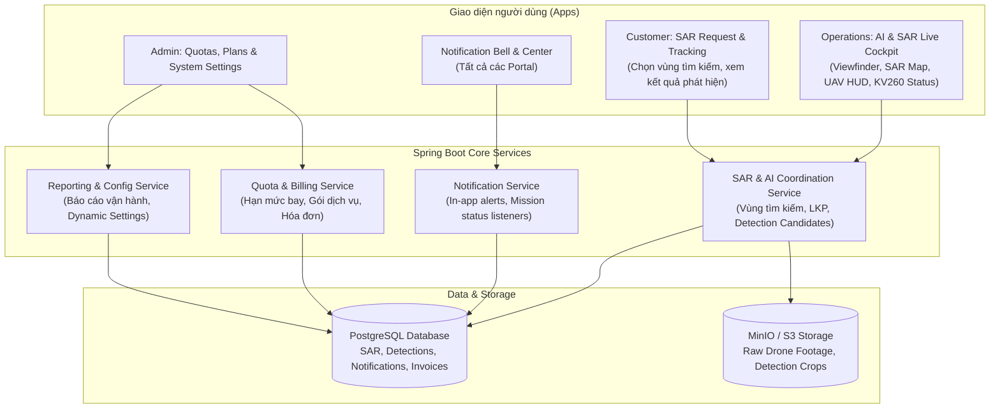

# Kế hoạch phát triển và mở rộng hệ thống UAV PAS (M7–M10)

> **Dành cho Agentic Workers:** REQUIRED SUB-SKILL: Dùng `superpowers:subagent-driven-development` hoặc `superpowers:executing-plans` để triển khai từng task theo thứ tự. Các bước dùng checkbox (`- [ ]`) để theo dõi tiến độ.

**Mục tiêu (Goal):** Thiết kế và triển khai 4 phân hệ còn thiếu trong nền tảng UAV PAS: (1) Màn hình điều hành trực quan AI (YOLOv8s Viewfinder) & Bản đồ Tìm kiếm cứu nạn SAR kèm Telemetry UAV và trạng thái bo mạch KV260 Edge; (2) Trung tâm thông báo thời gian thực; (3) Quản lý hạn mức (Quotas), Gói cước và Thanh toán; (4) Báo cáo chuyên sâu và Cấu hình hệ thống động.

**Kiến trúc (Architecture):**
- **Frontend-First cho AI & SAR:** Ưu tiên xây dựng màn hình Cockpit điều hành tác chiến tại `apps/operations` và `apps/customer`: Khung hình camera mô phỏng với bounding boxes YOLOv8s, bản đồ GIS phân vùng tìm kiếm đa giác (Search Grid / Polygon) & điểm LKP (Last Known Position), HUD thông số UAV (pin, độ cao, tốc độ, GPS) và card giám sát tài nguyên phần cứng KV260 (Nhiệt độ, DPU, FPS).
- **Notification Subsystem:** Cơ chế lưu trữ thông báo phía backend, kích hoạt qua Spring Application Events khi có thay đổi trạng thái nhiệm vụ, hiển thị Notification Bell & Drawer thời gian thực trên các portal.
- **Quota & Billing Subsystem:** Quản lý hạn mức sử dụng (giờ bay, số drone) gắn với người dùng/tổ chức, chặn vượt hạn mức khi tạo nhiệm vụ; mô hình hóa hóa đơn thanh toán (Invoice & Payment gateway ready).
- **Analytics & System Config:** Báo cáo tổng hợp số liệu vận hành và bảng quản trị tham số hệ thống động không cần restart server.

**Tech Stack:** Next.js 16 (App Router), React 19, Tailwind CSS v4, Lucide React, Spring Boot 3.4 (Java 21), PostgreSQL, Flyway, MinIO/S3 Storage.

---

## 1. Yêu cầu xem xét & Phản hồi (User Review Required)

> [!IMPORTANT]
> **Ưu tiên giai đoạn 1 (Phase 1): Thiết kế giao diện trực quan trước (UI Prototype First)**
> Theo yêu cầu của bạn, hệ thống sẽ tập trung dựng ngay giao diện hoàn chỉnh của **Khung video camera AI (YOLOv8s)**, **Bản đồ tác chiến SAR (Khu vực tìm kiếm, điểm LKP, đường bay UAV)**, **Bảng thông số Telemetry UAV** và **Card giám sát bo mạch nhúng KV260** trên portal Vận hành (`apps/operations`) để bạn có thể xem và trải nghiệm trực tiếp trước khi nối backend và model AI thực tế.

> [!WARNING]
> **Công nghệ Bản đồ (Map Component) trong Next.js 16 / React 19**
> Để tránh xung đột phiên bản của các thư viện bản đồ cũ với React 19 Server Components, giải pháp tối ưu là sử dụng **Interactive SVG/Canvas GIS Map Component** độc lập, hỗ trợ đầy đủ Zoom, Pan, vẽ đa giác tìm kiếm (Search Grid), ghim mốc LKP, đánh dấu UAV và các điểm phát hiện người (Detection Pinpoints). Bạn có muốn sử dụng component GIS bản đồ này hay muốn tích hợp trực tiếp MapLibre/Leaflet với OpenStreetMap tile layer?

---

## 2. Câu hỏi làm rõ (Open Questions)

> [!NOTE]
> 1. **Cổng thanh toán (Billing):** Khi tích hợp thanh toán ở Phase 3, bạn dự kiến kết nối với cổng thanh toán nào? (Ví dụ: Cổng thanh toán nội địa VNPay, MoMo, VietQR hay Stripe quốc tế, hay trước mắt dùng cơ chế Sandbox/Mô phỏng thanh toán?).
> 2. **Kênh nhận thông báo (Notification Center):** Bạn muốn thông báo hiển thị dưới dạng:
>    - Chuông thông báo trong ứng dụng (In-app Notification Dropdown).
>    - Kèm theo gửi Email tự động khi nhiệm vụ thay đổi trạng thái?

---

## 3. Kiến trúc tổng thể các phân hệ mới



---

## 4. Kế hoạch triển khai chi tiết theo từng giai đoạn (Phased Implementation Tasks)

### Giai đoạn 1: Màn hình điều hành AI & Tìm kiếm cứu nạn SAR (UI-First Prototype)
*Mục tiêu: Dựng toàn bộ giao diện trực quan cho phi công và bộ phận điều hành tác chiến.*

#### [NEW] `apps/operations/src/features/sar/components/AiViewfinder.tsx`
- Khung hiển thị camera trực tiếp (Live Video Feed) 16:9 với lớp giả lập hình ảnh thực địa.
- Lớp Bounding Box YOLOv8s overlay:
  - Khung màu xanh lá nhận diện Người (`Person: 96%`, `Person: 89%`).
  - Khung màu cam nhận diện Phao cứu sinh / Thuyền (`Lifebuoy: 92%`).
- Công tắc bật/tắt hiển thị Bounding Box, chuyển đổi chế độ xem: RGB thực tế / Thermal hồng ngoại / Edge Inference Overlay.
- Thanh danh sách các đối tượng phát hiện (Detection Candidates Feed) theo thời gian thực kèm ảnh crop nhỏ, tọa độ GPS và thời điểm phát hiện.

#### [NEW] `apps/operations/src/features/sar/components/SarTacticalMap.tsx`
- Bản đồ tác chiến trực quan có thể phóng to, thu nhỏ, kéo rê:
  - **Khu vực tìm kiếm (Search Polygon):** Vùng giới hạn tìm kiếm dạng đa giác với tọa độ đỉnh, hiển thị diện tích quét (km²).
  - **Lưới quét tìm kiếm (Search Grids):** Phân chia thành các ô lưới A1, A2, B1, B2 với trạng thái đã quét xong / đang quét.
  - **Điểm mất liên lạc cuối cùng (LKP - Last Known Position):** Marker biểu tượng cảnh báo đỏ nổi bật kèm bán kính ước lượng trôi dạt.
  - **Vị trí & Đường bay UAV (Flight Path):** Icon UAV xoay theo hướng bay, vệt đường bay (breadcrumbs) đã đi qua.
  - **Điểm ghim cứu hộ (Rescue Pinpoints):** Tương ứng với các vị trí mà AI phát hiện có người cần hỗ trợ.

#### [NEW] `apps/operations/src/features/sar/components/UavTelemetryHud.tsx`
- Bảng HUD hiển thị thông số bay thời gian thực của UAV:
  - Độ cao tương đối & tuyệt đối (Altitude AGL/MSL: vd: `120m`).
  - Vận tốc bay (Ground Speed: vd: `14.5 m/s`).
  - Mức pin & Điện áp cell (Battery: `84% - 22.8V`, cảnh báo màu đỏ khi dưới 20%).
  - Tín hiệu liên lạc (RC Signal & 4G/5G Link Quality: 5/5 vạch).
  - Số lượng vệ tinh định vị (GPS Satellites: 18 vệ tinh - RTK Fixed).

#### [NEW] `apps/operations/src/features/sar/components/Kv260EdgeStatusCard.tsx`
- Card hiển thị trạng thái bo mạch nhúng AI KV260:
  - Trạng thái kết nối: `ONLINE (Connected via High-speed Bus)`.
  - Tải bộ xử lý DPU / NPU: `68%`.
  - Tốc độ xử lý khung hình (Inference FPS): `28.4 FPS (YOLOv8s Int8)`.
  - Nhiệt độ chip xử lý: `52°C` (Cảnh báo khi vượt 75°C).
  - Chế độ điều phối: Chuyển đổi giữa `Edge Local Processing (KV260)` hoặc `Cloud Fallback Server`.

#### [NEW] `apps/operations/app/(portal)/sar-cockpit/page.tsx`
- Màn hình Cockpit tích hợp hợp nhất toàn bộ 4 thành phần trên vào một Dashboard tác chiến chuyên nghiệp, chia layout Bento/Grid:
  - Góc trên bên trái: Khung camera AI Viewfinder.
  - Góc trên bên phải: Bản đồ tác chiến SAR đa giác & LKP.
  - Góc dưới bên trái: HUD thông số bay UAV & Bo mạch KV260.
  - Góc dưới bên phải: Dòng thời gian phát hiện đối tượng (Detection Log) kèm nút "Xác nhận mục tiêu" & "Gửi tọa độ cứu hộ".

---

### Giai đoạn 2: Trung tâm thông báo (Notification System)
*Mục tiêu: Gửi và hiển thị thông báo tức thời cho Phi công, Điều phối viên và Khách hàng.*

#### Backend:
- **Migration Flyway V4:** Tạo bảng `notifications` (`id`, `user_id`, `title`, `content`, `type`, `reference_type`, `reference_id`, `is_read`, `created_at`).
- **Module Notification:**
  - Entity `Notification`, Repository, Service và Controller (`GET /api/v1/notifications`, `PATCH /api/v1/notifications/{id}/read`, `POST /api/v1/notifications/read-all`).
  - Tích hợp Spring Event Listener: Khi nhiệm vụ chuyển sang `CONFIRMED`, `ASSIGNED`, `READY`, hoặc phát hiện mục tiêu SAR -> Tự động sinh thông báo đến người nhận tương ứng.

#### Frontend:
- **Component NotificationBell:** Biểu tượng chuông trên thanh Navbar của `apps/customer`, `apps/operations`, `apps/admin` kèm huy hiệu (Badge) số lượng thông báo chưa đọc.
- **Drawer / Dropdown:** Bấm vào mở danh sách thông báo mới nhất, bấm để chuyển nhanh đến màn hình nhiệm vụ liên quan.
- **Trang `/notifications`:** Xem toàn bộ lịch sử thông báo, phân loại theo danh mục.

---

### Giai đoạn 3: Thanh toán, Gói cước và Hạn mức sử dụng (Billing & Quotas)
*Mục tiêu: Kiểm soát hạn mức bay và quy trình xuất hóa đơn/thanh toán dịch vụ.*

#### Backend:
- **Migration Flyway V5:**
  - Bảng `service_plans` (Gói cước: Basic, Pro, Enterprise, max_monthly_flight_hours, max_concurrent_uavs, allow_sar_ai).
  - Bảng `user_quotas` (Hạn mức của user: current_hours_used, quota_reset_date).
  - Bảng `invoices` & `payments` (Mã hóa đơn, số tiền, trạng thái `PENDING/PAID/FAILED`, phương thức thanh toán).
- **Module Quota Enforcement:**
  - Kiểm tra `UserQuota` khi khách hàng tạo nhiệm vụ: Nếu số giờ bay hoặc số lượng UAV vượt hạn mức của gói cước, từ chối tạo và yêu cầu nâng cấp gói.
- **Module Billing & Payment:**
  - API tạo hóa đơn theo nhiệm vụ/gói cước, API thanh toán giả lập (Mock Sandbox Gateway) và Webhook nhận kết quả thanh toán.

#### Frontend:
- **Admin:** Màn hình quản lý gói cước & theo dõi hạn mức khách hàng tại `apps/admin/app/(portal)/billing/page.tsx`.
- **Customer:** Màn hình xem hạn mức còn lại, danh sách hóa đơn và giao diện thanh toán tại `apps/customer/app/(portal)/billing/page.tsx`.

---

### Giai đoạn 4: Báo cáo chuyên sâu và Cấu hình hệ thống (Analytics & Settings)
*Mục tiêu: Cung cấp số liệu phân tích hoạt động và công cụ cấu hình linh hoạt cho Quản trị viên.*

#### Backend:
- **Module Reporting:**
  - API tổng hợp báo cáo chuyên sâu: Tỷ lệ hoàn thành nhiệm vụ theo tháng, thời lượng bay của từng UAV, thống kê số lượng người phát hiện trong các đợt cứu hộ SAR.
  - API xuất báo cáo định kỳ dưới dạng tệp CSV / Excel.
- **Module System Settings:**
  - Bảng `system_configurations` (Key-Value): Giới hạn thời gian nhiệm vụ tối đa, ngưỡng pin an toàn tối thiểu (`min_battery_threshold = 25%`), ngưỡng tin cậy AI (`ai_confidence_threshold = 0.85`).
  - API đọc và cập nhật tham số cấu hình hệ thống.

#### Frontend:
- **Admin Reports:** Biểu đồ xu hướng bay, phân bố nhiệm vụ theo trạm và nút xuất báo cáo tại `apps/admin/app/(portal)/reports/page.tsx`.
- **Admin Settings:** Giao diện điều chỉnh các tham số vận hành hệ thống tại `apps/admin/app/(portal)/settings/page.tsx`.

---

## 5. Kế hoạch xác minh & Kiểm thử (Verification Plan)

### Automated Tests
1. **Kiểm tra biên dịch và typecheck toàn bộ workspace:**
   ```bash
   npm run typecheck --workspaces
   npm run lint --workspaces
   npm test --workspaces
   ```
2. **Kiểm tra Backend Spring Boot và Flyway Migrations:**
   ```bash
   ./mvnw test -Dtest=NotificationServiceTest,QuotaServiceTest
   ```

### Manual Verification
1. **Trải nghiệm Màn hình Cockpit SAR & AI (`apps/operations/sar-cockpit`):**
   - Kiểm tra khung hình camera AI: bật/tắt bounding boxes, xem các hộp nhận diện `Person` và `Lifebuoy`.
   - Kiểm tra bản đồ SAR: tương tác kéo bản đồ, xem khu vực tìm kiếm đa giác, điểm LKP, vệt bay UAV và các điểm phát hiện.
   - Kiểm tra bảng HUD: xem các chỉ số pin, độ cao, vận tốc và thông số chip KV260 (nhiệt độ, FPS, tải DPU).
2. **Kiểm tra Trung tâm thông báo:**
   - Tạo sự kiện nhiệm vụ -> kiểm tra chuông thông báo nhảy số đếm đỏ -> mở xem nội dung -> đánh dấu đã đọc.
3. **Kiểm tra Hạn mức (Quota) & Gói cước:**
   - Thử đặt nhiệm vụ vượt quá hạn mức bay -> kiểm tra thông báo chặn hợp lệ.
