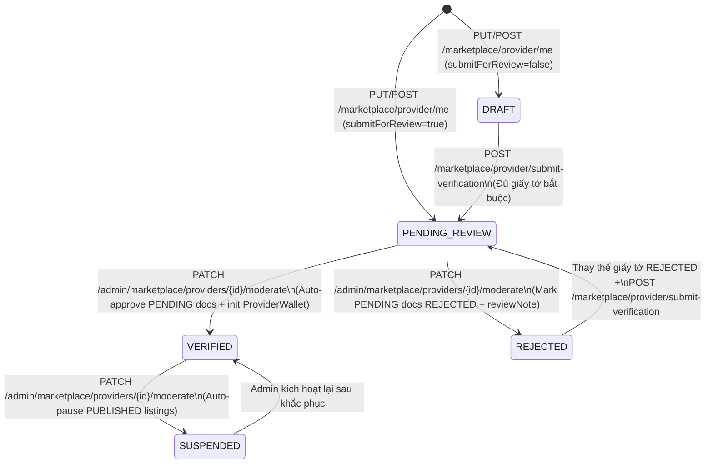
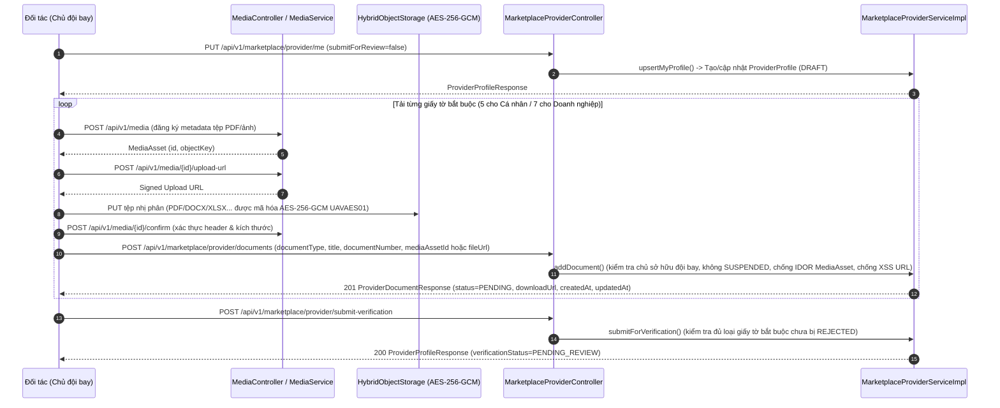

# Quy trình Xác minh Đối tác (KYC) & Thẩm định Hồ sơ Pháp lý UAV PAS

> **Phạm vi tài liệu**: Mô tả đầy đủ vòng đời định danh Đối tác bay (`ProviderProfile`), 8 loại giấy tờ pháp lý (`ProviderDocumentType`), quy tắc bắt buộc theo loại hình (`INDIVIDUAL` / `COMPANY`), quy trình thẩm định của Quản trị viên (duyệt từng giấy tờ & duyệt toàn bộ hồ sơ), cơ chế bảo vệ dữ liệu AES-256-GCM và đặc tả API Backend.
> **Nguồn triển khai Backend**: `backend/src/main/java/com/uav/platform/` (`MarketplaceProviderController`, `MarketplaceProviderServiceImpl`, `MarketplaceAdminController`, `MarketplaceAdminServiceImpl`, `ProviderDocumentDaoImpl`, `MarketplaceMapper`, `ApiRoutes.Marketplace`).

---

## 1. Tổng quan vòng đời xác minh Đối tác (Provider KYC Lifecycle)

Trạng thái xác minh hồ sơ đối tác được định nghĩa trong `ProviderVerificationStatus`:

| Bước | Trạng thái (`ProviderVerificationStatus`) | Ý nghĩa nghiệp vụ | Quyền vận hành trên Sàn |
|---:|---|---|---|
| 1 | `DRAFT` | Khởi tạo hồ sơ nháp: đối tác khai báo thông tin đơn vị, tỉnh/thành, bán kính phục vụ và tài khoản nhận đối soát. | Chưa được đăng bán công khai, chưa nhận đơn/rút tiền. |
| 2 | `PENDING_REVIEW` | Đã nộp bộ hồ sơ KYC lên hàng chờ thẩm định của Quản trị viên. | Có thể tạo gói dịch vụ ở trạng thái chờ duyệt (`PENDING_REVIEW`), chưa được phát hành (`PUBLISHED`). |
| 3 | `VERIFIED` | Đạt chuẩn KYC và được kích hoạt chính thức. Hệ thống tự động khởi tạo `ProviderWallet` (nếu chưa có) và duyệt các giấy tờ đang `PENDING`. | Được duyệt phát hành tin đăng (`PUBLISHED`), nhận điều phối đơn, đấu thầu RFQ (khi bật) và rút tiền từ ví. |
| 4 | `REJECTED` | Yêu cầu bổ sung / chỉnh sửa hồ sơ. Quản trị viên ghi rõ `reviewNote` (hồ sơ) và/hoặc `reviewerNote` (từng giấy tờ). | Phải xóa/thay thế giấy tờ bị từ chối và nộp lại để chuyển về `PENDING_REVIEW`. |
| 5 | `SUSPENDED` | Tạm đình chỉ giám sát (hết hạn giấy phép, vi phạm SLA, sự cố an toàn). Hệ thống tự động tạm dừng (`PAUSED`) toàn bộ tin đăng đang `PUBLISHED`. | Bị khóa toàn bộ thao tác cập nhật hồ sơ, tải/xóa giấy tờ, tạo tin đăng và nhận đơn (`403 PROVIDER_SUSPENDED`). |

### Sơ đồ chuyển trạng thái (State Machine)



### Vòng đời từng giấy tờ (`ProviderDocumentStatus`)

| Trạng thái | Ý nghĩa | Quy tắc thao tác |
|---|---|---|
| `PENDING` | Giấy tờ mới tải lên, chờ thẩm định. | Chủ đội bay được phép xóa (`DELETE /documents/{id}`). Admin có thể duyệt (`APPROVED`) hoặc từ chối (`REJECTED`). |
| `APPROVED` | Giấy tờ đã được đối chiếu và phê duyệt. | **Bị khóa bất biến** — đối tác không được phép xóa (`409 DOCUMENT_LOCKED`). |
| `REJECTED` | Giấy tờ không hợp lệ (mờ, hết hạn, sai số hiệu). | Bắt buộc có `reviewerNote` khi Admin từ chối (`400 REVIEWER_NOTE_REQUIRED`). Đối tác có thể xóa và tải bản thay thế. Không được tính là giấy tờ hợp lệ khi gọi `submit-verification`. |

---

## 2. Danh mục 8 loại Giấy tờ Pháp lý & Quy tắc Bắt buộc

Enum nguồn: `com.uav.platform.enums.marketplace.ProviderDocumentType`.
Ma trận bắt buộc được đồng bộ thống nhất giữa Backend (`MarketplaceProviderServiceImpl`) và Admin Portal (`admin/src/forms/marketplace/provider-verification-checklist.ts`):

| STT | Mã loại (`ProviderDocumentType`) | Tên hiển thị (VI) | Cá nhân (`INDIVIDUAL`) | Doanh nghiệp (`COMPANY`) | Mục đích thẩm định |
|---:|---|---|---|---|---|
| 1 | `IDENTITY_CARD` | CCCD / Hộ chiếu | **Bắt buộc (`REQUIRED`)** | **Bắt buộc (`REQUIRED`)** | Xác thực danh tính cá nhân hoặc người đại diện pháp luật. |
| 2 | `BUSINESS_LICENSE` | Giấy chứng nhận ĐKDN | Không áp dụng (`NOT_APPLICABLE`) | **Bắt buộc (`REQUIRED`)** | Chứng minh tư cách pháp nhân / hộ kinh doanh đang hoạt động. |
| 3 | `PILOT_CERTIFICATE` | Chứng chỉ điều khiển UAV | **Bắt buộc (`REQUIRED`)** | **Bắt buộc (`REQUIRED`)** | Chứng chỉ phi công / năng định tổ lái còn hiệu lực. |
| 4 | `UAV_REGISTRATION` | Hồ sơ đăng ký tàu bay | **Bắt buộc (`REQUIRED`)** | **Bắt buộc (`REQUIRED`)** | Hồ sơ đăng ký phương tiện bay & danh sách số serial thiết bị. |
| 5 | `INSURANCE_POLICY` | Bảo hiểm trách nhiệm dân sự | **Bắt buộc (`REQUIRED`)** | **Bắt buộc (`REQUIRED`)** | Bảo hiểm trách nhiệm dân sự cho hoạt động bay thương mại. |
| 6 | `FLIGHT_OPERATION_PERMIT` | Văn bản chấp thuận khai thác bay | Có điều kiện (`CONDITIONAL`) | Có điều kiện (`CONDITIONAL`) | Bắt buộc khi khai thác tại vùng trời kiểm soát hoặc nhiệm vụ chuyên ngành. |
| 7 | `PLATFORM_FEE_AGREEMENT` | Phụ lục Biểu phí & Quy chế đối soát | **Bắt buộc (`REQUIRED`)** | **Bắt buộc (`REQUIRED`)** | Xác nhận biểu phí dịch vụ nền tảng và quy chế đối soát thanh toán. |
| 8 | `TAX_SETTLEMENT_DOSSIER` | Hồ sơ Thuế & Tài khoản đối soát | Có điều kiện (`CONDITIONAL`) | **Bắt buộc (`REQUIRED`)** | Mã số thuế, thông tin xuất hóa đơn và tài khoản ngân hàng nhận đối soát. |

**Tổng số giấy tờ bắt buộc trước khi gửi thẩm định (`POST /api/v1/marketplace/provider/submit-verification`)**:
- **`INDIVIDUAL`**: tối thiểu **5 loại** (`IDENTITY_CARD`, `PILOT_CERTIFICATE`, `UAV_REGISTRATION`, `INSURANCE_POLICY`, `PLATFORM_FEE_AGREEMENT`).
- **`COMPANY`**: tối thiểu **7 loại** (`IDENTITY_CARD`, `BUSINESS_LICENSE`, `PILOT_CERTIFICATE`, `UAV_REGISTRATION`, `INSURANCE_POLICY`, `PLATFORM_FEE_AGREEMENT`, `TAX_SETTLEMENT_DOSSIER`).
- **Quy tắc nộp lại sau khi bị từ chối**: Đối với mỗi loại bắt buộc, phải tồn tại ít nhất một bản ghi có trạng thái khác `REJECTED` (`PENDING` hoặc `APPROVED`). Nếu giấy tờ bắt buộc bị `REJECTED`, đối tác **bắt buộc** phải tải lên bản thay thế (`PENDING`) trước khi `submit-verification` thành công; nếu thiếu, hệ thống trả về `400 Bad Request` với mã lỗi `REQUIRED_DOCUMENTS_MISSING` kèm danh sách các mã loại còn thiếu.

---

## 3. Luồng Nghiệp vụ Chi tiết

### 3.1. Luồng Đối tác tải tài liệu & nộp hồ sơ (Provider Side)



**Các quy tắc kiểm soát phía Đối tác**:
1. **Quyền chủ đội bay (`FLEET_OWNER_REQUIRED`)**: Chỉ tài khoản chủ sở hữu `ProviderProfile` mới được phép thêm/xóa giấy tờ KYC và gửi thẩm định; phi công phụ thuộc (`ProviderPilot`) bị chặn với `403`.
2. **Trạng thái đình chỉ (`PROVIDER_SUSPENDED`)**: Tài khoản `SUSPENDED` không thể cập nhật hồ sơ, tải thêm hoặc xóa giấy tờ.
3. **Nguồn tài liệu bắt buộc (`DOCUMENT_SOURCE_REQUIRED`)**: Mỗi giấy tờ phải có ít nhất `fileUrl` (`http://` hoặc `https://` hợp lệ — chặn `javascript:`, `data:` với lỗi `INVALID_EXTERNAL_URL`) hoặc `mediaAssetId`.
4. **Chống IDOR tệp đính kèm (`MEDIA_ACCESS_DENIED`)**: `mediaAssetId` phải tồn tại, chưa bị xóa (`!deleted`) và do chính tài khoản đối tác hiện tại tải lên (`uploadedBy == username`).
5. **Khóa xóa giấy tờ đã duyệt (`DOCUMENT_LOCKED`)**: `DELETE /api/v1/marketplace/provider/documents/{id}` chỉ cho phép xóa giấy tờ `PENDING` hoặc `REJECTED`, từ chối `409` đối với `APPROVED`.

### 3.2. Luồng Thẩm định của Quản trị viên (Admin Review Workflow)

Yêu cầu quyền RBAC: `@PreAuthorize("@permissionService.has(authentication, 'MARKETPLACE_MODERATE')")` (mặc định cấp cho `ROLE_ADMIN`, `ROLE_COMMANDER` qua `V52`).

1. **Xem danh sách hồ sơ đối tác kèm tài liệu**:
   - `GET /api/v1/admin/marketplace/providers?status=PENDING_REVIEW&keyword=...&page=0&size=20`
   - `MarketplaceAdminServiceImpl.listProviders` tải lô toàn bộ giấy tờ bằng một câu truy vấn HQL duy nhất (`IProviderDocumentDao.findByProviderIdInOrderByCreatedAtDesc` dùng `left join fetch e.mediaAsset`, không phát sinh N+1 query).
   - Mỗi `ProviderDocumentResponse` chứa đầy đủ: `id`, `documentType`, `title`, `documentNumber`, `fileUrl`, `mediaAssetId`, **`downloadUrl`** (tự động ký Signed Download URL từ `ObjectStorageService` nếu có `MediaAsset` đã xác nhận, fallback về `fileUrl`), `status`, `reviewerNote`, `createdAt`, **`updatedAt`**.
2. **Xem danh sách giấy tờ chi tiết của một Đối tác**:
   - `GET /api/v1/admin/marketplace/providers/{providerId}/documents`
   - Trả về `List<ProviderDocumentResponse>` theo thứ tự mới nhất trước (`createdAt DESC`). Trả `404 PROVIDER_NOT_FOUND` nếu đối tác không tồn tại.
3. **Thẩm định từng giấy tờ độc lập (Approve / Reject)**:
   - `PATCH /api/v1/admin/marketplace/providers/{providerId}/documents/{docId}`
   - Body: `ProviderDocumentModerationRequest { status: APPROVED | REJECTED | PENDING, reviewerNote?: string (<= 500 chars) }`
   - Truy vấn bằng `IProviderDocumentDao.findByIdAndProviderId(docId, providerId)` để cô lập tuyệt đối theo `providerId` (chống thao tác chéo đối tác).
   - Khi `status == REJECTED`: bắt buộc nhập `reviewerNote` (`400 REVIEWER_NOTE_REQUIRED`).
   - Ghi nhận Audit Log (`resource = "PROVIDER_DOCUMENT"`, chi tiết `providerId, type, status`) và gửi thông báo realtime (best-effort) tới tài khoản đối tác.
4. **Phê duyệt / Từ chối / Đình chỉ toàn bộ hồ sơ Đối tác**:
   - `PATCH /api/v1/admin/marketplace/providers/{id}/moderate` (hỗ trợ cả alias `POST`)
   - Body: `ProviderModerationRequest { status, reviewNote?, commissionRateOverride? }`
   - Tác động dây chuyền:
     - `VERIFIED`: Ghi `verifiedAt`, `verifiedBy`; tự động chuyển tất cả giấy tờ `PENDING` sang `APPROVED` (giữ nguyên giấy tờ `REJECTED`); khởi tạo `ProviderWallet` nếu chưa tồn tại.
     - `REJECTED`: Tự động chuyển tất cả giấy tờ `PENDING` sang `REJECTED` kèm `reviewNote` (cắt tối đa 500 ký tự), giữ nguyên các giấy tờ đã `APPROVED` để đối tác không phải nộp lại phần đã đạt.
     - `SUSPENDED`: Tự động chuyển toàn bộ `MarketplaceListing` đang `PUBLISHED` của đối tác sang `PAUSED`.

---

## 4. Bảo mật Dữ liệu Định danh (PII) & Tài liệu với AES-256-GCM

Hệ thống bảo vệ dữ liệu KYC ở cả hai tầng: **Database (PII Columns)** và **Object Storage (Binary Documents)** bằng chuẩn mã hóa xác thực **AES-256-GCM** (`AES/GCM/NoPadding`, IV ngẫu nhiên 12 byte / 96 bit, Authentication Tag 128 bit, khóa 256 bit dẫn xuất SHA-256 từ `app.crypto.aes-secret` với fallback `app.jwt.secret`).

### 4.1. Bảo vệ PII hồ sơ đối tác trong Cơ sở dữ liệu
Converter: `com.uav.platform.common.util.AesStringAttributeConverter` (định dạng lưu trữ `AES256GCM::v1::<Base64(IV || ciphertext || tag)>`, tương thích ngược đọc plaintext cũ).
Migration mở rộng cột: `V68__widen_aes_encrypted_user_columns.sql` (`VARCHAR(512)`).

| Bảng | Cột được mã hóa AES-256-GCM | Entity Field |
|---|---|---|
| `provider_profiles` | `tax_or_id_number` | `ProviderProfile.taxOrIdNumber` (CCCD / MST) |
| `provider_profiles` | `flight_license_number` | `ProviderProfile.flightLicenseNumber` (Số giấy phép bay) |
| `provider_profiles` | `contact_phone` | `ProviderProfile.contactPhone` (SĐT liên hệ) |
| `provider_profiles` | `bank_account_number` | `ProviderProfile.bankAccountNumber` (Số tài khoản đối soát) |
| `provider_profiles` | `bank_account_holder` | `ProviderProfile.bankAccountHolder` (Chủ tài khoản) |

### 4.2. Bảo vệ tệp tài liệu tải lên trong Object Storage
Dịch vụ: `DocumentEncryptionServiceImpl` tích hợp trực tiếp vào `HybridObjectStorageServiceImpl`:
- Mọi tệp tài liệu thuộc nhóm MIME (`application/pdf`, `application/msword`, `application/vnd.openxmlformats-officedocument.*`, `application/vnd.ms-excel`, `application/json`, `application/xml`, `application/zip`, `text/*`) khi tải qua `uploadObject(...)` được tự động mã hóa với header định danh 8 byte `UAVAES01` + 12 byte IV + ciphertext + GCM tag.
- Khi đọc luồng tải xuống (`maybeDecryptStream`), hệ thống kiểm tra magic header `UAVAES01` để giải mã trong suốt và xác thực tính toàn vẹn (ném `DOCUMENT_DECRYPT_FAILED` nếu phát hiện chỉnh sửa trái phép).

---

## 5. Danh mục API Endpoints

### 5.1. Nhóm Provider (`ApiRoutes.Marketplace.PROVIDER_BASE = /api/v1/marketplace/provider`)

| Method | Endpoint | Quyền | Request DTO | Response DTO | Mã lỗi chính |
|---|---|---|---|---|---|
| `GET` | `/api/v1/marketplace/provider/me` | Authenticated | — | `200 ProviderProfileResponse` / `204` | — |
| `PUT` / `POST` / `PATCH` | `/api/v1/marketplace/provider/me` | Authenticated | `ProviderOnboardingRequest` | `200 ProviderProfileResponse` | `403 PROVIDER_SUSPENDED` |
| `POST` | `/api/v1/marketplace/provider/submit-verification` | Fleet Owner | — | `200 ProviderProfileResponse` | `400 REQUIRED_DOCUMENTS_MISSING`, `403 FLEET_OWNER_REQUIRED` / `PROVIDER_SUSPENDED`, `409 PROVIDER_ALREADY_VERIFIED` |
| `GET` | `/api/v1/marketplace/provider/documents` | Fleet Member | — | `200 List<ProviderDocumentResponse>` | — |
| `POST` | `/api/v1/marketplace/provider/documents` | Fleet Owner | `ProviderDocumentCreateRequest` | `201 ProviderDocumentResponse` | `400 DOCUMENT_SOURCE_REQUIRED` / `INVALID_EXTERNAL_URL`, `403 FLEET_OWNER_REQUIRED` / `PROVIDER_SUSPENDED` / `MEDIA_ACCESS_DENIED`, `404 MEDIA_NOT_FOUND` |
| `DELETE` | `/api/v1/marketplace/provider/documents/{id}` | Fleet Owner | — | `204 No Content` | `403 FLEET_OWNER_REQUIRED` / `PROVIDER_SUSPENDED`, `404 DOCUMENT_NOT_FOUND`, `409 DOCUMENT_LOCKED` |

### 5.2. Nhóm Admin Moderation (`ApiRoutes.Marketplace.ADMIN_BASE = /api/v1/admin/marketplace`)

| Method | Endpoint | Quyền | Request DTO | Response DTO | Mã lỗi chính |
|---|---|---|---|---|---|
| `GET` | `/api/v1/admin/marketplace/providers` | `MARKETPLACE_MODERATE` | Query: `status`, `keyword`, `page`, `size` | `200 PageResponse<ProviderProfileResponse>` | `403 Forbidden` |
| `GET` | `/api/v1/admin/marketplace/providers/{providerId}/documents` | `MARKETPLACE_MODERATE` | Path: `providerId` | `200 List<ProviderDocumentResponse>` | `403 Forbidden`, `404 PROVIDER_NOT_FOUND` |
| `PATCH` | `/api/v1/admin/marketplace/providers/{providerId}/documents/{docId}` | `MARKETPLACE_MODERATE` | `ProviderDocumentModerationRequest` | `200 ProviderDocumentResponse` | `400 REVIEWER_NOTE_REQUIRED`, `403 Forbidden`, `404 PROVIDER_NOT_FOUND` / `DOCUMENT_NOT_FOUND` |
| `PATCH` / `POST` | `/api/v1/admin/marketplace/providers/{id}/moderate` | `MARKETPLACE_MODERATE` | `ProviderModerationRequest` | `200 ProviderProfileResponse` | `403 Forbidden`, `404 PROVIDER_NOT_FOUND` |

### 5.3. Cấu trúc Payload chuẩn

**`ProviderDocumentResponse`**:
```json
{
  "id": 101,
  "documentType": "IDENTITY_CARD",
  "title": "CCCD người đại diện pháp luật",
  "documentNumber": "001090123456",
  "fileUrl": null,
  "mediaAssetId": 77,
  "downloadUrl": "https://storage.example.com/signed/document/kyc-cert.pdf?sig=...",
  "status": "PENDING",
  "reviewerNote": null,
  "createdAt": "2026-11-23T08:00:00",
  "updatedAt": "2026-11-23T08:00:00"
}
```

**`ProviderDocumentModerationRequest`**:
```json
{
  "status": "REJECTED",
  "reviewerNote": "Ảnh CCCD bị mờ góc phải, vui lòng tải bản scan rõ nét."
}
```
